> **文档元信息**
>
> | 项目 | 内容 |
> |------|------|
> | 文档版本 | v1.0 |
> | 作者 | AiWork · 系分设计节点（skill: dtazziboot-system-analysis-design） |
> | 创建日期 | 2026-10-16 |
> | 需求来源 | 用户一句话需求「实现一个俄罗斯方块小游戏，直接在 html 页面打开就可以玩」；需求澄清产出 `.agents/20261016-实现一个俄罗斯方块小游戏_直接在html/design.md`（同路径历史版本，用户已确认 Q1–Q3）；实施计划 `.agents/plans/tetris.md`、`docs/superpowers/plans/2026-10-16-tetris-html.md` |
> | 评审状态 | 待评审 |
> | 变更说明 | 本文档为**系分设计**，承接同路径「需求澄清」版本（该版本内容已入库 git，并在 `docs/superpowers/plans/2026-10-16-tetris-html.md` 留档）；实施计划中的接口契约（模块名/签名/常量值）为本文档的**既定输入**，本文档不改变其语义 |

# 俄罗斯方块小游戏（单文件 HTML）系分设计

## 1. 需求与范围

### 背景与目标

用户需要一份「拿到就能玩」的俄罗斯方块：**双击 `.html` 文件、以 `file://` 协议打开即可开始一局完整对局**，不需要安装、不需要构建、不需要本地服务器、不需要联网、不需要账号。

- **一句话目标**：交付一个自包含的静态 HTML 页面，双击打开即可开始并完整完成一局标准俄罗斯方块（完整手感 + 三种挑战模式），并附一份不被页面引用的 `README.md` 说明文档。
- **成功判据**：断网环境下双击打开，全程无控制台报错，玩法完整度与状态健壮性按 §附录 A 的 20 条验收清单逐条通过。
- **技术定位**：**纯前端、零依赖、单文件自包含**。无服务端、无数据库、无中间件、无第三方运行时依赖。

### 核心功能

1. **核心玩法**：10×20 可视棋盘（顶部 2 行隐藏缓冲）；7 种方块（I/O/T/S/Z/J/L）按 7-bag 随机出场；左右移动（含 DAS/ARR 连发）、SRS 顺/逆时针旋转（含踢墙）、软降、硬降、自动下落、碰撞检测、方块固定、满行消除（1–4 行）与消行动画。
2. **手感与辅助**：幽灵块落点提示、Next 队列预览 3 个、Hold 暂存（落地前一次）、锁定延迟（500ms，最多 15 次移动/旋转重置）、等级加速。
3. **计分**：Guideline 计分（单/双/三/四行 = 100/300/500/800 × 当前等级；软降 1 分/格、硬降 2 分/格）；每消 10 行升 1 级。
4. **挑战模式**：马拉松（无尽）、40 行竞速（`SPRINT_LINES = 40`）、限时冲刺（`ULTRA_MS = 120000`）；起始等级 1–15 可选；结算面板显示按模式定制的结算文案，并可重开。
5. **会话与状态**：暂停/继续、失焦与切后台自动暂停、结算后返回选择面板、会话内最高分（仅内存，不持久化）。
6. **界面**：中文文案；深色霓虹主题；Canvas 绘制棋盘/幽灵块/侧栏（Hold、Next、分数、等级、消行、模式进度）；READY/PAUSED/GAME_OVER 三种覆盖层；键鼠双通道操作面板。
7. **可维护与可验证**：手感与规则参数集中在 `CONST` 一处可调；内核逻辑可被 Node 沙箱抽取断言（不引入测试框架）。

### 约束与非功能要求

| 类别 | 要求 |
|------|------|
| 交付形态 | 单文件 `index.html`（游戏本体全内联）+ 独立 `README.md`（不被页面引用，删除它游戏照常运行） |
| 运行方式 | 双击 `file://` 可玩 → 禁止 `type="module"`；禁止任何本地服务器、构建步骤、安装步骤 |
| 依赖 | 零第三方运行时依赖：无 CDN、无外部字体/图片/音频/脚本；源码不得出现外部 `src=`/`href=`/`http(s)://` |
| 开放接口 | 无服务端接口，无网络请求（含不发起任何 XHR/fetch） |
| 持久化 | 禁止读写 `localStorage`/`sessionStorage`/`document.cookie`；最高分仅当前会话内存 |
| 输入面 | 仅桌面键盘；不得出现 `touch*`/`pointerdown` 等触控监听，不渲染屏幕按键 |
| 兼容性 | Chrome / Edge / Firefox / Safari 近两个大版本，桌面优先；可用 `const/let`、箭头函数、模板字符串、`Object.assign`、`Array#includes`、`String#padStart` |
| 性能 | 主循环 `requestAnimationFrame` 稳定 60fps；单帧逻辑+渲染 CPU 预算 < 5ms；冷启动（加载到 READY 面板可交互）< 100ms；无内存持续增长（无每帧对象分配累积） |
| 体积 | `index.html` 约 700–1000 行 / 建议 < 60KB（含样式与注释），无需压缩 |
| 可维护性 | 内核/外壳两区块固定分节注释；规则数值全部来自 `CONST`，外壳不持有规则数值 |
| 可测试性 | 内核不依赖 DOM 与 `window`（仅末行导出 `window.Tetris`），可被 Node 沙箱整段执行；自测为一次性断言脚本，非交付物运行依赖 |
| 安全 | 无网络、无存储、无第三方脚本 → 无 XSS 注入面、无敏感数据、无权限申请；不请求任何浏览器敏感 API |
| 数据 | 无数据库、无缓存、无 MQ、无租户概念（单用户本地运行） |

### 排除范围

移动端触控与屏幕按键、音效、最高分持久化、多人在线对战、排行榜/账号体系、关卡编辑器、皮肤系统、成就系统、AI 自动游玩、PWA 离线安装、多语言、存档续玩、服务端与数据库、构建工具链（npm/Vite/TypeScript/打包器）、测试框架。

### 需求功能清单与优先级

| 编号 | 功能点 | 优先级 | 需求原始描述/来源 | 备注 |
|------|--------|--------|-------------------|------|
| F01 | `file://` 双击打开即玩 | P0 | 需求原文「直接在 html 页面打开就可以玩」 | §附录 A-1 验收 |
| F02 | 单文件自包含交付（零依赖/无构建/无服务器） | P0 | 需求原文「直接在 html 页面打开」 | 技术选型见 §2.4 |
| F03 | 独立 `README.md` 说明文档（不被页面引用） | P1 | 需求澄清 Q1 已确认 | 交付物 2 |
| F04 | 棋盘 10×20 + 2 行隐藏缓冲 | P0 | 需求澄清 Q2「完整手感」 | `COLS=10/ROWS=20/HIDDEN_ROWS=2` |
| F05 | 7 种方块与固定配色 | P0 | 需求澄清 Q2；设计 §6.1 | I/O/T/S/Z/J/L |
| F06 | 左右移动（DAS/ARR 连发） | P0 | 需求澄清 Q2；设计 §6.8 | `DAS=170ms`/`ARR=50ms` |
| F07 | SRS 顺时针/逆时针旋转 + 踢墙 | P0 | 需求澄清 Q2；设计 §6.3 | JLSTZ 与 I 两套踢墙表 |
| F08 | 软降（20× 重力，+1 分/格） | P0 | 需求澄清 Q2/Q4 | `SOFT_DROP_FACTOR=20` |
| F09 | 硬降（立即锁定，+2 分/格） | P0 | 需求澄清 Q2/Q4 | 与幽灵块一致 |
| F10 | 自动下落与等级加速重力曲线 | P0 | 需求澄清 Q2；设计 §6.5 | 每 10 行升 1 级 |
| F11 | 碰撞检测与方块固定（合入棋盘） | P0 | 需求澄清 Q2 | 纯函数 |
| F12 | 满行消除（1–4 行）与消行动画 | P0 | 需求澄清 Q2；设计 §6.2 | `CLEAR_ANIM_MS=120` |
| F13 | 幽灵块落点提示 | P0 | 需求澄清 Q2 | 与硬降落点一致 |
| F14 | Next 队列预览 3 个 | P1 | 设计 §6.6 | `NEXT_COUNT=3` |
| F15 | Hold 暂存（落地前一次） | P1 | 需求澄清 Q2；设计 §6.6 | `canHold` 由 spawn 重置 |
| F16 | 锁定延迟（500ms / 最多 15 次重置） | P1 | 设计 §6.5 | `LOCK_DELAY_MS=500`/`LOCK_RESET_LIMIT=15` |
| F17 | Guideline 计分与升级 | P0 | 需求澄清 Q4；设计 §6.7 | 100/300/500/800 × 等级 |
| F18 | 7-bag 随机（可注入种子） | P0 | 设计 §6.4 | 袋内 7 种各一次 |
| F19 | 模式：马拉松 | P0 | 需求澄清 Q2；设计 §6.7 | 堆顶结束 |
| F20 | 模式：40 行竞速 | P0 | 需求澄清 Q2；设计 §6.7 | 消满 40 行立即结算 |
| F21 | 模式：限时冲刺 | P0 | 需求澄清 Q2；设计 §6.7 | 120 秒倒计时 |
| F22 | 起始等级 1–15 可选 | P1 | 实施计划 Global Constraints | 影响初速与计分系数 |
| F23 | 暂停/继续、失焦与切后台自动暂停、结算后重开 | P0 | 设计 §6.5/§6.8/§6.10 | 计时不累加 |
| F24 | 会话内最高分（不持久化） | P2 | 需求澄清 Q3 已确认 | 刷新即清零 |
| F25 | 中文界面 + 深色霓虹视觉 | P1 | 需求澄清 Q5/Q6 | 纯样式与文案 |
| F26 | 桌面四大浏览器近两个大版本兼容 | P1 | 需求澄清 Q7 | 桌面优先 |
| F27 | 手感与规则参数集中于 `CONST` | P1 | 设计 §附录 C；README 参数表 | 一处可调 |
| F28 | 开发期自测脚本（Node 断言，非运行依赖） | P2 | 设计 §6.11 | `tools/selftest.mjs` |

### 假设与待确认项

| 编号 | 假设/待确认内容 | 当前假设 | 确认状态 |
|------|-----------------|----------|----------|
| A01 | 交付形态 | 单文件 `index.html` + 独立 `README.md`（页面不引用 README） | 已确认（需求澄清 Q1） |
| A02 | 玩法范围 | 完整手感（SRS 踢墙 / 7-bag / 幽灵块 / Hold / 锁定延迟 / 等级加速）+ 三种挑战模式 | 已确认（需求澄清 Q2） |
| A03 | 附加体验 | 无移动端触控、无音效、无最高分持久化 | 已确认（需求澄清 Q3） |
| A04 | 计分规则 | 现代 Guideline：100/300/500/800 × 等级；软降 1/格、硬降 2/格 | 派生默认（需求澄清 Q4） |
| A05 | 视觉风格 | 深色霓虹主题、Canvas 圆角方块 + 顶部高光、含侧栏 | 派生默认（需求澄清 Q5） |
| A06 | 界面语言 | 中文 | 派生默认（需求澄清 Q6） |
| A07 | 目标浏览器 | Chrome/Edge/Firefox/Safari 近两个大版本，桌面优先 | 派生默认（需求澄清 Q7） |
| A08 | 起始等级范围 | 1–15（`START_LEVEL_MIN=1`/`START_LEVEL_MAX=15`） | 既定（实施计划 Global Constraints） |
| A09 | 时间基准 | 单一 `elapsedMs` 由主循环累计，暂停/切后台期间不累加 | 假设：保证 Sprint/Ultra 计时不泄漏 |
| A10 | 数据模型形态 | 无数据库/缓存，全部为内存态结构；`references/db.md` 的表命名与 DDL 规范不适用 | 假设：单用户本地运行 |
| A11 | 构建链 | 不引入 npm/打包/TS；交付物即手写单文件 | 假设：仓库无既有前端工程约定 |
| A12 | 自测方式 | 一次性 Node 断言脚本（`node tools/selftest.mjs`），不建测试框架；无 Node 环境按等价降级路径在浏览器 Console 执行 | 假设：验收门槛为「断言 0 失败」 |
| A13 | 文件命名 | `index.html`、`README.md`、`tools/selftest.mjs` | 假设：与实施计划 File Structure 一致 |
| A14 | 会话内最高分 | 只在内存 `ui.bestScore` 保留，刷新即清零 | 假设：替代持久化的最小体验 |
| A15 | 静态托管（可选） | 未要求发布；如需分发，仅复制单文件即可，不依赖服务器 | 假设：分发方式为文件复制/下载 |

## 2. 架构与模块

### 2.1 功能架构

单文件内部按「**纯逻辑内核 + DOM 外壳**」两层划分，**单向依赖**：外壳依赖内核，内核不反向依赖外壳，也**不接触 DOM**（内核区块仅末行执行一次宿主导出）。

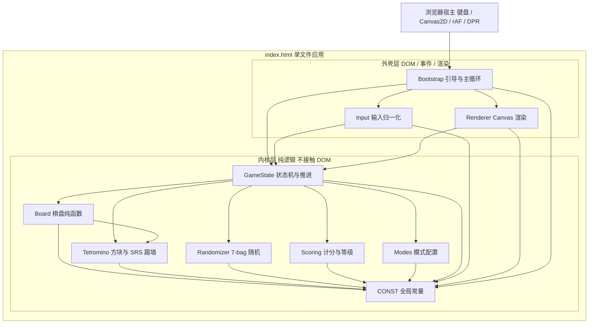

- **外壳层说明**：`Bootstrap` 持有 `requestAnimationFrame` 主循环、键鼠事件绑定、覆盖层面板交互与自动暂停；`Input` 把原始键盘事件归一化为「意图（intent）」并实现 DAS/ARR 连发；`Renderer` 是状态的**只读**消费者，负责棋盘/幽灵块/侧栏/统计数字与高清屏适配。
- **内核层说明**：`GameState` 是唯一的可变状态持有者与状态机，负责重力推进、锁定延迟、消行动画、模式判定与结算；`Board/Tetromino/Randomizer/Scoring/Modes` 均为纯逻辑（`Modes` 为数据化配置对象）；`CONST` 是全部规则数值与键位的唯一来源。
- **依赖方向**：`Bootstrap → (Input, Renderer, GameState)`，`GameState → (Board, Tetromino, Randomizer, Scoring, Modes, CONST)`，`Board → (Tetromino, CONST)`，叶子节点为 `CONST`。**无循环依赖**（内核区块不得引用外壳标识符，由自测静态断言守住）。

**模块清单**

| 模块 | 所在区块 | 职责 | 依赖 | 纯函数/副作用 |
|------|----------|------|------|----------------|
| `CONST` | 内核 | 全部规则数值、颜色、计分表、速度曲线参数、模式参数、键位映射 | 无 | 只读常量 |
| `Tetromino` | 内核 | 7 种方块基础矩阵、4 个预计算旋转态、SRS 踢墙候选表、出生点 | `CONST` | 纯函数（预计算一次） |
| `Randomizer` | 内核 | 7-bag 随机抽取，可注入种子；提供 `next()`/`peek(n)` | `CONST` | 有内部游标，无外部副作用 |
| `Board` | 内核 | 22×10 网格创建/复制、碰撞检测、合入、满行识别、消行 | `Tetromino`,`CONST` | 纯函数 |
| `Scoring` | 内核 | 消行计分、软/硬降计分、等级推进、重力间隔曲线 | `CONST` | 纯函数 |
| `Modes` | 内核 | 三种模式的目标判定、结算文案、进度文案；`formatMs` | `CONST` | 数据化配置 + 纯函数 |
| `GameState` | 内核 | 状态机（READY/PLAYING/PAUSED/GAME_OVER）、重力与锁定推进、消行动画、暂存、结算 | `Board`,`Tetromino`,`Randomizer`,`Scoring`,`Modes`,`CONST` | 唯一可变状态持有者 |
| `Input` | 外壳 | 键位映射、按下/抬起归一化为 intent、DAS/ARR 连发、状态复位 | `CONST` | 有内部计时状态 |
| `Renderer` | 外壳 | Canvas 尺寸与 DPR 适配、棋盘/幽灵块/方块绘制、Hold/Next 迷你绘制、统计数字与覆盖层文案 | `CONST`,`Board`,`Tetromino`,`GameState` | 只读渲染，写 DOM/Canvas |
| `Bootstrap` | 外壳 | 主循环、事件绑定、模式与等级选择面板、会话内最高分、失焦/切后台自动暂停、resize 重算 | 全部 | 有副作用（事件/循环） |

**模块耦合度量**：最大的 `GameState` 承担「状态机 + 推进」职责，其余模块均单一职责；无任何模块承担超过 50% 的功能点（功能点分布：核心玩法 8、辅助手感 4、计分 1、模式 3、状态 3、界面 2、工程性 4，分散在 10 个模块）。

### 2.2 应用集成架构

本系统**无服务端**，唯一外部集成面是「浏览器宿主能力」与「本地文件系统（只读加载）」。

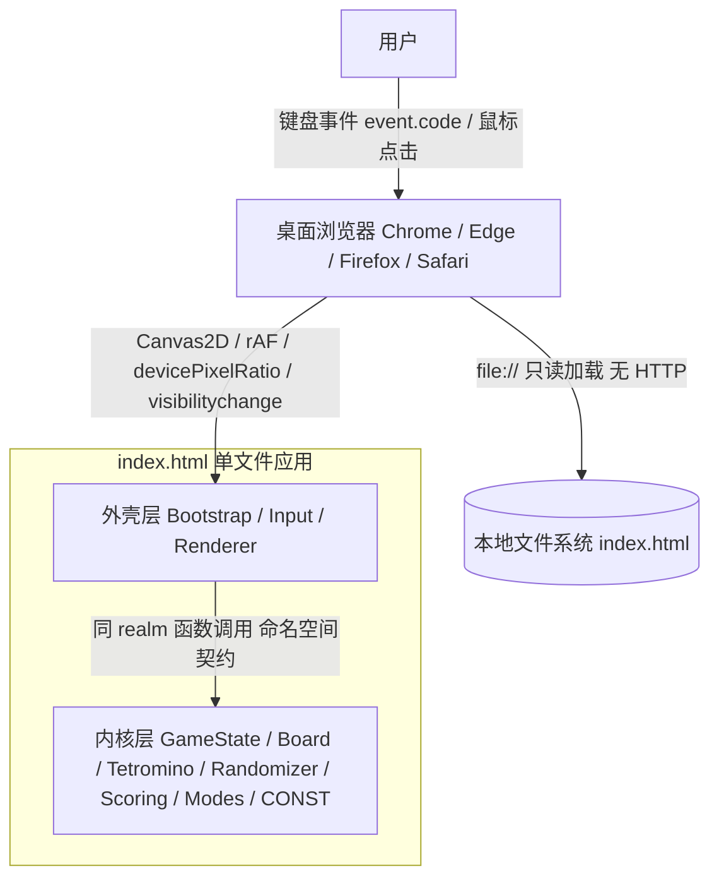

**集成关系说明：**

| 调用方 | 被调用方 | 协议 | 接口类型 | 说明 |
|--------|----------|------|----------|------|
| 用户 | 浏览器 | 物理键盘/鼠标 | 宿主输入事件 | 全部操作通过 `event.code` 映射，仅按下沿/抬起沿使用 |
| 浏览器 | 本地文件系统 | `file://` | 文件读取（只读） | 单次加载 `index.html`，无网络请求、无跨域 |
| 外壳层 | 浏览器宿主 | Canvas 2D API / `requestAnimationFrame` / `devicePixelRatio` / `resize` / `blur` / `visibilitychange` | 宿主 Web API | 见 §4.4 |
| 外壳层 | 内核层 | 同 realm 直接函数调用 | 内部接口（§4.3） | 单向：外壳调用内核；内核仅末行挂载 `window.Tetris` |
| 内核层 | 外壳层 | — | 无 | 内核不接触 DOM，不回调外壳 |
| 本应用 | 外部业务系统 / 三方服务 | — | **不适用**，原因：零第三方依赖，不发起任何网络请求 | 无鉴权、无签名、无限流对接面 |

**下游异常时的可用性**：唯一运行依赖是用户浏览器的本地渲染能力，不存在下游服务。若浏览器不支持 Canvas 2D 或 `requestAnimationFrame`（目标浏览器外），则属于支持范围外；设计上仍不降级为 DOM 渲染（YAGNI），但 `Renderer` 对缺失的 canvas 元素采取「跳过该层绘制、不中断逻辑推进」的容错（`RENDER_001`）。

### 2.3 部署架构

无服务端、无中间件、无数据层，因此不存在传统部署拓扑；交付形态即「**文件复制 + 本地浏览器执行**」。

**部署说明：**

- **分发层**：无部署流水线需求；`index.html` 单文件即为完整运行体，`README.md` 与 `tools/selftest.mjs` 为非运行交付物（删除不影响游戏）。
- **执行层**：应用运行在用户浏览器渲染进程内，单进程、单页面、无后端实例，**无实例数量与发布策略概念**。
- **数据层**：**不适用**，原因：无数据库、无对象存储、无缓存（详见 §3.4）。
- **单点分析**：无服务端即无服务端单点；唯一依赖为用户本地浏览器（本地可用性由用户环境保证）。若采用可选静态托管，静态文件服务器为**可选入口**而非必需路径，失效时用户仍可本地双击打开，不构成业务单点。

### 2.4 技术选型方案对比

| 维度 | 方案 A：单文件 HTML + Canvas 2D（**推荐，已采用**） | 方案 B：单文件 HTML + DOM/CSS 网格 | 方案 C：多文件 `index.html` + `js/*.js`（ES Modules） |
|------|----------------------------------------------------|------------------------------------|------------------------------------------------------|
| `file://` 双击可玩 | 满足 | 满足 | **不满足**：ES Module 导入被 CORS 规则拦截，须起本地服务器 |
| 渲染性能/手感 | 稳定 60fps；软降、消行动画流畅 | 每帧批量改 DOM，软降/动画下明显更差 | 同 A |
| 样式自由度 | 高（圆角、高光、幽灵描边、DPR 适配） | 中（受 CSS 类与盒模型约束） | 同 A |
| 代码量 | 中（约 700–1000 行，含样式与注释） | 不更少（需维护网格 DOM 结构） | 更多（需模块/加载约定） |
| 可测试性 | 内核可为纯逻辑，Node 沙箱可整段执行断言 | 逻辑易与 DOM 耦合 | 需模块加载器/打包器才能测 |
| 依赖与构建 | 零依赖、零构建 | 零依赖、零构建 | 引入模块加载/打包需求 |
| 结论 | **采用** | 否决：性能与手感劣化，收益不抵成本 | 否决：直接违反「双击即玩」，留作未来工程化迁移路径（§2.1 分层已预留） |

**推荐方案：方案 A**。理由：唯一同时满足「`file://` 双击即玩 + 零依赖 + 手感与动画质量」的形态；且内核/外壳分层使未来迁移到方案 C（多文件 + 测试框架 + 打包）时无需重写逻辑层。方案对比作为设计结论留档，不再等待人工选择。

**选型清单（其余设计决策）**：

| 决策点 | 采用 | 备选 | 理由 |
|--------|------|------|------|
| 脚本形态 | classic script（两个 `<script>` 区块，无 `type="module"`） | ES Module | 见方案 C 否决理由 |
| 时间驱动 | `requestAnimationFrame` + `dt` 钳制（`MAX_DT_MS=250`） | `setInterval` | 避免切后台后的瞬时多格掉落；无定时器单点 |
| 随机 | 7-bag + 可注入种子 RNG | 纯 `Math.random()` 逐块均匀 | 保证 7 块周期内不重复，公平；种子可复现用于自测 |
| 旋转 | SRS（JLSTZ + I 双踢墙表） | 朴素矩阵旋转 | 贴墙/堆叠中可正常旋转，符合现代手感 |
| 模式扩展 | 数据化模式配置（目标判定 + 结算/进度文案） | 条件分支散落 | 核心规则完全共用，无分支分叉 |
| 状态承载 | 单一 `GameState` 对象 + 不可变棋盘快照 | 多全局变量 | 渲染只读、推进集中，便于断言 |
| 最高分 | 会话内内存（`ui.bestScore`） | `localStorage` | 用户已确认不做持久化；`file://` 下存储不保证 |

<!-- 数据模型、接口、模块详细设计与检查见下文章节 -->

## 3. 数据模型与存储

### 3.1 存储形态说明

本系统**无数据库、无缓存、无消息队列**：所有数据均为浏览器内存中的运行时结构，随页面关闭而销毁。因此：

- `references/db.md`（库表命名、DDL、索引、字段类型规范）**本项不适用**，原因：不存在 MySQL/关系型存储，也不产出 DDL。
- 本章「数据模型」指**内存态数据结构与实体关系**，字段级定义在各模块设计（§5）中给出；命名沿用实施计划契约的 `camelCase`（JS 惯例），不套用数据库 `snake_case` 表名规范。
- **租户隔离**：本项不适用，原因：单用户、单机、无服务端、无多租户与权限体系。
- **数据迁移**：本项不适用，原因：无库表变更、无初始化数据、无历史数据；唯一「迁移」是页面刷新后回到 READY 面板（会话状态清零，见 F23/A14）。

### 3.2 实体清单

| 实体名称 | 实体说明 | 所属模块 | 与其他实体的关系 |
|----------|----------|----------|------------------|
| `GameState`（游戏会话状态） | 一局游戏的完整状态快照，唯一可变状态持有者 | `GameState` | 1:1 持有 `Board`、`ActivePiece`、`Bag`、`HoldSlot`、`ModeConfig`、`ScoringRule`；1:N 持有 `NextQueue` |
| `Board`（棋盘网格） | 22 行 × 10 列占用矩阵（含 2 行隐藏缓冲），元素为 `null` 或方块类型 | `Board` | N:1 归属 `GameState` |
| `ActivePiece`（当前方块） | 在场方块的 `type/rot/x/y` | `GameState` | N:1 归属 `GameState` |
| `TetrominoDef`（方块定义） | 7 种方块的基础矩阵（大小 2/3/4）与 4 个预计算旋转态 | `Tetromino` | 1:N `RotationState`；1:1 `SpawnOffset` |
| `RotationState`（旋转态） | 单个旋转态下的 4 个格坐标（`{x,y}` 集合） | `Tetromino` | N:1 归属 `TetrominoDef` |
| `KickTable`（踢墙表） | 按「起始态>目标态」索引的位移候选序列，JLSTZ 与 I 各一套 | `Tetromino` | N:1 归属 `TetrominoDef`（按类型分派） |
| `Bag`（7-bag 牌袋） | 一袋 7 种方块各一次并打乱后的待出队列 + 可注入种子 RNG | `Randomizer` | N:1 被 `GameState` 引用 |
| `NextQueue`（预览队列） | 3 个待出场方块类型 | `GameState` | N:1 归属 `GameState`；数据来源 `Bag` |
| `HoldSlot`（暂存槽） | 暂存的方块类型 + `canHold` 标记 | `GameState` | N:1 归属 `GameState` |
| `ModeConfig`（模式配置） | `id/label/goal/目标判定/结算文案/进度文案` | `Modes` | 1:N 被 `GameState` 引用（一局选其一） |
| `ScoringRule`（计分规则） | 消行分表、软/硬降分、升级阈值、重力曲线参数 | `Scoring` | N:1 被 `GameState` 引用 |
| `InputState`（输入状态） | 按下集合、DAS/ARR 计时、软降开关 | `Input` | N:1 归一化为 intent 流注入 `GameState` |
| `SessionUI`（会话界面状态） | `modeIndex/startLevel/bestScore/lastStatus` | `Bootstrap` | 1:1 与 `GameState` 并行存在（界面偏好，非规则状态） |

### 3.3 实体关系图

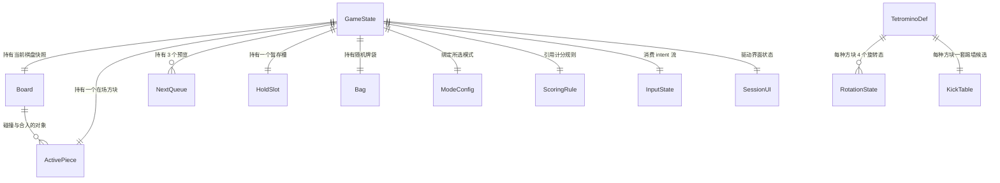

**模型说明：**

- `Board`、`ActivePiece`、`Bag`、`NextQueue`、`HoldSlot` 构成一局的**可变状态子图**，全部由 `GameState` 单一入口写入，`Renderer` 只读；这保证「渲染不反向修改状态」。
- `Board` 与 `ActivePiece` 的关系是**碰撞与合入的对象关系**：每个推进步骤先做碰撞校验（不合入），落地/硬降时才把当前方块合入棋盘并生成新的 `Board` 快照。
- `TetrominoDef → RotationState / KickTable` 为**静态只读数据**（启动时预计算一次），在整局生命周期内不变，可被多局复用。
- `Randomizer/Bag` 允许注入种子，使 `NextQueue` 序列可复现 —— 这是自测可断言的前提（§附录 B 验证方式）。
- 生命周期：`READY` 阶段仅有 `SessionUI` 有效；`Enter` 后 `GameState.start` 创建/重置全部状态子图；`GAME_OVER → toReady` 时保留 `SessionUI.bestScore`，其余状态子图清空待下次开局。

## 4. 接口设计

### 4.0 接口分类结论

| 类别 | 是否适用 | 说明 |
|------|----------|------|
| oneapi（`/api` 前缀 Web 控制台接口） | **不适用** | 无服务端、无控制台后端，页面全部逻辑在浏览器内完成 |
| OpenAPI（`/openapi` 前缀对外接口） | **不适用** | 无对外服务能力，不暴露任何 HTTP 端点，不产生网络请求 |
| 内部接口（模块间契约） | **适用** | 采用同 realm 命名空间函数调用（§4.3），是本文档接口设计的核心 |
| 集成接口（外部系统） | **不适用**（无三方系统）；以**宿主浏览器 API 契约**替代（§4.4） | 唯一集成面是浏览器宿主能力 |

**通用出参结构**：`{code, msg, data}` 本项不适用，原因：无服务端接口与网络协议。等价约定：内核接口返回**纯值/新对象**（不变式由断言守护），外壳接口返回 `intent` 或 `void`（见 §5.0）。

### 4.1 oneapi（Web 控制台接口）

本项不适用，原因：本系统为单机静态页面，无 Web 后端与登录态，不提供任何 `/api` 端点。

### 4.2 OpenAPI（对外接口）

本项不适用，原因：本系统不对外提供服务，也不被外部系统调用，无鉴权/签名/限流对接面。

### 4.3 内部接口（内核与外壳模块契约）

下列名称与签名是模块间的**强契约**（与实施计划的跨任务接口契约一致），任何实现不得改名或改变语义。

| 编号 | 接口名称 | 所属模块 | 类/命名空间 | 方法签名 |
|------|----------|----------|-------------|----------|
| S01 | 全局常量读取 | `CONST` | `CONST` | `CONST.*`（尺寸/颜色/计分表/手感/模式/键位，见 §5.1） |
| S02 | 方块类型清单 | `Tetromino` | `Tetromino` | `TYPES -> string[]`（7 种） |
| S03 | 姿态格坐标查询 | `Tetromino` | `Tetromino` | `cells(type, rot) -> {x,y}[]` |
| S04 | 踢墙候选查询 | `Tetromino` | `Tetromino` | `kicksFor(type, from, to) -> [dx,dy][]` |
| S05 | 出生点查询 | `Tetromino` | `Tetromino` | `spawnX(type) -> number`；`spawnY() -> number` |
| S06 | 棋盘创建/复制 | `Board` | `Board` | `create() -> board`；`clone(board) -> board` |
| S07 | 碰撞检测 | `Board` | `Board` | `collides(board, type, x, y, rot) -> boolean` |
| S08 | 方块合入 | `Board` | `Board` | `merge(board, type, x, y, rot) -> board` |
| S09 | 满行识别 | `Board` | `Board` | `fullRows(board) -> number[]` |
| S10 | 消行结算 | `Board` | `Board` | `clearLines(board) -> {board, cleared, rows}`；`clearRows(board, rows) -> board` |
| S11 | 空行判定 | `Board` | `Board` | `isEmptyRow(board, r) -> boolean` |
| S12 | 方块抽取 | `Randomizer` | `Randomizer` | `create(seed?) -> {next(): type, peek(n): type[]}` |
| S13 | 消行计分 | `Scoring` | `Scoring` | `linePoints(cleared, level) -> number` |
| S14 | 软/硬降计分 | `Scoring` | `Scoring` | `softDropPoints(cells) -> number`；`hardDropPoints(cells) -> number` |
| S15 | 等级与重力 | `Scoring` | `Scoring` | `levelFor(totalLines, startLevel) -> number`；`gravityMs(level) -> number` |
| S16 | 计分结算 | `Scoring` | `Scoring` | `applyClear({score,lines,level,startLevel}, cleared) -> {score,lines,level}` |
| S17 | 模式查询与判定 | `Modes` | `Modes` | `list -> Mode[]`；`byId(id) -> Mode`；`isOver(mode, state) -> boolean` |
| S18 | 时间格式化 | `Modes` | `Modes` | `formatMs(ms) -> 'mm:ss.cc'` |
| S19 | 状态机生命周期 | `GameState` | `GameState` | `create() -> state`；`start(state, modeId, startLevel, seed?) -> state`；`toReady(state) -> state` |
| S20 | 状态推进 | `GameState` | `GameState` | `update(state, dtMs) -> state`；`applyIntent(state, intent) -> state` |
| S21 | 落点与地面判定 | `GameState` | `GameState` | `ghostY(state) -> number`；`isGrounded(state) -> boolean` |
| S22 | 方块出场与暂存 | `GameState` | `GameState` | `spawn(state, forcedType?) -> state`；`hold(state) -> boolean` |
| S23 | 落地与暂停 | `GameState` | `GameState` | `hardDrop(state) -> number`；`lockPiece(state) -> void`；`togglePause(state) -> void` |
| S24 | 输入归一化 | `Input` | `Input` | `handleDown(code, isRepeat) -> intent\|null`；`handleUp(code) -> intent\|null`；`poll(dtMs) -> intent[]`；`reset() -> void`；`actionFor(code) -> string\|null` |
| S25 | 渲染 | `Renderer` | `Renderer` | `attach({board,next,hold}) -> void`；`bindStats(els) -> void`；`setup(canvas, cssW, cssH) -> ctx`；`draw(state, ui?) -> void`；`drawMini(...)` |
| S26 | 宿主导出 | 页面 | `window.Tetris` | `window.Tetris = { Board, Tetromino, Randomizer, Scoring, Modes }` |

**`intent` 形状（输入层到状态机的唯一通道）**：

| intent 类型 | 字段 | 触发来源 | 语义 |
|-------------|------|----------|------|
| `move` | `dx`（-1/1） | `←`/`→` 按下沿与 ARR 连发 | 水平移动一格 |
| `rotate` | `dir`（1 顺时针 / -1 逆时针） | `↑`/`X`、`Z`/`Ctrl` 按下沿 | 带踢墙尝试的旋转 |
| `softDrop` | `on`（true/false） | `↓` 按下/抬起 | 切换软降加速状态 |
| `hardDrop` | — | `Space` 按下沿 | 立即落底并锁定 |
| `hold` | — | `C`/`Shift` 按下沿 | 暂存/取回当前方块 |
| `pause` | — | `P`/`Esc` 按下沿 | 播放中 ⇄ 暂停 |

### 4.4 集成接口（宿主浏览器 API）

| 编号 | 接口名称 | 宿主 API | 调用方式 | 说明 |
|------|----------|----------|----------|------|
| I01 | 键盘事件 | `keydown` / `keyup` | `window.addEventListener` | 基于 `event.code` 映射键位；游戏键统一 `preventDefault()` 防页面滚动 |
| I02 | 帧驱动 | `requestAnimationFrame` | 回调循环 | 唯一时间源；`dt` 由时间戳差计算并钳制（`MAX_DT_MS`） |
| I03 | 画布绘制 | Canvas 2D（`getContext('2d')`） | 逐帧调用 | 棋盘/幽灵块/方块/迷你面板/覆盖层背景 |
| I04 | 高清屏适配 | `devicePixelRatio` | 读取 + backing store 缩放 | 画布尺寸按 DPR 放大后以 CSS 尺寸呈现，避免模糊 |
| I05 | 生命周期事件 | `blur` / `visibilitychange` / `resize` | `window`/`document` 监听 | 失焦与切后台自动暂停并清空按键；`resize` 重算画布 |
| I06 | 面板交互 | DOM `click`、`classList`、`textContent` | 元素创建与事件绑定 | 模式/起始等级按钮点选与高亮，覆盖层显隐与文案 |

**外部系统集成**：不适用，原因：零第三方依赖，不集成支付/认证/消息/存储等任何外部服务（对应 §1 排除范围与 §2.2 集成关系表末行）。

## 5. 功能模块设计

按依赖拓扑排序：`CONST → Tetromino → Randomizer → Board → Scoring → Modes → GameState → Input → Renderer → Bootstrap`（内核区块前 7 个，外壳区块后 3 个）。

### 5.0 全局约定

**5.0.1 命名空间与命名**

| 约定项 | 规则 |
|--------|------|
| 内核命名空间 | `CONST`、`Tetromino`、`Board`、`Randomizer`、`Scoring`、`Modes`、`GameState`（模块内的辅助函数/表为 IIFE 私有，不外泄） |
| 外壳命名空间 | `Input`、`Renderer`（IIFE 私有），`Bootstrap` 为自执行函数，不导出 |
| 宿主导出 | 仅内核末行导出 `window.Tetris = { Board, Tetromino, Randomizer, Scoring, Modes }`（供自测取用），外壳不导出任何全局 |
| 命名风格 | JS 惯例 `camelCase`（方法/字段）+ `UPPER_SNAKE_CASE`（常量键）；不使用数据库 `snake_case`，原因见 §3.1 |
| 脚本分区块 | `<script id="tetris-core">`（纯逻辑，不得出现除末行 `window.Tetris` 外的宿主依赖）、`<script id="tetris-shell">`（DOM/事件/主循环，不得持有规则数值） |

**5.0.2 坐标、朝向与单位约定**

| 约定项 | 规则 |
|--------|------|
| 坐标系 | 屏幕坐标：`x` 向右递增，`y` **向下**递增；棋盘行 `0` 为最顶（位于 2 行隐藏缓冲内），行 `TOTAL_ROWS-1` 为最底 |
| 棋盘规模 | `TOTAL_ROWS = ROWS + HIDDEN_ROWS = 22`，`COLS = 10`；元素为 `null`（空）或方块类型字符串 |
| `y` 边界语义 | `y < 0` 视为合法（隐藏缓冲上方，用于出生期）；`y >= TOTAL_ROWS` 为越界（碰撞） |
| 旋转态编号 | `0 = 出生态`、`1 = R（顺时针一次）`、`2 = 2`、`3 = L（逆时针一次）`；`cells(type, rot)` 对 `rot` 取正模后回绕（`rot=5` 等价 `rot=1`） |
| 踢墙表键 | 字符串 `'起始态>目标态'`，如 `'0>1'`；值为**依次试探**的 `[dx, dy]` 候选序列 |
| 踢墙表坐标系 | SRS 官方偏移表为「y 轴向上」，本实现 `y` 轴向下，故表中 `dy` 已全部取反 |
| 时间单位 | 毫秒（ms），整数或浮点均可；渲染像素单位为 CSS 像素 |
| 方块类型标识 | 单字符 `I O T S Z J L`，同时作为棋盘格取值与颜色表键 |

**5.0.3 错误码与异常约定**

格式：`{MODULE}_{SEQ}`（skill 默认约定）。本系统无网络协议，错误码**不用于响应透传**，仅用于开发期断言失败定位与浏览器控制台提示；内核纯函数以「返回安全值 + 断言失败」为主，不抛异常（唯一例外：`Tetromino` 遇未知类型时抛出由自测捕获的错误，便于尽早暴露契约破坏）。

| 错误码 | 所属模块 | 触发条件 | 处理方式 |
|--------|----------|----------|----------|
| `CONST_001` | `CONST` | 必填常量缺失或非有限数（如 `COLS/ROWS/CELL` 非法） | 启动自检不通过 → 控制台 error 并终止引导（不进入主循环），避免以错误参数运行 |
| `TETROMINO_001` | `Tetromino` | `type` 不在 7 种之内 | 开发期抛出错误（自测断言捕获）；运行期由 `Randomizer` 保证不产生非法类型 |
| `TETROMINO_002` | `Tetromino` | 踢墙键不存在于表中 | 回退为唯一候选 `(0,0)`（等效「只试原位旋转」），不中断流程 |
| `BOARD_001` | `Board` | 传入棋盘尺寸非 22×10 | 开发期断言失败；运行期按实际行列容错遍历，不抛异常 |
| `RANDOMIZER_001` | `Randomizer` | `peek(n)` 的 `n` 超过袋容量 | 自动跨袋补足（一袋 7 种），保证预览数量恒定 |
| `SCORING_001` | `Scoring` | `cleared` 不在 `0..4` | 计 0 分且不推进等级，并记录开发期告警 |
| `MODE_001` | `Modes` | `byId` 传入未知模式 id | 回退为「马拉松」模式，保证界面与状态机始终有模式可用 |
| `STATE_001` | `GameState` | 非法状态迁移（如 `READY` 下收到 `hardDrop`、`GAME_OVER` 下收到 `move`） | 幂等忽略，不修改状态、不抛异常 |
| `RENDER_001` | `Renderer` | 目标 canvas 元素缺失或 2D 上下文获取失败 | 跳过该层绘制，逻辑推进不受影响（渲染与逻辑解耦） |
| `INPUT_001` | `Input` | 按键未映射到任何动作 | 返回 `null`，不产生 intent，不阻止默认行为（除游戏键之外） |

**5.0.4 通用出参与返回值约定**

`{code, msg, data}` 本项不适用，原因：无服务端接口。等价约定：内核接口一律返回**纯值或新对象**（调用方不可变性约定见各接口「不变式」列），外壳接口返回 `intent`（输入归一化）或 `void`（渲染/绑定）。自测断言是「返回值正确性」的唯一验收手段（§附录 B）。

**5.0.5 数据结构设计规范说明**

`references/db.md` 的库表/字段/索引规范（主键 `pk_`、唯一键 `uk_`、字段长度、字符集、InnoDB、`gmt_create/gmt_modified` 等）**本项不适用**，原因：本系统无关系型数据库、无 DDL、无索引。内存态结构的等价约束为：字段名小写驼峰、只读常量用大写、结构元素类型固定且判空明确、集合长度常量固定（`COLS/ROWS/HIDDEN_ROWS`）。

---

### 5.1 内核 · `CONST` 常量与配置模块

#### 5.1.1 数据结构设计（内存态常量表）

| 字段名 | 类型 | 取值/约束 | 说明 |
|--------|------|-----------|------|
| `COLS` | number | 10 | 棋盘列数 |
| `ROWS` | number | 20 | 可视行数 |
| `HIDDEN_ROWS` | number | 2 | 顶部隐藏缓冲行数（方块在可视区外出生） |
| `CELL` | number | 30 | 单元格 CSS 像素尺寸 |
| `NEXT_COUNT` | number | 3 | Next 预览个数 |
| `COLORS` | 对象 | `{I,O,T,S,Z,J,L} -> 颜色字符串` | 7 种方块固定配色 |
| `GHOST_STROKE` | string | `rgba(226,232,240,0.45)` | 幽灵块描边色 |
| `SCORE_TABLE` | 对象 | `{1:100, 2:300, 3:500, 4:800}` | 消行基础分（再乘当前等级） |
| `SOFT_DROP_POINTS_PER_CELL` | number | 1 | 软降每格加分 |
| `HARD_DROP_POINTS_PER_CELL` | number | 2 | 硬降每格加分 |
| `LEVEL_UP_LINES` | number | 10 | 每消多少行升 1 级 |
| `START_LEVEL_MIN` / `START_LEVEL_MAX` | number | 1 / 15 | 起始等级可选区间 |
| `LOCK_DELAY_MS` | number | 500 | 锁定延迟 |
| `LOCK_RESET_LIMIT` | number | 15 | 锁定延迟最大重置次数 |
| `CLEAR_ANIM_MS` | number | 120 | 消行闪白动画时长 |
| `DAS_MS` | number | 170 | 长按起步延迟 |
| `ARR_MS` | number | 50 | 连发间隔 |
| `SOFT_DROP_FACTOR` | number | 20 | 软降重力倍率 |
| `MAX_DT_MS` | number | 250 | 单帧 `dt` 上限（防切后台瞬时掉落） |
| `MIN_GRAVITY_MS` | number | 16 | 重力间隔下限（防高速下无法操作） |
| `SPRINT_LINES` | number | 40 | 40 行竞速目标行数 |
| `ULTRA_MS` | number | 120000 | 限时冲刺时长（120 秒） |
| `KEYS` | 对象 | 动作 → `event.code` 数组（见 5.1.2） | 键位映射唯一来源 |

**索引**：本项不适用，原因：内存态只读常量对象，无查询需求。

#### 5.1.2 枚举与常量定义

**方块类型与颜色枚举（`COLORS`）**

| 枚举名称 | 取值 | 含义 | 关联字段 |
|----------|------|------|----------|
| `COLORS.I` | `#22d3ee` | 青色长条 | 棋盘格取值 / 当前方块 / Next、Hold 迷你绘制 |
| `COLORS.O` | `#facc15` | 黄色方块 | 同上 |
| `COLORS.T` | `#c084fc` | 紫色 T | 同上 |
| `COLORS.S` | `#4ade80` | 绿色 S | 同上 |
| `COLORS.Z` | `#f87171` | 红色 Z | 同上 |
| `COLORS.J` | `#60a5fa` | 蓝色 J | 同上 |
| `COLORS.L` | `#fb923c` | 橙色 L | 同上 |

**键位映射枚举（`KEYS`，基于 `event.code`）**

| 动作键 | 取值（`event.code`） | 语义 | 关联 intent |
|--------|----------------------|------|-------------|
| `MOVE_LEFT` | `ArrowLeft` | 左移 | `{type:'move', dx:-1}` |
| `MOVE_RIGHT` | `ArrowRight` | 右移 | `{type:'move', dx:1}` |
| `ROTATE_CW` | `ArrowUp`, `KeyX` | 顺时针旋转 | `{type:'rotate', dir:1}` |
| `ROTATE_CCW` | `KeyZ`, `ControlLeft`, `ControlRight` | 逆时针旋转 | `{type:'rotate', dir:-1}` |
| `SOFT_DROP` | `ArrowDown` | 软降（按下/抬起成对） | `{type:'softDrop', on:true/false}` |
| `HARD_DROP` | `Space` | 硬降 | `{type:'hardDrop'}` |
| `HOLD` | `KeyC`, `ShiftLeft`, `ShiftRight` | 暂存 | `{type:'hold'}` |
| `PAUSE` | `KeyP`, `Escape` | 暂停/继续 | `{type:'pause'}` |
| `START` | `Enter` | 开始/重开 | 由 `Bootstrap` 直接处理（非 intent） |

**派生常量（由上述常量计算，不单独配置）**

| 名称 | 计算方式 | 说明 |
|------|----------|------|
| 棋盘总行数 | `ROWS + HIDDEN_ROWS` = 22 | `Board.TOTAL_ROWS` |
| 软降重力间隔 | `gravityMs(level) / SOFT_DROP_FACTOR` | 软降时重力为该等级重力的 20 倍 |
| 游戏键全集 | `KEYS` 各动作取值并集去重 | 用于统一 `preventDefault()` |

#### 5.1.3 接口详细设计

##### S01 全局常量读取（`CONST.*`）

- **URI**：不适用（内存态命名空间只读属性）
- **描述**：为内核与外壳提供全部规则数值、颜色、计分表、模式参数与键位映射的**唯一来源**。
- **入参**：

| 参数名称 | 类型 | 是否必填 | 描述 |
|----------|------|----------|------|
| 属性名 | string | 是 | 上述常量表字段名 |
| `KEYS.动作键` | string | 否 | 键位动作名（如 `MOVE_LEFT`） |

- **出参**：

| 参数名称 | 类型 | 描述 |
|----------|------|------|
| 常量值 | number/string/object | 对应常量项；对象类型为只读使用（不得原地修改） |

- **错误码**：

| 错误码 | 说明 |
|--------|------|
| `CONST_001` | 必填常量缺失或非有限数（引导期自检） |

- **业务规则**：

| 规则编号 | 规则描述 | 校验时机 | 不满足时的处理 |
|----------|----------|----------|----------------|
| R-CONST-01 | 全部规则数值只能来自 `CONST`，外壳不得内联硬编码数值 | 实现评审 + 自测静态断言 | 视为实现缺陷，须回改 |
| R-CONST-02 | `CONST` 为只读：运行期不得修改任何常量项 | 始终 | 违反即为缺陷（自测可校验关键项未被改写） |
| R-CONST-03 | 引导期自检：`COLS>0`、`ROWS>0`、`HIDDEN_ROWS>=0`、`CELL>0`、`NEXT_COUNT>0`、`START_LEVEL_MIN<=START_LEVEL_MAX` | 页面加载时一次 | 输出 `CONST_001`，终止引导 |
| R-CONST-04 | 键位取值必须覆盖 §附录 A-20 要求的全部动作（移动/旋转/软降/硬降/暂存/暂停/开始） | 引导期自检 | 输出 `CONST_001` 并列出缺失动作 |

- **请求示例 / 响应示例**：本项不适用，原因：无网络协议与报文结构（内存态属性读取）。

#### 5.1.4 子功能详细设计

##### 5.1.4.1 常量集中配置（F27）

- 处理时序图：

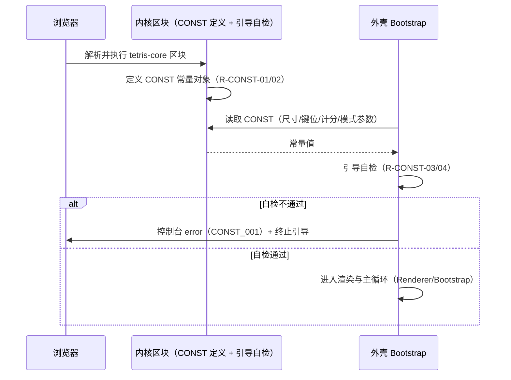

**业务规则：**

| 规则编号 | 规则描述 | 校验时机 | 不满足时的处理 |
|----------|----------|----------|----------------|
| R-CONST-05 | 修改任一常量后无需改动其他代码即可生效（改完保存刷新） | 始终 | 需改代码才能生效即为设计缺陷 |
| R-CONST-06 | 手感类常量（`DAS_MS/ARR_MS/LOCK_DELAY_MS/SOFT_DROP_FACTOR/CLEAR_ANIM_MS`）与视觉常量（`CELL/COLORS`）分离于规则常量（计分/模式），互不影响 | 始终 | — |

**异常场景：**

| 异常场景 | 处理方式 |
|----------|----------|
| 常量被误改为 `0` 或负数 | 引导自检不通过 → `CONST_001` + 终止引导，避免静默错误运行 |
| 浏览器不支持某 Web API（Canvas 2D / rAF） | 属目标范围外（§1 兼容性约束）；页面不抛异常崩溃，`Renderer` 走 `RENDER_001` 跳过绘制 |
| 用户清空 `KEYS` 中某动作 | `CONST_001` 提示缺失动作（R-CONST-04） |

**并发控制：**
- 并发场景：无。`CONST` 为一次性初始化的只读常量，任何时刻可能被多处以读方式访问，但不存在写者。
- 控制策略：不需要锁，原因：只读常量 + 单线程事件循环；不变式由 R-CONST-02 保证。

#### 5.1.5 模块自检

| 检查维度 | 结论 |
|----------|------|
| 完备性对账 | F04（棋盘规模）→ 5.1.1 `COLS/ROWS/HIDDEN_ROWS`；F05（配色）→ 5.1.2 颜色枚举；F22（起始等级 1–15）→ `START_LEVEL_MIN/MAX`；F27（参数集中）→ R-CONST-01/05；F06/F08/F09/F12/F16（手感参数）→ `DAS_MS/ARR_MS/SOFT_DROP_FACTOR/HARD_DROP_POINTS_PER_CELL/CLEAR_ANIM_MS/LOCK_DELAY_MS/LOCK_RESET_LIMIT`；F19/F20/F21（模式参数）→ `SPRINT_LINES/ULTRA_MS` |
| 过度设计检查 | 未引入「运行时可改配置面板」「多主题色板切换」等范围内外能力；颜色与参数以常量硬编码，符合 YAGNI |

---

### 5.2 内核 · `Tetromino` 方块定义与 SRS

#### 5.2.1 数据结构设计

**`TetrominoDef`（方块定义，静态只读）**

| 字段名 | 类型 | 约束 | 默认值 | 说明 |
|--------|------|------|--------|------|
| `type` | string | 枚举 `I O T S Z J L` | — | 方块类型，同时是棋盘格取值与颜色键 |
| `size` | number | `2`（O）或 `3`（T/S/Z/J/L）或 `4`（I） | — | 包围盒边长，决定旋转公式的取模基准 |
| `rotations` | `RotationState[4]` | 长度恒为 4 | — | 4 个预计算旋转态（O 的 4 态相同） |

**`RotationState`（旋转态）**

| 字段名 | 类型 | 约束 | 说明 |
|--------|------|------|------|
| `cells` | `{x:number, y:number}[]` | 长度恒为 4，且 4 格互不重复 | 该旋转态下方块占据的 4 个格（相对包围盒原点） |

**出生姿态基础矩阵（`BASE`，定义 1 个姿态，其余 3 态由旋转公式预计算）**

| 类型 | `size` | 出生态格坐标 `(x,y)` | 形状说明 |
|------|--------|----------------------|----------|
| `I` | 4 | `(0,1) (1,1) (2,1) (3,1)` | 横条 |
| `O` | 2 | `(0,0) (1,0) (0,1) (1,1)` | 方框（4 态相同） |
| `T` | 3 | `(1,0) (0,1) (1,1) (2,1)` | T 形 |
| `S` | 3 | `(1,0) (2,0) (0,1) (1,1)` | S 形 |
| `Z` | 3 | `(0,0) (1,0) (1,1) (2,1)` | Z 形 |
| `J` | 3 | `(0,0) (0,1) (1,1) (2,1)` | J 形 |
| `L` | 3 | `(2,0) (0,1) (1,1) (2,1)` | L 形 |

**`SpawnOffset`（出生点）**

| 字段名 | 类型 | 取值 | 说明 |
|--------|------|------|------|
| `spawnX` | 对象 | `I:3, O:4, T:3, S:3, Z:3, J:3, L:3` | 各类型出生的列偏移，保证出生后水平居中 |
| `spawnY` | number | `0` | 出生的行偏移：恰好落在 2 行隐藏缓冲内，不立即出现在可视区 |

**`KickTable`（踢墙候选表，SRS）**

| 转移 `起始>目标` | JLSTZ 候选序列 `(dx,dy)`（依次试探） | I 候选序列 `(dx,dy)`（依次试探） |
|------------------|--------------------------------------|----------------------------------|
| `0>1` | `(0,0) (-1,0) (-1,-1) (0,2) (-1,2)` | `(0,0) (-2,0) (1,0) (-2,1) (1,-2)` |
| `1>0` | `(0,0) (1,0) (1,1) (0,-2) (1,-2)` | `(0,0) (2,0) (-1,0) (2,-1) (-1,2)` |
| `1>2` | `(0,0) (1,0) (1,1) (0,-2) (1,-2)` | `(0,0) (-1,0) (2,0) (-1,-2) (2,1)` |
| `2>1` | `(0,0) (-1,0) (-1,-1) (0,2) (-1,2)` | `(0,0) (1,0) (-2,0) (1,2) (-2,-1)` |
| `2>3` | `(0,0) (1,0) (1,-1) (0,2) (1,2)` | `(0,0) (2,0) (-1,0) (2,-1) (-1,2)` |
| `3>2` | `(0,0) (-1,0) (-1,1) (0,-2) (-1,-2)` | `(0,0) (-2,0) (1,0) (-2,1) (1,-2)` |
| `3>0` | `(0,0) (-1,0) (-1,1) (0,-2) (-1,-2)` | `(0,0) (1,0) (-2,0) (1,2) (-2,-1)` |
| `0>3` | `(0,0) (1,0) (1,-1) (0,2) (1,2)` | `(0,0) (-1,0) (2,0) (-1,-2) (2,1)` |
| O（任意转移） | `(0,0)` 唯一候选 | `(0,0)` 唯一候选（O 不旋转） |

**索引**：本项不适用，原因：静态只读表，按键直接查表（O(1)），无检索需求。

#### 5.2.2 枚举与常量定义

| 枚举名称 | 取值 | 含义 | 关联字段 |
|----------|------|------|----------|
| 方块类型（`TYPES`） | `I`, `O`, `T`, `S`, `Z`, `J`, `L` | 7 种标准方块，顺序固定用于自测与调试 | `TetrominoDef.type`、棋盘格取值、`COLORS` 键 |
| 旋转态编号 | `0`（出生）, `1`（R）, `2`（2）, `3`（L） | 相对出生态顺时针旋转次数 | `rotations` 下标、`piece.rot`、踢墙表键 |
| 旋转方向 | `1`（顺时针）, `-1`（逆时针） | 旋转意图方向 | `intent.dir`（S24） |
| 踢墙表类别 | `JLSTZ`（共用一表）、`I`（独立表）、`O`（不旋转） | 按 SRS 规范分组 | `kicksFor` 分派 |

#### 5.2.3 接口详细设计

##### S02 方块类型清单

- **描述**：返回 7 种方块类型的有序清单，供自测遍历与调试展示。
- **入参**：无。
- **出参**：

| 参数名称 | 类型 | 描述 |
|----------|------|------|
| `TYPES` | string[] | 长度恒 7，取值 `I O T S Z J L` |

- **错误码**：无（常量读）。
- **业务规则**：R-TET-01 —— `TYPES` 长度恒为 7 且互不重复；每种类型必须在 `SHAPES` 与 `COLORS` 中都有定义。

##### S03 姿态格坐标查询

- **描述**：取某类型在某旋转态下的 4 个格坐标（相对包围盒原点）。
- **入参**：

| 参数名称 | 类型 | 是否必填 | 描述 |
|----------|------|----------|------|
| `type` | string | 是 | 方块类型，须属于 `TYPES` |
| `rot` | number | 是 | 旋转态，任意整数；内部取正模回绕到 `0..3` |

- **出参**：

| 参数名称 | 类型 | 描述 |
|----------|------|------|
| 格坐标数组 | `{x,y}[]` | 长度恒 4；元素为相对坐标，不含 `piece.x/y` 偏移 |

- **错误码**：

| 错误码 | 说明 |
|--------|------|
| `TETROMINO_001` | `type` 不在 7 种之内 |

- **业务规则**：

| 规则编号 | 规则描述 | 校验时机 | 不满足时的处理 |
|----------|----------|----------|----------------|
| R-TET-02 | `cells(type, rot)` 返回值长度恒为 4，且 4 格互不重复 | 每次调用（不变式） | 视为实现缺陷（自测断言失败） |
| R-TET-03 | `rot` 取正模：`cells('T', 5)` 与 `cells('T', 1)` 等价，`cells('T', -1)` 与 `cells('T', 3)` 等价 | 每次调用 | — |
| R-TET-04 | O 的 4 个旋转态完全相同 | 每次调用 | — |
| R-TET-05 | 返回值不得被调用方原地修改（返回只读引用） | 始终 | 调用方一律以只读方式使用 |

##### S04 踢墙候选查询

- **描述**：返回某类型从「起始旋转态」转到「目标旋转态」时，按序试探的位移候选。
- **入参**：

| 参数名称 | 类型 | 是否必填 | 描述 |
|----------|------|----------|------|
| `type` | string | 是 | 方块类型 |
| `from` | number | 是 | 起始旋转态（`0..3`） |
| `to` | number | 是 | 目标旋转态（`0..3`） |

- **出参**：

| 参数名称 | 类型 | 描述 |
|----------|------|------|
| 候选序列 | `[dx,dy][]` | JLSTZ/I 为 5 个候选，首项恒为 `(0,0)`；O 恒为 `[(0,0)]` |

- **错误码**：

| 错误码 | 说明 |
|--------|------|
| `TETROMINO_002` | 表中不存在该转移键（非合法转移） → 回退 `[(0,0)]` |

- **业务规则**：

| 规则编号 | 规则描述 | 校验时机 | 不满足时的处理 |
|----------|----------|----------|----------------|
| R-TET-06 | 非 O 类型的 8 个合法转移（`0>1,1>0,1>2,2>1,2>3,3>2,3>0,0>3`）均返回 5 个候选且首项为 `(0,0)` | 每次调用 | 缺失即 `TETROMINO_002` 回退 |
| R-TET-07 | 候选位移量级限定在 SRS 范围内（`|dx|<=2`、`|dy|<=2`） | 自测断言 | 超范围视为抄表错误 |
| R-TET-08 | 候选必须**按序**试探：首个不碰撞的候选生效；全部失败则保持原姿态，不消耗锁定延迟重置次数 | 旋转时 | — |
| R-TET-09 | 表内 `dy` 已按「屏幕坐标 y 向下」取反，与 SRS 官方（y 向上）表相反 | 始终 | 实现与自测须按此约定核对 |

##### S05 出生点查询

- **描述**：返回某类型出生时的列偏移与统一的行偏移。
- **入参**：`type`（string，必填）。
- **出参**：

| 参数名称 | 类型 | 描述 |
|----------|------|------|
| `spawnX` | number | 列偏移，取值 `0..COLS-1` |
| `spawnY` | number | 行偏移，恒为 `0`（位于 2 行隐藏缓冲内） |

- **错误码**：`TETROMINO_001`（未知类型）。
- **业务规则**：R-TET-10 —— 各类型 `spawnX >= 0` 且 `spawnX + size <= COLS`，保证出生时水平完全在界内；R-TET-11 —— `spawnY = 0` 使出生瞬间方块完全处于隐藏缓冲内，不出现「出生即压到堆顶」。

#### 5.2.4 子功能详细设计

##### 5.2.4.1 旋转态预计算（F07）

- 处理时序图：

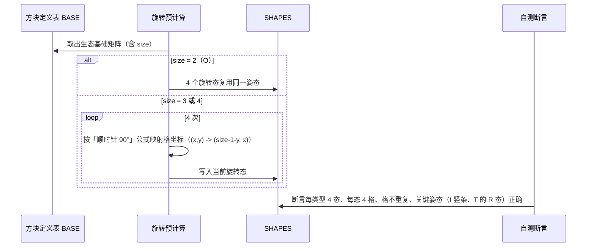

**业务规则：**

| 规则编号 | 规则描述 | 校验时机 | 不满足时的处理 |
|----------|----------|----------|----------------|
| R-TET-12 | 旋转在**预计算期**完成（启动一次），运行期只做查表，避免每帧矩阵转置出错与性能损耗 | 启动时 | — |
| R-TET-13 | 关键姿态必须可由公式推导出，例如 I 的 R 态为竖条 `(2,0)(2,1)(2,2)(2,3)`，T 的 R 态为 `(1,0)(1,1)(1,2)(2,1)` | 自测断言 | 视为抄表/公式错误，须修正 |
| R-TET-14 | O 不参与旋转公式，4 态同一姿态，`kicksFor('O',*,*)` 恒为 `(0,0)` | 始终 | — |

**异常场景：**

| 异常场景 | 处理方式 |
|----------|----------|
| 踢墙表某转移缺失（抄写遗漏） | `TETROMINO_002` 回退 `(0,0)`：旋转退化为「仅原位尝试」，不崩溃但手感降级 —— 由自测断言（R-TET-06）在开发期拦截 |
| 旋转态出现 3 格或 5 格（公式写错） | 自测断言（R-TET-02）失败，阻塞进入下一任务 |
| 候选位移超出 SRS 量级（符号写反） | 自测断言（R-TET-07）失败；另由「I 贴左墙借踢墙转平」「1 格宽竖井内旋转失败且姿态不变」两个定向场景兜底 |
| 未知方块类型（未来新增类型未注册） | `TETROMINO_001` 抛出，自测捕获并定位 |

**并发控制：**
- 并发场景：无。旋转表与踢墙表在启动期一次性构建后只读，运行期仅并发读。
- 控制策略：不需要锁，原因：只读数据结构 + 单线程事件循环（本模块无状态写入）。

#### 5.2.5 模块自检

| 检查维度 | 结论 |
|----------|------|
| 完备性对账 | F05（7 种方块）→ 5.2.2 类型枚举；F07（SRS 旋转 + 踢墙）→ 5.2.1 踢墙表 + R-TET-06/07/08；F11（碰撞用姿态）→ S03 出参；F13（幽灵块姿态一致）→ S03 复用同一姿态数据 |
| 过度设计检查 | 未实现「任意角度旋转」「自定义方块形状」「方块贴图」；踢墙表未做可配置化（SRS 规范固定），符合 YAGNI |

---

### 5.3 内核 · `Randomizer` 7-bag 随机

#### 5.3.1 数据结构设计

| 字段名 | 类型 | 约束 | 默认值 | 说明 |
|--------|------|------|--------|------|
| `bag` | string[] | 长度恒为 7，元素为 7 种类型各一次 | 打乱后的一袋 | 当前袋的待出队列 |
| `cursor` | number | `0..7` | 0 | 袋内消费位置；等于 7 时触发补袋 |
| `rng` | function | `() -> [0,1)` | 基于 `Math.random()` 或注入的种子发生器 | 洗牌随机源，可注入以便自测复现 |
| `queue` | string[] | 长度 ≥ `NEXT_COUNT` | 空 | 预览缓冲（供 `peek` 跨袋连续取用） |

**索引**：本项不适用，原因：内存队列顺序消费。

#### 5.3.2 枚举与常量定义

| 枚举名称 | 取值 | 含义 | 关联字段 |
|----------|------|------|----------|
| 袋容量 | 恒 `7`（= `TYPES.length`） | 一袋内 7 种方块各出现一次 | `bag` 长度 |
| 种子参数 | 可选 number | 注入确定性 RNG 用于自测复现 | `create(seed?)` 入参 |

#### 5.3.3 接口详细设计

##### S12 方块抽取（`create(seed?)`）

- **描述**：创建 7-bag 抽取器，暴露 `next()`（取下一个类型）与 `peek(n)`（预览后续 n 个类型而不消费）。
- **入参**：

| 参数名称 | 类型 | 是否必填 | 描述 |
|----------|------|----------|------|
| `seed` | number | 否 | 注入种子；缺省使用非确定性随机源 |

- **出参**：

| 参数名称 | 类型 | 描述 |
|----------|------|------|
| `next()` | `() -> string` | 取下一个方块类型（消费）；袋空时自动补新袋 |
| `peek(n)` | `(n) -> string[]` | 预览后续 n 个类型（不消费），`n <= NEXT_COUNT` 时长度恒等于 n |

- **错误码**：

| 错误码 | 说明 |
|--------|------|
| `RANDOMIZER_001` | `peek(n)` 的 `n` 超出一袋容量 → 自动跨袋补足，保证返回数量恒定 |

- **业务规则**：

| 规则编号 | 规则名称与描述 | 校验时机 | 不满足时的处理 |
|----------|----------------|----------|----------------|
| R-RND-01 | 每袋包含 7 种类型各一次，袋内顺序打乱（7-bag） | 每次补袋 | 缺项即为缺陷（自测断言） |
| R-RND-02 | 连续 7 次 `next()` 的结果集合必须恰好等于 7 种类型（无重复、无缺失） | 自测断言 | 视为洗牌或消费逻辑错误 |
| R-RND-03 | `peek(n)` 不得消费袋内容；连续 `peek(3)` 在 `next()` 前结果稳定 | 每次调用 | — |
| R-RND-04 | `next()` 与 `peek` 的顺序一致：`peek(1)[0]` 等于下一次 `next()` 的返回值 | 自测断言 | 视为队列与游标不同步 |
| R-RND-05 | 注入相同种子时，出块序列完全可复现（用于自测与问题定位） | 自测 | — |

#### 5.3.4 子功能详细设计

##### 5.3.4.1 7-bag 出块与预览（F18、F14）

- 处理时序图：

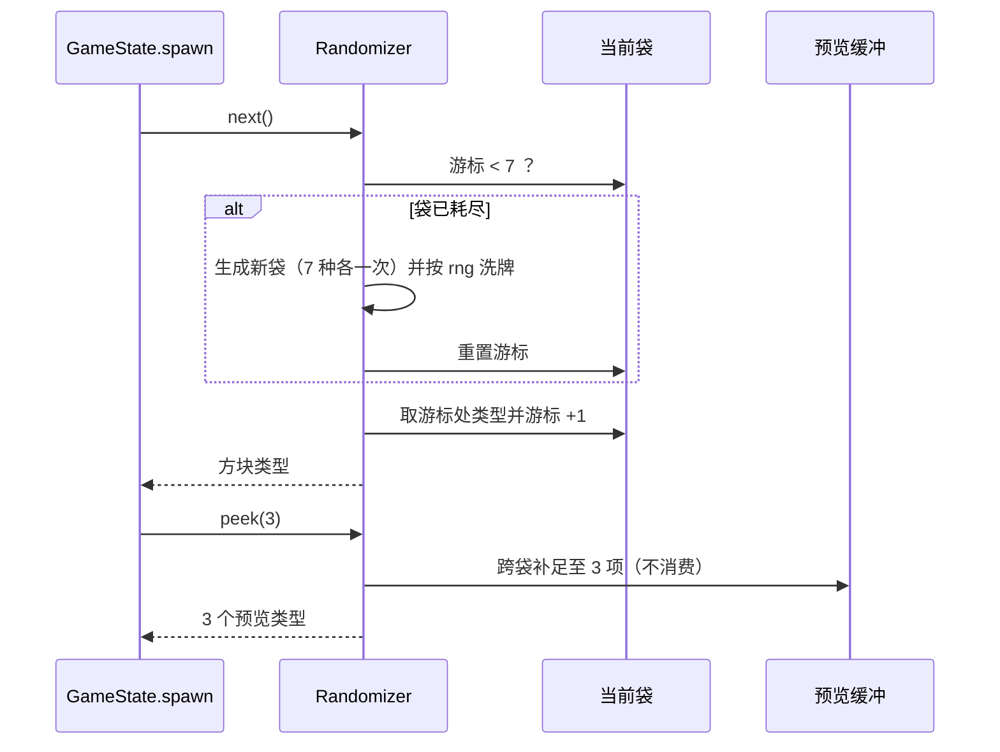

**业务规则：**

| 规则编号 | 规则描述 | 校验时机 | 不满足时的处理 |
|----------|----------|----------|----------------|
| R-RND-06 | 洗牌必须使用 Fisher–Yates 类**均匀**洗牌（每位置等概率），不得使用偏斜的排序随机（如随机比较器排序） | 实现评审 + 自测分布检查 | 视为缺陷，须重写洗牌 |
| R-RND-07 | 一局内袋序列连续：开局、补袋、重开均从新袋开始，不跨局复用袋状态 | 每次 `start` | `GameState.start` 重建抽取器（种子可选） |
| R-RND-08 | 预览数量恒为 `NEXT_COUNT`（3），队列不足时从后续袋补齐 | 每次绘图 | 不足即 `RANDOMIZER_001`，按规则补足 |

**异常场景：**

| 异常场景 | 处理方式 |
|----------|----------|
| `Math.random()` 被宿主环境限制（个别沙箱） | 使用可注入 RNG；`file://` 桌面浏览器下 `Math.random()` 始终可用，不构成风险 |
| `peek(n)` 传入超大 n | 按需跨袋补足并按 `RANDOMIZER_001` 记录；界面只用 `n = NEXT_COUNT` |
| 种子相同但序列不同（洗牌不确定） | 视为缺陷，由 R-RND-05 断言拦截 |

**并发控制：**
- 并发场景：无（袋与游标仅被 `GameState.spawn` 与渲染预览读取，且都发生在主循环内串行执行）。
- 控制策略：不需要锁，原因：单线程、单一写入者（`GameState` 经由 `next()` 消费）。

#### 5.3.5 模块自检

| 检查维度 | 结论 |
|----------|------|
| 完备性对账 | F18（7-bag）→ R-RND-01/02/06；F14（Next 预览 3 个）→ R-RND-03/04/08；F24（结算可复现）→ R-RND-05 种子注入 |
| 过度设计检查 | 未实现「多袋预取队列」「权重配置」（现代 Guideline 7-bag 已定），未实现「随机难度」；符合 YAGNI |

---

### 5.4 内核 · `Board` 棋盘纯函数模块

#### 5.4.1 数据结构设计

**`Board`（棋盘网格）**

| 字段名 | 类型 | 约束 | 默认值 | 说明 |
|--------|------|------|--------|------|
| 行（`0..TOTAL_ROWS-1`） | `(string\|null)[COLS]` | 每行长度恒为 `COLS = 10` | `null` | `null` 为空；否则为方块类型字符（落地固化的颜色键） |
| `TOTAL_ROWS` | number | 恒 `22`（= `ROWS` + `HIDDEN_ROWS`） | — | 可见行 + 顶部 2 行隐藏缓冲 |
| `HIDDEN_ROWS` | number | 恒 `2` | — | 行 `0..1` 不绘制；固定方块落入此处不进入可视区 |

**派生视图（只读）**

| 字段名 | 类型 | 说明 |
|--------|------|------|
| 可视行映射 | number | 可视第 `r` 行对应网格第 `r + HIDDEN_ROWS` 行（渲染时统一偏移，避免重复计算） |
| 行满判定 | boolean | 该行 10 个格全部非 `null` |

**索引**：本项不适用，原因：二维数组随机访问，无检索式查询；满行扫描为 O(TOTAL_ROWS×COLS) 的线性遍历（220 次比较，成本可忽略）。

#### 5.4.2 枚举与常量定义

| 枚举名称 | 取值 | 含义 | 关联字段 |
|----------|------|------|----------|
| 格取值 | `null` \| `'I'..'L'` | 空格 / 已固化方块类型 | 棋盘格 |
| 边界语义 | `y<0` 合法；`y>=TOTAL_ROWS` 越界；`x<0` 或 `x>=COLS` 越界 | 出生期可能位于棋盘上方 | `collides` 判定 |
| 返回值结构 | `{board, cleared, rows}` | `clearLines` 的出参形状 | `GameState` 消行流程 |

#### 5.4.3 接口详细设计

##### S06 棋盘创建/复制

- **描述**：`create()` 生成全空棋盘；`clone(board)` 生成深拷贝（行级复制），用于「合入」等写操作前的不变性保护。
- **入参**：

| 参数名称 | 类型 | 是否必填 | 描述 |
|----------|------|----------|------|
| `board` | `(string\|null)[][]` | 是（`clone`） | 源棋盘，须为 `TOTAL_ROWS × COLS` |

- **出参**：

| 参数名称 | 类型 | 描述 |
|----------|------|------|
| `board` | `(string\|null)[][]` | 新棋盘；与原棋盘不共享行引用（写互不影响） |

- **错误码**：`BOARD_001`（尺寸非 22×10，开发期断言）。
- **业务规则**：

| 规则编号 | 规则描述 | 校验时机 | 不满足时的处理 |
|----------|----------|----------|----------------|
| R-BRD-01 | `create()` 返回 `TOTAL_ROWS` 行、每行 `COLS` 列，全部为 `null` | 每次调用 | — |
| R-BRD-02 | `clone` 为深拷贝：修改返回值任一行任一格不得影响源棋盘（防止状态被意外共享修改） | 每次调用 | 视为缺陷（自测断言） |

##### S07 碰撞检测（`collides`）

- **描述**：判断某类型方块在给定位置与旋转态下，是否越界或与已固化方块重叠。**不修改任何状态**。
- **入参**：

| 参数名称 | 类型 | 是否必填 | 描述 |
|----------|------|----------|------|
| `board` | `(string\|null)[][]` | 是 | 当前棋盘 |
| `type` | string | 是 | 方块类型 |
| `x` | number | 是 | 方块原点列偏移（可为负） |
| `y` | number | 是 | 方块原点行偏移（可为负，表示在棋盘上方） |
| `rot` | number | 是 | 旋转态 |

- **出参**：

| 参数名称 | 类型 | 描述 |
|----------|------|------|
| 是否碰撞 | boolean | `true` = 越界或重叠；`false` = 该位置合法 |

- **错误码**：`TETROMINO_001`（未知类型）、`BOARD_001`（棋盘尺寸非法）。
- **业务规则**：

| 规则编号 | 规则描述 | 校验时机 | 不满足时的处理 |
|----------|----------|----------|----------------|
| R-BRD-03 | 逐格判定：`x` 越界（`<0` 或 `>=COLS`）→ 碰撞；`y >= TOTAL_ROWS` → 碰撞；`y >= 0` 且该格非 `null` → 碰撞；`y < 0` → 视为合法（隐藏缓冲上方） | 每次调用 | — |
| R-BRD-04 | 判定必须遍历该姿态全部 4 格，任一格不合法即返回 `true` | 每次调用 | — |
| R-BRD-05 | 纯函数：不得修改棋盘、不得依赖外部可变状态 | 始终 | 视为缺陷（破坏可测试性） |

##### S08 方块合入（`merge`）

- **描述**：把落地方块写入棋盘副本，返回新棋盘（不改动入参）。
- **入参**：`board`、`type`、`x`、`y`、`rot`（同上）。
- **出参**：

| 参数名称 | 类型 | 描述 |
|----------|------|------|
| 新棋盘 | `(string\|null)[][]` | 已写入该方块类型的深拷贝棋盘 |

- **错误码**：`BOARD_001`、`TETROMINO_001`。
- **业务规则**：

| 规则编号 | 规则描述 | 校验时机 | 不满足时的处理 |
|----------|----------|----------|----------------|
| R-BRD-06 | 仅写入 `y` 在 `[0, TOTAL_ROWS)` 且 `x` 在 `[0, COLS)` 的格；位于隐藏缓冲上方的格（`y<0`）被忽略 | 每次调用 | — |
| R-BRD-07 | 合入前必须已确认无碰撞（调用方保证：`collides` 为 `false`）；合入不得覆盖已有非空格 | 调用顺序 | 覆盖即为调用方缺陷（自测断言覆盖场景） |
| R-BRD-08 | 返回新对象，入参棋盘保持不变 | 每次调用 | 视为缺陷 |

##### S09 满行识别 / S10 消行结算 / S11 空行判定

- **描述**：`fullRows(board)` 返回所有满行行号；`clearRows(board, rows)` 删除指定行并把上方整体下移、顶部补空行；`clearLines(board)` 是「识别 + 删除」的组合入口，返回 `{board, cleared, rows}`；`isEmptyRow(board, r)` 判断某行是否全空。
- **入参**：

| 参数名称 | 类型 | 是否必填 | 描述 |
|----------|------|----------|------|
| `board` | `(string\|null)[][]` | 是 | 当前棋盘 |
| `rows` | number[] | 是（`clearRows`） | 待删除行号集合 |
| `r` | number | 是（`isEmptyRow`） | 行号 |

- **出参**：

| 参数名称 | 类型 | 描述 |
|----------|------|------|
| `fullRows` 结果 | number[] | 满行行号（升序），长度 `0..4` |
| `clearLines` 结果 | `{board, cleared:number, rows:number[]}` | 新棋盘、消除行数、被消除的行号 |
| `clearRows`/`isEmptyRow` 结果 | `board` / `boolean` | 新棋盘 / 是否全空 |

- **错误码**：`BOARD_001`；`rows` 含非法行号时按「忽略该行号」容错（不抛异常）。
- **业务规则**：

| 规则编号 | 规则描述 | 校验时机 | 不满足时的处理 |
|----------|----------|----------|----------------|
| R-BRD-09 | 满行定义：该行 10 格全部非 `null`（含隐藏缓冲行） | 每次调用 | — |
| R-BRD-10 | 消行后：被删行上方的所有行整体下移相同行数，顶部补足等量空行；**不改变其他行的格内相对顺序** | 每次调用 | 视为缺陷（自测断言多行同时消除的稳定性） |
| R-BRD-11 | 一次最多消除 4 行（一个方块最多覆盖 4 行）；`cleared` 取值 `0..4` | 每次调用 | 超范围由 `SCORING_001` 兜底 |
| R-BRD-12 | `clearLines` 与 `clearRows(fullRows(board))` 语义等价（组合入口仅为便捷） | 自测断言 | — |
| R-BRD-13 | 纯函数：返回新棋盘，入参不变 | 每次调用 | 视为缺陷 |

#### 5.4.4 子功能详细设计

##### 5.4.4.1 落地固化与消行（F11、F12）

- 处理时序图：

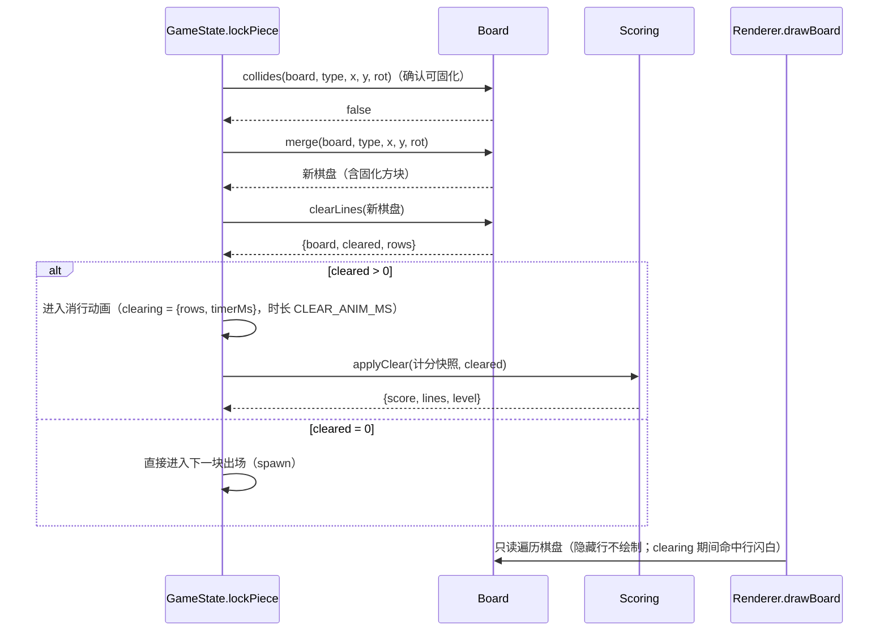

**业务规则：**

| 规则编号 | 规则描述 | 校验时机 | 不满足时的处理 |
|----------|----------|----------|----------------|
| R-BRD-14 | 固化前必须 `collides == false`；固化后必须立刻做满行识别（同一次锁定内完成） | 每次锁定 | — |
| R-BRD-15 | 消行动画期间棋盘保持「已含满行」的状态，动画结束后才真正删除行并 spawn 新块（保证视觉与逻辑一致） | 每次消行 | — |
| R-BRD-16 | 隐藏缓冲行同样参与满行判定（极端堆叠下可消隐藏行），但**不绘制** | 每次消行 | — |

**异常场景：**

| 异常场景 | 处理方式 |
|----------|----------|
| 固化位置与已有方块重叠（调用顺序错误） | 防御性判定：合入前再次 `collides`，为 `true` 则跳过固化并按 `STATE_001` 记录（不破坏棋盘） |
| 一次锁定同时出现 4 行满（Tetris） | 正常路径：`cleared = 4`，计 800 × 等级；自测断言覆盖 |
| 消行行号包含隐藏行与可视行混合 | 按行号统一下移处理，不区分隐藏/可视（R-BRD-10 一致） |
| 单格宽竖井内方块固化后形成 1 列高堆 | 属正常玩法；不特殊处理 |
| 棋盘为 0 行（构造错误） | `BOARD_001` 开发期断言失败；运行期按实际尺寸容错不崩溃 |

**并发控制：**
- 并发场景：无。棋盘只在主循环内被单一写入者（`GameState`）替换为新快照；渲染只读上一帧快照。
- 控制策略：不需要锁，原因：纯函数 + 不可变风格（每次返回新棋盘）+ 单线程；渲染读取的棋盘对象在整个帧内不会被原地修改。

#### 5.4.5 模块自检

| 检查维度 | 结论 |
|----------|------|
| 完备性对账 | F04（棋盘规模）→ 5.4.1；F11（碰撞与固化）→ S07/S08 + R-BRD-03/06；F12（满行消除 1–4 行）→ S09/S10 + R-BRD-09/10/11；F13（幽灵块复用碰撞）→ S07 被 `ghostY` 复用 |
| 过度设计检查 | 未引入「行列分区索引」「位压缩棋盘」「多行同时消除特效分级」；未引入撤销/回放所需的棋盘历史；符合 YAGNI |

---

### 5.5 内核 · `Scoring` 计分与等级模块

#### 5.5.1 数据结构设计

| 字段名 | 类型 | 约束 | 默认值 | 说明 |
|--------|------|------|--------|------|
| `score` | number | `>= 0` 整数 | 0 | 累计总分 |
| `lines` | number | `>= 0` 整数 | 0 | 累计消行数 |
| `level` | number | `>= START_LEVEL_MIN` | 起始等级 | 当前等级，影响重力与计分系数 |
| `startLevel` | number | `1..15` | 1 | 本局起始等级（等级公式的基准） |
| `dropIntervalMs` | number | `>= MIN_GRAVITY_MS` | 由 `gravityMs(level)` 计算 | 当前重力间隔（毫秒/格） |

**索引**：本项不适用，原因：内存标量与常量表查找。

#### 5.5.2 枚举与常量定义

| 枚举名称 | 取值 | 含义 | 关联字段 |
|----------|------|------|----------|
| 消行数 `cleared` | `0/1/2/3/4` | 无/单/双/三/四行 | `SCORE_TABLE` 键、`applyClear` 入参 |
| 消行基础分 | `1→100`、`2→300`、`3→500`、`4→800` | 未乘等级的基础分 | `SCORE_TABLE` |
| 软降分 | `1` 分/格 | `SOFT_DROP_POINTS_PER_CELL` | `softDropPoints` |
| 硬降分 | `2` 分/格 | `HARD_DROP_POINTS_PER_CELL` | `hardDropPoints` |
| 升级阈值 | `10` 行/级 | `LEVEL_UP_LINES` | `levelFor` |
| 重力下限 | `16` ms | `MIN_GRAVITY_MS`（高速下仍可操作） | `gravityMs` |

#### 5.5.3 接口详细设计

##### S13 消行计分（`linePoints(cleared, level)`）

- **描述**：按 Guideline 计分表计算本次消行的得分。
- **入参**：

| 参数名称 | 类型 | 是否必填 | 描述 |
|----------|------|----------|------|
| `cleared` | number | 是 | 本次消除行数（`0..4`） |
| `level` | number | 是 | 当前等级（计分系数） |

- **出参**：

| 参数名称 | 类型 | 描述 |
|----------|------|------|
| 得分 | number | `SCORE_TABLE[cleared] × level`；`cleared = 0` 时为 0 |

- **错误码**：`SCORING_001`（`cleared` 不在 `0..4`）。
- **业务规则**：R-SCR-01 —— 计分严格为 `100/300/500/800 × 当前等级`（软降/硬降分不含系数）；R-SCR-02 —— 纯函数，无副作用。

##### S14 软/硬降计分（`softDropPoints(cells)` / `hardDropPoints(cells)`）

- **描述**：按主动下落格数计分。
- **入参**：

| 参数名称 | 类型 | 是否必填 | 描述 |
|----------|------|----------|------|
| `cells` | number | 是 | 本次主动下落的格数（软降为逐格累计，硬降为落底格数） |

- **出参**：

| 参数名称 | 类型 | 描述 |
|----------|------|------|
| 得分 | number | 软降：`cells × 1`；硬降：`cells × 2` |

- **错误码**：无（负数按 0 处理）。
- **业务规则**：R-SCR-03 —— 仅**主动**下降计分（重力自动下落不计分）；R-SCR-04 —— 软降与硬降分**不乘等级系数**。

##### S15 等级与重力（`levelFor` / `gravityMs`）

- **描述**：由累计消行数推导等级；由等级推导重力间隔（Guideline 速度曲线）。
- **入参**：

| 参数名称 | 类型 | 是否必填 | 描述 |
|----------|------|----------|------|
| `totalLines` | number | 是（`levelFor`） | 本局累计消行数 |
| `startLevel` | number | 是（`levelFor`） | 起始等级 `1..15` |
| `level` | number | 是（`gravityMs`） | 当前等级 |

- **出参**：

| 参数名称 | 类型 | 描述 |
|----------|------|------|
| `level` | number | `startLevel + floor(totalLines / 10)` |
| `gravityMs` | number | `max(MIN_GRAVITY_MS, 曲线(level) × 1000)`；曲线为 `(0.8 - (level-1) × 0.007) ^ (level-1)` 秒；等级 1 时约 1000ms |

- **错误码**：无（`level < 1` 按 1 处理）。
- **业务规则**：

| 规则编号 | 规则描述 | 校验时机 | 不满足时的处理 |
|----------|----------|----------|----------------|
| R-SCR-05 | 等级只升不降（`lines` 单调递增） | 每次消行 | — |
| R-SCR-06 | 重力间隔随等级单调不增，且不得小于 `MIN_GRAVITY_MS` | 每次调用 | 小于下限时取 `MIN_GRAVITY_MS` |
| R-SCR-07 | 起始等级直接抬高初始等级：起始等级 15 时的初速与等级 15 一致（影响初速与计分系数） | 开局 | — |
| R-SCR-08 | 软降重力间隔 = 当前重力间隔 / `SOFT_DROP_FACTOR`（20），但不小于单帧最小间隔（由 `MIN_GRAVITY_MS` 与 `dt` 钳制共同保证） | 软降期间 | — |

##### S16 计分结算（`applyClear({score,lines,level,startLevel}, cleared)`）

- **描述**：一次消行的原子结算：加分、累计消行、按阈值推进等级。
- **入参**：

| 参数名称 | 类型 | 是否必填 | 描述 |
|----------|------|----------|------|
| 计分快照 | `{score,lines,level,startLevel}` | 是 | 消行前的计分状态 |
| `cleared` | number | 是 | 本次消除行数 |

- **出参**：

| 参数名称 | 类型 | 描述 |
|----------|------|------|
| 新计分状态 | `{score,lines,level}` | 结算后的总分、累计行数、新等级 |

- **错误码**：`SCORING_001`（`cleared` 越界 → 计 0 分、不推进等级）。
- **业务规则**：

| 规则编号 | 规则描述 | 校验时机 | 不满足时的处理 |
|----------|----------|----------|----------------|
| R-SCR-09 | 计分与等级推进**只在 `applyClear` 一处发生**，`GameState` 不得重复实现计分算术 | 实现评审 | 重复实现即为缺陷 |
| R-SCR-10 | 先按「消行前等级」计分，再推进等级（同一次消行不会因刚升级而跳档加分） | 每次结算 | — |
| R-SCR-11 | 纯函数：返回新计分对象，入参不变 | 每次调用 | 视为缺陷 |

#### 5.5.4 子功能详细设计

##### 5.5.4.1 消行结算与升级（F17、F10）

- 处理时序图：

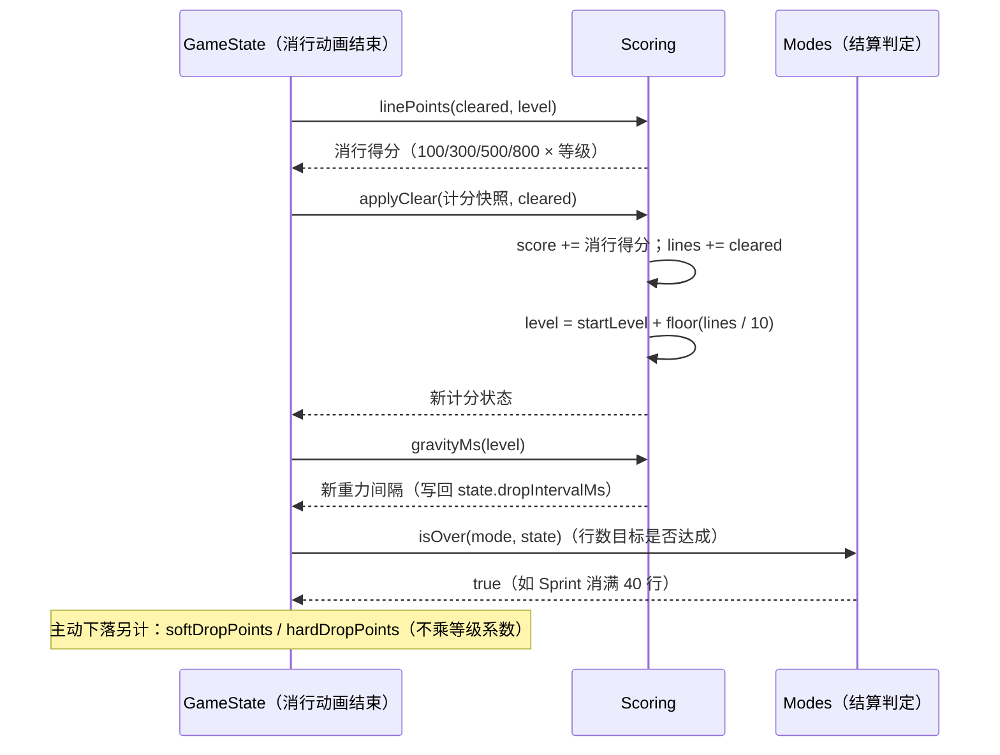

**业务规则：**

| 规则编号 | 规则描述 | 校验时机 | 不满足时的处理 |
|----------|----------|----------|----------------|
| R-SCR-12 | 一帧内只可能发生一次消行结算（锁定是离散事件），不存在同帧多次结算 | 每次锁定 | — |
| R-SCR-13 | 等级变化后必须立即刷新 `dropIntervalMs`；正在进行的软降使用刷新后的间隔 | 每次升级 | — |
| R-SCR-14 | 结算时最高分比较使用结算后的 `score`（避免漏记最后一手） | 进入 `GAME_OVER` | — |

**异常场景：**

| 异常场景 | 处理方式 |
|----------|----------|
| `cleared` 为 0 却调用 `applyClear` | 计 0 分、`lines` 不变、等级不变（幂等安全） |
| 等级达到曲线下限后继续升级 | `gravityMs` 取 `MIN_GRAVITY_MS`，速度不再加快，避免不可玩 |
| 起始等级 15 + 立即消行 | 计分系数按 15 计算（`100 × 15`），等级继续按行数推进 |
| 单局分数极大（长时间马拉松） | 双精度整数范围内不会溢出（需数百年游玩才接近安全整数上限），不特殊处理 |

**并发控制：**
- 并发场景：无。计分状态只由 `GameState` 在主循环内更新。
- 控制策略：不需要锁，原因：纯函数 + 单一写入路径（R-SCR-09 强制单点计分）。

#### 5.5.5 模块自检

| 检查维度 | 结论 |
|----------|------|
| 完备性对账 | F17（Guideline 计分与升级）→ S13/S16 + R-SCR-01/09/10；F10（等级加速）→ S15 + R-SCR-06；F08/F09（软硬降加分）→ S14 + R-SCR-03/04；F22（起始等级）→ S15 + R-SCR-07 |
| 过度设计检查 | 未实现「连击/Back-to-Back/T-spin 加成」「连消倍率」「成就分数」；计分表以常量固定，符合 YAGNI（如需扩展只需替换计分表） |

---

### 5.6 内核 · `Modes` 模式配置模块

#### 5.6.1 数据结构设计

**`ModeConfig`（模式配置，静态只读数组 `Modes.list`）**

| 字段名 | 类型 | 约束 | 说明 |
|--------|------|------|------|
| `id` | string | 枚举 `marathon` / `sprint` / `ultra` | 模式唯一标识，`GameState.mode` 持有 |
| `label` | string | 中文（马拉松 / 40 行竞速 / 限时冲刺） | 面板按钮与结算标题文案 |
| `goal` | string | 中文目标描述 | 面板副标题（如「最快消满 40 行」） |
| `isFinished(state)` | `(state) -> boolean` | 纯函数 | 目标达成判定（不含堆顶判定，堆顶由 `GameState` 统一处理） |
| `resultText(state)` | `(state) -> string` | 纯函数，中文 | 结算面板正文（按模式差异化：总分/等级/消行/用时） |
| `progressLabel` | string | 中文（进度 / 剩余 / 等级） | 侧栏进度标签 |
| `progressText(state)` | `(state) -> string` | 纯函数 | 侧栏进度文案（如「12/40」「01:23.45」「1:58.20」） |

**索引**：本项不适用，原因：固定 3 项数组，`byId` 为线性查找（3 次比较）。

#### 5.6.2 枚举与常量定义

| 枚举名称 | 取值 | 含义 | 关联字段 |
|----------|------|------|----------|
| 模式 id | `marathon` | 马拉松：无尽冲分，堆顶结束 | `mode.id`、`start(state, modeId,...)` 入参 |
| 模式 id | `sprint` | 40 行竞速：最快消满 `SPRINT_LINES`(=40) 行 | 同上 |
| 模式 id | `ultra` | 限时冲刺：`ULTRA_MS`(=120000) 毫秒内冲最高分 | 同上 |
| 结束原因 | `目标达成` / `堆顶`（`topOut = true`） | 结算标题与副文案的区分依据 | `state.topOut`、`state.message` |
| 时间格式 | `mm:ss.cc`（`formatMs`） | 百分秒精度，用于竞速与倒计时展示 | `progressText`/`resultText` |

#### 5.6.3 接口详细设计

##### S17 模式查询与判定（`Modes.list` / `byId` / `isOver`）

- **描述**：提供模式清单、按 id 取配置、判定本局是否结束。
- **入参**：

| 参数名称 | 类型 | 是否必填 | 描述 |
|----------|------|----------|------|
| `id` | string | 是（`byId`） | 模式 id |
| `mode` | `ModeConfig` | 是（`isOver`） | 模式配置 |
| `state` | `GameState` | 是（`isOver`） | 当前状态快照（只读） |

- **出参**：

| 参数名称 | 类型 | 描述 |
|----------|------|------|
| `list` | `ModeConfig[]` | 长度 3，顺序固定（面板展示顺序） |
| `byId` 结果 | `ModeConfig` | 匹配配置；未知 id 时回退马拉松 |
| `isOver` 结果 | boolean | 模式目标是否达成 |

- **错误码**：

| 错误码 | 说明 |
|--------|------|
| `MODE_001` | `byId` 传入未知 id → 回退马拉松 |

- **业务规则**：

| 规则编号 | 规则描述 | 校验时机 | 不满足时的处理 |
|----------|----------|----------|----------------|
| R-MODE-01 | 三种模式**共用**同一套核心规则（重力/碰撞/消行/计分），差异只在「目标判定 + 结算/进度文案」 | 实现评审 | 出现 `if (mode === 'sprint')` 类分支散落到核心流程即为缺陷 |
| R-MODE-02 | `marathon.isFinished` 恒为 `false`（只有堆顶结束） | 每帧判定 | — |
| R-MODE-03 | `sprint.isFinished` 为 `state.lines >= SPRINT_LINES`（40） | 每帧判定 | — |
| R-MODE-04 | `ultra.isFinished` 为 `state.elapsedMs >= ULTRA_MS`（120000） | 每帧判定 | — |
| R-MODE-05 | `isOver(mode, state)` = `mode.isFinished(state) || state.topOut` | 每帧判定 | 堆顶判定统一复用，不由模式各写一份 |
| R-MODE-06 | `isFinished`/`resultText`/`progressText` 必须是纯函数：只读 `state`，不得修改 | 始终 | 视为缺陷 |

##### S18 时间格式化（`formatMs(ms)`）

- **描述**：把毫秒格式化为 `mm:ss.cc` 展示串（百分秒），用于竞速用时与倒计时。
- **入参**：

| 参数名称 | 类型 | 是否必填 | 描述 |
|----------|------|----------|------|
| `ms` | number | 是 | 毫秒数（`>= 0`；负值按 0 处理） |

- **出参**：

| 参数名称 | 类型 | 描述 |
|----------|------|------|
| 时间串 | string | 形如 `01:23.45`（分两位、秒两位、百分秒两位） |

- **错误码**：无。
- **业务规则**：R-MODE-07 —— 倒计时展示为 `ULTRA_MS - elapsedMs`，不得出现负值（下限 0）；R-MODE-08 —— 分秒补零使用定长补位（`padStart`），保证面板数字不跳动错位。

#### 5.6.4 子功能详细设计

##### 5.6.4.1 模式目标判定与结算（F19、F20、F21）

- 处理时序图：

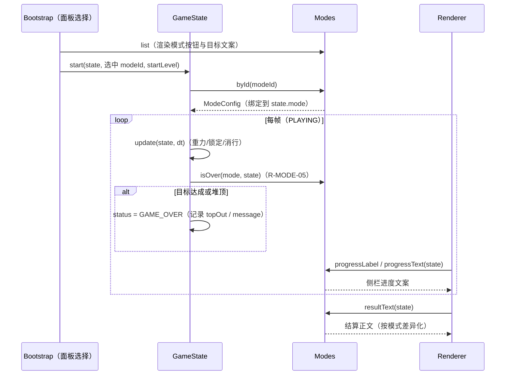

**业务规则：**

| 规则编号 | 规则描述 | 校验时机 | 不满足时的处理 |
|----------|----------|----------|----------------|
| R-MODE-09 | 模式目标判定只在 `PLAYING` 状态参与（暂停/结算后不再判定，避免重复触发） | 每帧 | — |
| R-MODE-10 | 结算文案必须包含该模式的差异化信息：马拉松=总分/等级/消行；竞速=用时(`mm:ss.cc`)/消行；冲刺=总分/消行 | 进入 `GAME_OVER` | 缺失即缺陷（自测断言关键字段） |
| R-MODE-11 | 结算面板同时展示「本会话最佳」（`ui.bestScore`），并提示按 `Enter` 返回选择面板 | 进入 `GAME_OVER` | — |
| R-MODE-12 | 三种模式的计时源统一为 `state.elapsedMs`（仅 `PLAYING` 累加），暂停与切后台不累加 | 始终 | 计时泄漏即为缺陷 |

**异常场景：**

| 异常场景 | 处理方式 |
|----------|----------|
| Sprint 消满 40 行与堆顶同一帧发生 | 以「目标达成」优先展示（`topOut` 为 false 时标题为「目标达成」），得分照常结算 |
| Ultra 倒计时归零与锁定/消行同一帧 | 先完成该帧消行结算再判定结束，避免丢失最后一手分数（R-SCR-14） |
| 面板未选择模式即按 `Enter` | `modeIndex` 默认 0（马拉松），始终存在有效模式，不出现空模式 |
| `byId` 收到被篡改的 id | `MODE_001` 回退马拉松，界面与状态机始终可用 |
| 用户切后台导致计时长时间停滞 | `elapsedMs` 不累加（R-MODE-12），恢复后从原值继续，不跳动 |

**并发控制：**
- 并发场景：无。模式判定为纯读判定，状态迁移由 `GameState` 单一写入者完成。
- 控制策略：不需要锁，原因：单线程 + 纯函数判定 + 唯一的 `GAME_OVER` 写入点。

#### 5.6.5 模块自检

| 检查维度 | 结论 |
|----------|------|
| 完备性对账 | F19（马拉松）→ R-MODE-02/10；F20（40 行竞速）→ R-MODE-03/10；F21（限时冲刺）→ R-MODE-04/10；F22（起始等级影响计分与速度）→ `start` 入参 + §5.5 R-SCR-07；F12/§5.11（结算重开）→ R-MODE-11 |
| 过度设计检查 | 未实现「自定义模式」「在线排行榜」「模式解锁条件」；进度文案仅三种固定实现，符合 YAGNI |

---

### 5.7 内核 · `GameState` 状态机与推进模块（核心模块）

#### 5.7.1 数据结构设计

**`GameState`（会话状态，唯一可变对象）**

| 字段名 | 类型 | 约束 | 默认值 | 说明 |
|--------|------|------|--------|------|
| `status` | string | 枚举 `READY/PLAYING/PAUSED/GAME_OVER` | `READY` | 状态机当前状态 |
| `mode` | `ModeConfig` | 必为 `Modes.list` 中一项 | 马拉松 | 本局模式 |
| `startLevel` | number | `1..15` | 1 | 起始等级 |
| `board` | `(string\|null)[][]` | `22 × 10` | 全空 | 棋盘快照（不可变替换） |
| `piece` | `{type,rot,x,y} \| null` | `rot ∈ 0..3` | `null` | 在场方块；`null` 表示当前无可操作方块（消行动画/结算中） |
| `next` | string[] | 长度 = `NEXT_COUNT`(3) | 由 `Bag` 预取 | 预览队列 |
| `hold` | string \| null | 类型枚举或 `null` | `null` | 暂存槽内容 |
| `canHold` | boolean | — | `true` | 本次出场是否还允许暂存（`spawn` 后置 `true`，`hold` 后置 `false`） |
| `score` | number | `>= 0` | 0 | 总分 |
| `lines` | number | `>= 0` | 0 | 累计消行 |
| `level` | number | `>= startLevel` | `startLevel` | 当前等级 |
| `elapsedMs` | number | `>= 0` | 0 | 本局有效计时（仅 `PLAYING` 累加） |
| `topOut` | boolean | — | `false` | 是否因堆顶结束 |
| `dropAccMs` | number | `0 <= v < dropIntervalMs` | 0 | 重力累计计时 |
| `dropIntervalMs` | number | `>= MIN_GRAVITY_MS` | `gravityMs(level)` | 当前重力间隔 |
| `softDropping` | boolean | — | `false` | 软降是否按下 |
| `lockTimerMs` | number | `0..LOCK_DELAY_MS` | 0 | 触底后的锁定延迟计时 |
| `lockResets` | number | `0..LOCK_RESET_LIMIT` | 0 | 本次触底期间锁定延迟被重置的次数 |
| `grounded` | boolean | — | `false` | 当前方块是否已触底 |
| `clearing` | `{rows:number[], timerMs:number} \| null` | `timerMs ∈ 0..CLEAR_ANIM_MS` | `null` | 消行动画状态；非 `null` 时不推进重力 |
| `rng` | `Randomizer` | 由 `start` 创建 | — | 抽取器实例 |
| `message` | string | 中文 | `''` | 结束原因文案（如「方块堆顶」） |

**索引**：本项不适用，原因：单对象字段直接访问。

#### 5.7.2 枚举与常量定义

| 枚举名称 | 取值 | 含义 | 关联字段 |
|----------|------|------|----------|
| 状态（`STATUS`） | `READY` | 未开始，展示模式/等级选择面板 | `state.status` |
| 状态 | `PLAYING` | 播放中，推进重力与计时 | 同上 |
| 状态 | `PAUSED` | 暂停，冻结一切推进与计时 | 同上 |
| 状态 | `GAME_OVER` | 结算，展示结算面板 | 同上 |
| 结束原因 | `topOut = true` / 目标达成 | 结算标题与 `message` 的区分依据 | `state.topOut`、`state.message` |
| 锁定延迟状态 | 未触底 / 已触底（`grounded`） / 已锁定 | 锁定计时器启停依据 | `grounded`、`lockTimerMs` |
| intent 类型 | `move/rotate/softDrop/hardDrop/hold/pause` | 状态机唯一外部输入 | `applyIntent` 入参 |

#### 5.7.3 接口详细设计

##### S19 状态机生命周期（`create` / `start` / `toReady`）

- **描述**：`create()` 生成初始状态（`READY`，空棋盘，无在场方块）；`start(state, modeId, startLevel, seed?)` 初始化一局；`toReady(state)` 从结算回到选择面板。
- **入参**：

| 参数名称 | 类型 | 是否必填 | 描述 |
|----------|------|----------|------|
| `state` | `GameState` | 是 | 目标状态对象（原地更新） |
| `modeId` | string | 是（`start`） | 模式 id（`marathon/sprint/ultra`） |
| `startLevel` | number | 是（`start`） | 起始等级，越界时钳制到 `1..15` |
| `seed` | number | 否（`start`） | 注入随机种子（自测复现用） |

- **出参**：

| 参数名称 | 类型 | 描述 |
|----------|------|------|
| 新状态 | `GameState` | 初始化/重置后的状态（`status = PLAYING` 或 `READY`） |

- **错误码**：`MODE_001`（未知模式 id → 回退马拉松）。
- **业务规则**：

| 规则编号 | 规则描述 | 校验时机 | 不满足时的处理 |
|----------|----------|----------|----------------|
| R-GS-01 | `start` 必须整体重置：棋盘清空、计分归零、`elapsedMs=0`、`clearing=null`、`hold=null`、`canHold=true`、`topOut=false`、重建 `rng` | 每次开局 | 残留上一局状态即为缺陷 |
| R-GS-02 | `startLevel` 越界时钳制到 `1..15`，不报错（保证界面与状态一致） | 每次开局 | — |
| R-GS-03 | `start` 结束后立即执行一次 `spawn`，使 `piece` 非 `null` 且 `next` 队列已填满 3 项 | 每次开局 | — |
| R-GS-04 | `toReady` 只重置规则状态，保留 `SessionUI.bestScore`（在 `Bootstrap` 侧），`status = READY` | 结算后按 `Enter` | — |

##### S20 状态推进（`update(state, dtMs)` / `applyIntent(state, intent)`）

- **描述**：`update` 按帧推进时间（重力、锁定延迟、消行动画、计时、模式判定）；`applyIntent` 处理一次归一化输入。
- **入参**：

| 参数名称 | 类型 | 是否必填 | 描述 |
|----------|------|----------|------|
| `state` | `GameState` | 是 | 目标状态 |
| `dtMs` | number | 是（`update`） | 距上一帧的毫秒数（内部钳制到 `MAX_DT_MS`） |
| `intent` | `intent` | 是（`applyIntent`） | 归一化意图（§4.3 形状表） |

- **出参**：

| 参数名称 | 类型 | 描述 |
|----------|------|------|
| 状态 | `GameState` | 推进后的状态（原地更新并返回，便于链式调用） |

- **错误码**：

| 错误码 | 说明 |
|--------|------|
| `STATE_001` | 非法状态迁移或当前状态不接受的 intent → 幂等忽略 |

- **业务规则：**

| 规则编号 | 规则描述 | 校验时机 | 不满足时的处理 |
|----------|----------|----------|----------------|
| R-GS-05 | 仅 `PLAYING` 推进：重力累加、`elapsedMs` 累加、锁定计时、消行动画计时、模式判定；`READY/PAUSED/GAME_OVER` 一律不推进 | 每帧 | — |
| R-GS-06 | `dt` 钳制：实际使用 `min(dtMs, MAX_DT_MS)`（250ms），防止切后台回来瞬时掉落多格 | 每帧 | — |
| R-GS-07 | 重力累加：`dropAccMs += dt`，达到 `dropIntervalMs` 时下移一格（可在一帧内多次），并对间隔取模保留余量 | 每帧 | — |
| R-GS-08 | 软降：`softDropping` 为 `true` 时使用 `dropIntervalMs / SOFT_DROP_FACTOR` 作为下落间隔，并对每格主动下落计 `SOFT_DROP_POINTS_PER_CELL` 分 | 软降期间 | — |
| R-GS-09 | 锁定延迟：`grounded` 时 `lockTimerMs += dt`；达到 `LOCK_DELAY_MS`（500ms）即锁定 | 每帧 | — |
| R-GS-10 | 锁定延迟重置：触底期间每次**成功**的移动/旋转将 `lockTimerMs` 归零且 `lockResets + 1`，当 `lockResets >= LOCK_RESET_LIMIT`(15) 后不再重置 | 每次成功操作 | 超限后不再重置（防无限拖延） |
| R-GS-11 | 消行动画：锁定命中满行时进入 `clearing`（`timerMs` 累加至 `CLEAR_ANIM_MS`=120ms），期间**不推进重力、不作落地判定**；动画结束执行消行与计分并 `spawn` | 每次消行 | — |
| R-GS-12 | 堆顶判定：`spawn` 时若出生位置即 `collides` → `topOut=true`、`message='方块堆顶'`、`status=GAME_OVER`，不进入死循环 | 每次 `spawn` | — |
| R-GS-13 | 模式结束判定：每次 `update` 末尾执行 `Modes.isOver(mode, state)`，命中则 `status=GAME_OVER` | 每帧 | — |
| R-GS-14 | intent 分发按类型限流：`move/rotate/hardDrop/hold` 在非 `PLAYING` 或 `piece=null` 或 `clearing!=null` 时忽略；`pause` 仅 `PLAYING ⇄ PAUSED` 有效 | 每次 intent | `STATE_001` 幂等忽略 |
| R-GS-15 | 所有状态变更集中在 `GameState`；`Renderer` 与 `Input` 不得直接写 `state` 字段 | 始终 | 视为缺陷（渲染反向修改状态） |
| R-GS-16 | `update` 幂等安全：`status != PLAYING` 或 `dt <= 0` 时直接返回，不产生任何副作用 | 每帧 | — |

##### S21 落点与地面判定（`ghostY(state)` / `isGrounded(state)`）

- **描述**：`ghostY` 返回当前姿态的**硬降落点**行偏移（幽灵块位置）；`isGrounded` 判断当前方块是否已触底（再下一格即碰撞）。
- **入参**：`state`（`GameState`，必填，只读）。
- **出参**：

| 参数名称 | 类型 | 描述 |
|----------|------|------|
| `ghostY` | number | 硬降落点行偏移（`>= piece.y`）；`piece=null` 时返回 0 |
| `isGrounded` | boolean | 是否为触底状态 |

- **错误码**：无（`piece=null` 返回安全值）。
- **业务规则**：R-GS-17 —— `ghostY` 由「从当前 `y` 逐格 +1 试探 `collides` 直到碰撞，回退一格」求得，与硬降实际落点**必然一致**（同一判定函数）；R-GS-18 —— `isGrounded` 等价于 `collides(board, type, x, y+1, rot)` 为 `true`，且必须与重力下移判定使用同一函数（避免幽灵块与实际落点不一致）。

##### S22 方块出场与暂存（`spawn(state, forcedType?)` / `hold(state)`）

- **描述**：`spawn` 从预览队列取头出新块并补齐预览；`hold` 执行暂存/取回。
- **入参**：

| 参数名称 | 类型 | 是否必填 | 描述 |
|----------|------|----------|------|
| `state` | `GameState` | 是 | 目标状态 |
| `forcedType` | string | 否（`spawn`） | 强制指定类型（自测用）；缺省取 `rng.next()` |

- **出参**：

| 参数名称 | 类型 | 描述 |
|----------|------|------|
| 状态 | `GameState` | 出场后的状态 |
| `hold` 结果 | boolean | 是否执行了暂存（`false` = 因 `canHold=false` 被忽略） |

- **错误码**：`STATE_001`（在非 `PLAYING` 状态调用）。
- **业务规则**：

| 规则编号 | 规则描述 | 校验时机 | 不满足时的处理 |
|----------|----------|----------|----------------|
| R-GS-19 | `spawn` 使用 `Tetromino.spawnX/spawnY` 与旋转态 `0`；`lockTimerMs=0`、`lockResets=0`、`grounded=false`、`dropAccMs=0`、`softDropping` 保持按键状态 | 每次出场 | — |
| R-GS-20 | `spawn` 后 `canHold` 置 `true`（新的一块可以再暂存一次） | 每次出场 | — |
| R-GS-21 | `hold` 在 `canHold=false` 时返回 `false` 且不改变状态（同一方块落地前只能换一次） | 每次暂存 | — |
| R-GS-22 | `hold` 空槽：当前块类型存入 `hold`，随后 `spawn()` 出一块新块；非空槽：与 `hold` 内容交换，取回的块以出生点与旋转态 `0` 出场 | 每次暂存 | — |
| R-GS-23 | `hold` 成功后置 `canHold=false`，并重置锁定延迟相关计时（R-GS-19 等价处理） | 每次暂存 | — |

##### S23 落地与暂停（`hardDrop(state)` / `lockPiece(state)` / `togglePause(state)`）

- **描述**：`hardDrop` 立即落底、按格计分并锁定；`lockPiece` 执行固化 + 消行 + 计分 + 出场；`togglePause` 在 `PLAYING` 与 `PAUSED` 间切换。
- **入参**：`state`（`GameState`，必填）。
- **出参**：

| 参数名称 | 类型 | 描述 |
|----------|------|------|
| `hardDrop` 结果 | number | 本次下落格数（用于计分与自测断言） |
| `lockPiece` / `togglePause` | `void` | 原地更新状态 |

- **错误码**：`STATE_001`（非 `PLAYING` 或 `piece=null` 时调用 → 忽略）。
- **业务规则**：

| 规则编号 | 规则描述 | 校验时机 | 不满足时的处理 |
|----------|----------|----------|----------------|
| R-GS-24 | 硬降：将 `piece.y` 置为 `ghostY`，按 `HARD_DROP_POINTS_PER_CELL × 下落格数` 加分，随即 `lockPiece` | 每次硬降 | — |
| R-GS-25 | `lockPiece` 顺序固定：合入棋盘 → 满行识别 → 若满行进入 `clearing` 并结算（`Scoring.applyClear`）→ 否则立即 `spawn` | 每次锁定 | — |
| R-GS-26 | `togglePause`：`PLAYING → PAUSED` 时保留全部计时值（含 `dropAccMs`/`lockTimerMs`/`clearing.timerMs`），`PAUSED → PLAYING` 时不清零（避免暂停被滥用为「重置重力」） | 每次暂停/继续 | — |
| R-GS-27 | `togglePause` 在 `READY/GAME_OVER` 下忽略（`STATE_001`），状态机幂等 | 每次调用 | — |

#### 5.7.4 子功能详细设计

##### 5.7.4.1 主循环推进与重力/锁定（F10、F16）

- 处理时序图：

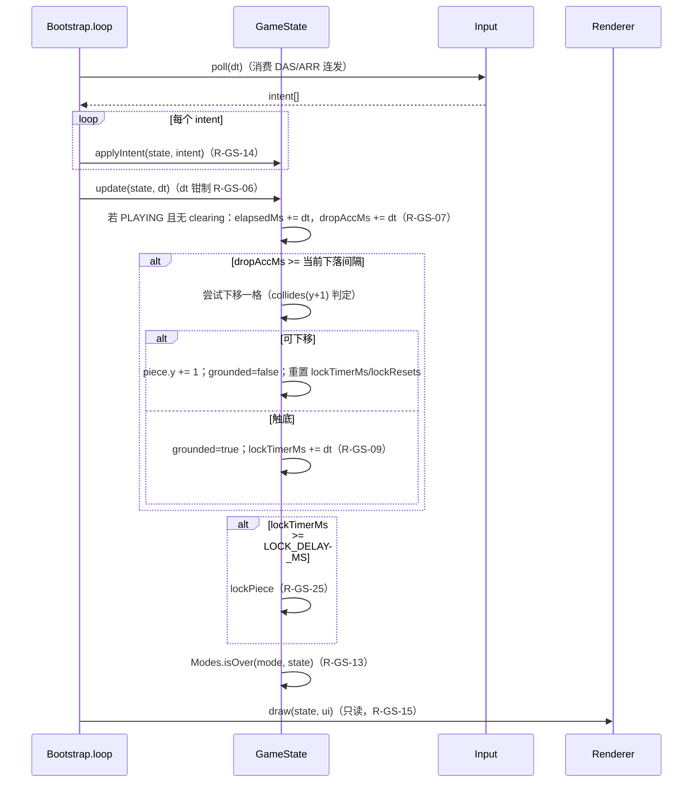

**业务规则：**

| 规则编号 | 规则描述 | 校验时机 | 不满足时的处理 |
|----------|----------|----------|----------------|
| R-GS-28 | 一帧内允许多格下落（高速等级/软降），但**至多一次锁定**（下移后必须重新判定触底） | 每帧 | — |
| R-GS-29 | 触底后 `dropAccMs` 归零，避免解锁后连续触发 | 触底时 | — |
| R-GS-30 | 硬降与锁定延迟的优先级：硬降立即锁定（忽略剩余锁延） | 每次硬降 | — |
| R-GS-31 | 消行动画期间 `elapsedMs` 仍累加（Ultra 计时不因动画暂停），但重力与锁延不推进 | 每帧 | — |

##### 5.7.4.2 旋转（含踢墙）与移动（F06、F07）

- 处理时序图：

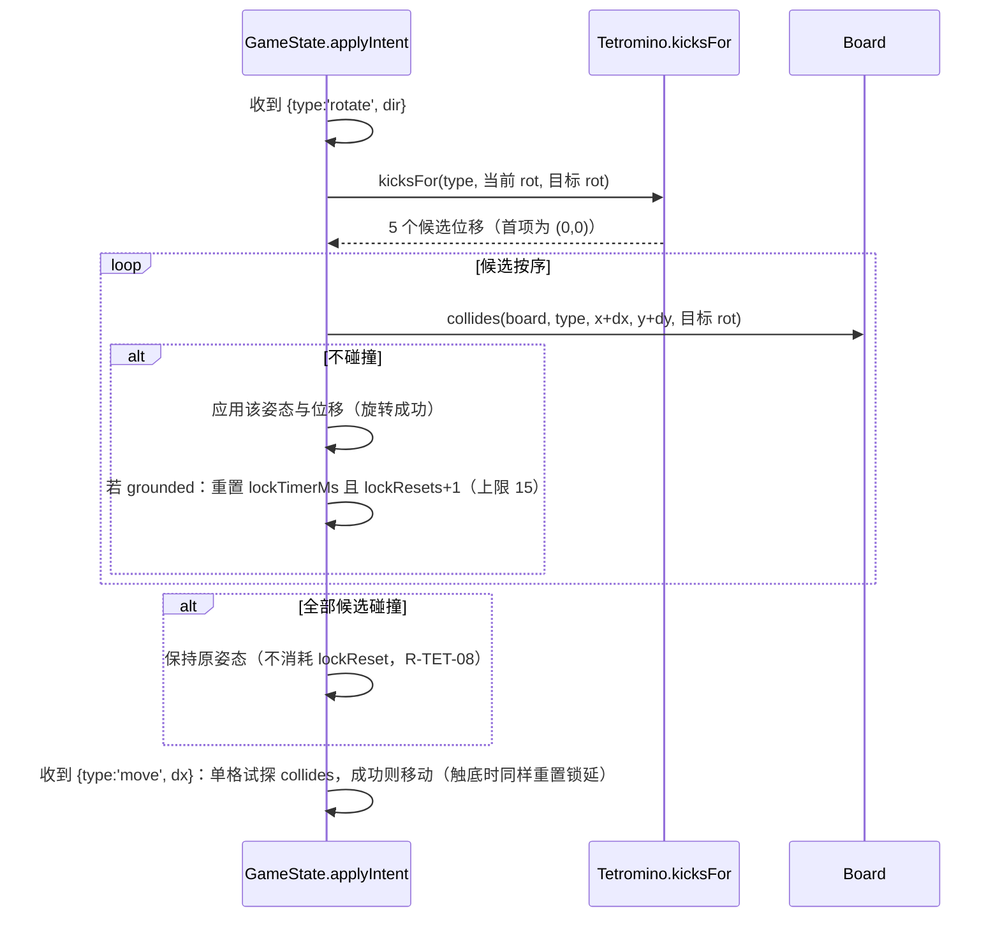

**业务规则：**

| 规则编号 | 规则描述 | 校验时机 | 不满足时的处理 |
|----------|----------|----------|----------------|
| R-GS-32 | 踢墙候选必须**按序**试探，首个合法即生效，不得跳序、不得全量择优 | 每次旋转 | — |
| R-GS-33 | 旋转/移动成功后需重新计算 `grounded`（可能离地）；离地则 `lockTimerMs=0`、`lockResets=0` | 每次成功操作 | — |
| R-GS-34 | 旋转失败不改变任何状态（不放音效、不计数、不消耗锁延重置次数） | 每次旋转 | — |
| R-GS-35 | 左右移动在贴墙时静默失败（碰撞则不变），不消耗锁延重置次数 | 每次移动 | — |

##### 5.7.4.3 状态机

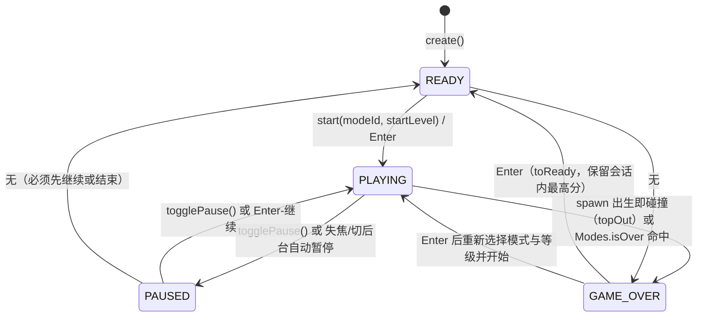

**状态流转规则：**

| 当前状态 | 目标状态 | 流转条件 | 前置校验 | 触发动作 |
|----------|----------|----------|----------|----------|
| `READY` | `PLAYING` | 按 `Enter` 且已选定模式与起始等级 | 模式 id 合法（否则回退马拉松）；起始等级钳制 `1..15` | `start`：重置棋盘/计分/计时/暂存，重建抽取器，立即 `spawn`，填充预览队列 |
| `PLAYING` | `PAUSED` | 按 `P`/`Esc`，或 `window.blur`，或 `document.hidden` | 当前无消行动画（动画期间可按暂停，动画计时冻结） | 冻结推进与 `elapsedMs`；**保留**全部计时值（`dropAccMs`/`lockTimerMs`/`clearing.timerMs`）；清空按键状态 |
| `PAUSED` | `PLAYING` | 按 `P`/`Esc` | — | 从冻结的计时值继续，不重置重力；恢复后首帧 `dt = 0`（`lastTs` 归零） |
| `PLAYING` | `GAME_OVER` | `spawn` 出生位置碰撞（`topOut`）或 `Modes.isOver` 为真 | 结束判定只在 `PLAYING` 参与（R-MODE-09） | 结算：写入 `message`；比较并更新 `ui.bestScore`；展示结算面板（按模式差异化文案 + 重开提示） |
| `GAME_OVER` | `READY` | 按 `Enter` | — | `toReady`：清空规则状态；保留 `SessionUI`（模式选择位置、起始等级、会话内最高分） |
| `READY`/`GAME_OVER` | 自身（忽略） | 收到 `move/rotate/softDrop/hardDrop/hold` | — | `STATE_001`：幂等忽略，不修改状态（R-GS-14） |

**孤岛状态检查**：无孤岛 —— `READY` 有出边（→`PLAYING`）、`PLAYING` 有入出边、`PAUSED` 可进可出、`GAME_OVER` 可回 `READY`；每个状态都可达且可离开。

#### 5.7.5 模块自检

| 检查维度 | 结论 |
|----------|------|
| 完备性对账 | F01/F23（开始/暂停/重开/自动暂停）→ 状态机表；F06/F07/F08/F09（操作与计分）→ R-GS-08/24/32/35；F10/F16（重力与锁延）→ R-GS-07/09/10；F11/F12（固化与消行）→ R-GS-25/R-GS-11；F13（幽灵块）→ R-GS-17；F14/F15（预览与暂存）→ R-GS-03/19/21/22；F17（计分）→ R-SCR-09 单点调用；F19–F21（模式结束）→ R-GS-13 |
| 过度设计检查 | 未实现「撤销/重放」「存档续玩」「AI 演示模式」「多线程 Worker 计算」；未引入通用事件总线或状态订阅机制（直接函数调用足够）；符合 YAGNI |

---

### 5.8 外壳 · `Input` 输入归一化模块

#### 5.8.1 数据结构设计

| 字段名 | 类型 | 约束 | 默认值 | 说明 |
|--------|------|------|--------|------|
| `pressed` | 集合/映射 | 键为动作名 | 空 | 当前按下的动作集合（按动作而非按键去重） |
| `dasTimerMs` | number | `>= 0` | 0 | 水平移动长按起步计时（达 `DAS_MS` 后转入 ARR 连发） |
| `arrTimerMs` | number | `>= 0` | 0 | 连发间隔计时（每达 `ARR_MS` 发射一次） |
| `lastDir` | number | `-1/0/1` | 0 | 当前生效的水平方向（后按者优先） |
| `softDropOn` | boolean | — | `false` | 软降是否处于按下状态 |
| `pendingAutoMs` | number | `>= 0` | 0 | 连发累计余量（帧间补偿） |

**索引**：本项不适用，原因：按键动作数量固定（≤9），集合查找 O(1)。

#### 5.8.2 枚举与常量定义

| 枚举名称 | 取值 | 含义 | 关联字段 |
|----------|------|------|----------|
| 动作名 | `MOVE_LEFT/MOVE_RIGHT/ROTATE_CW/ROTATE_CCW/SOFT_DROP/HARD_DROP/HOLD/PAUSE/START` | 与 `CONST.KEYS` 键一一对应 | `actionFor` 返回值 |
| 连发参数 | `DAS_MS`(170) / `ARR_MS`(50) | 长按起步延迟 / 连发间隔 | `dasTimerMs`/`arrTimerMs` |
| 按下沿语义 | 旋转/硬降/暂存/暂停只响应**非重复**的 `keydown` | 忽略系统自动重复 | `handleDown(code, isRepeat)` |

#### 5.8.3 接口详细设计

##### S24 输入归一化（`handleDown` / `handleUp` / `poll` / `reset` / `actionFor`）

- **描述**：把原始键盘事件归一化为 `intent`，并实现 DAS/ARR 长按连发；`poll(dt)` 由主循环每帧调用，产出本帧应执行的意图序列。
- **入参**：

| 参数名称 | 类型 | 是否必填 | 描述 |
|----------|------|----------|------|
| `code` | string | 是 | `event.code`（物理键位） |
| `isRepeat` | boolean | 是（`handleDown`） | 是否为系统自动重复的 `keydown` |
| `dtMs` | number | 是（`poll`） | 帧间隔毫秒 |

- **出参**：

| 参数名称 | 类型 | 描述 |
|----------|------|------|
| `handleDown` | `intent \| null` | 按下沿产生的即时意图；无映射或触发连发的按键返回 `null` |
| `handleUp` | `intent \| null` | 抬起沿产生的意图（典型为 `{type:'softDrop', on:false}`） |
| `poll` | `intent[]` | 本帧意图序列（含 ARR 连发产生的 `move`） |
| `actionFor` | `string \| null` | 键位对应的动作名；未映射返回 `null`（`INPUT_001`） |
| `reset` | `void` | 清空全部按键与计时状态（失焦/自动暂停时调用） |

- **错误码**：

| 错误码 | 说明 |
|--------|------|
| `INPUT_001` | 未映射按键 → 返回 `null`，不阻止默认行为 |

- **业务规则**：

| 规则编号 | 规则描述 | 校验时机 | 不满足时的处理 |
|----------|----------|----------|----------------|
| R-IN-01 | 旋转（`↑`/`X`/`Z`/`Ctrl`）、硬降（`Space`）、暂存（`C`/`Shift`）、暂停（`P`/`Esc`）**只响应按下沿**：`isRepeat` 为 `true` 时返回 `null` | 每次 `keydown` | 忽略，避免系统重复触发多次旋转/多块硬降 |
| R-IN-02 | 水平移动：按下沿立即产生 1 次 `move`，并启动 `dasTimerMs`；长按达 `DAS_MS`(170ms) 后进入 ARR，每 `ARR_MS`(50ms) 产生一次 `move` | 每次按下与每帧 `poll` | — |
| R-IN-03 | 左右同时按下：后按者优先（`lastDir`），松开后回退到仍按住的另一侧 | 每次按下/抬起 | 两侧均松开则停止连发 |
| R-IN-04 | 软降：`↓` 按下产生 `{softDrop, on:true}`，抬起产生 `{softDrop, on:false}`；抬起沿必须可靠发出（含反向 Tab 切走场景由 `reset` 兜底） | 每次按下/抬起 | — |
| R-IN-05 | `poll(dt)` 使用帧内 `dt` 驱动 DAS/ARR 计时，并保留余量（`dt` 大于多个 `ARR_MS` 时一次产出多个 `move`，不丢格） | 每帧 | — |
| R-IN-06 | `reset()` 清空按键集合与全部计时器（`dasTimerMs/arrTimerMs/lastDir/softDropOn`），防止失焦后「按键粘住」 | 失焦/切后台/暂停 | — |
| R-IN-07 | 输入层不接触 `GameState`：只产出 intent，不修改游戏状态 | 始终 | 视为分层缺陷 |

#### 5.8.4 子功能详细设计

##### 5.8.4.1 长按连发（DAS/ARR）与按下沿（F06）

- 处理时序图：

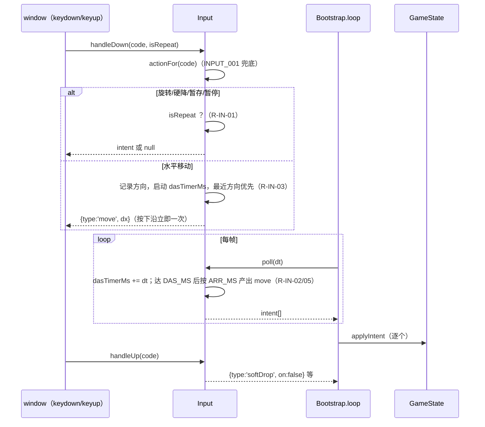

**业务规则：**

| 规则编号 | 规则描述 | 校验时机 | 不满足时的处理 |
|----------|----------|----------|----------------|
| R-IN-08 | 所有游戏内按键在 `keydown` 时统一 `preventDefault()`（防止方向键/空格滚动页面） | 每次按下 | 未阻止即视为缺陷（自测静态断言） |
| R-IN-09 | 输入映射基于 `event.code`（物理键位），不受键盘布局/输入法影响 | 始终 | — |
| R-IN-10 | 同一动作的多个键位（如旋转 `↑`/`X`）语义完全一致 | 始终 | — |
| R-IN-11 | 不注册任何触控事件（`touch*`/`pointerdown`），不渲染屏幕按键 | 始终 | 出现触控监听即为范围违规（自测静态断言） |

**异常场景：**

| 异常场景 | 处理方式 |
|----------|----------|
| 切后台/失焦导致 `keyup` 丢失（按键粘住） | `blur`/`visibilitychange` → `reset()`（R-IN-06）+ 自动暂停，避免持续移动或持续软降 |
| 长按时间超过数秒（ARR 连续出格） | 每格前做碰撞判定，贴墙后静默失败，不产生错误状态（R-GS-35） |
| 输入法/中文输入状态下按键 | 使用 `event.code` 映射，不受输入法影响；`preventDefault` 避免触发页面行为 |
| 系统按键重复速率极高 | 旋转/硬降/暂存/暂停忽略重复（R-IN-01），仅移动使用受控 ARR |
| 未映射按键（如 F5、字母键） | `INPUT_001` 返回 `null`，不 `preventDefault`，保持浏览器原生行为 |

**并发控制：**
- 并发场景：**存在「事件任务」与「渲染帧任务」交错** —— `keydown` 可能在两帧之间多次触发。
- 控制策略：`handleDown/handleUp` 只**写入输入层自身状态**并返回即时 intent（由 `Bootstrap` 立即转发），而长按连发产生的 intent 全部由主循环内的 `poll(dt)` 统一产出 → 输入状态与游戏状态的写入都在主线程串行发生，无需锁；`Input` 不持有游戏状态引用（R-IN-07），杜绝跨任务写冲突。

#### 5.8.5 模块自检

| 检查维度 | 结论 |
|----------|------|
| 完备性对账 | F06（移动 + DAS/ARR）→ R-IN-02/03/05；F07（旋转按下沿）→ R-IN-01；F08（软降开关）→ R-IN-04；F09（硬降）→ R-IN-01；F15（Hold）→ R-IN-01；F23（暂停键）→ R-IN-01；F23/§附录 A-20（不滚动页面、无触控）→ R-IN-08/11 |
| 过度设计检查 | 未实现「键位自定义/改键面板」「手柄/触控支持」「输入录制回放」；DAS/ARR 参数固定于 `CONST`，符合 YAGNI |

---

### 5.9 外壳 · `Renderer` 渲染模块

#### 5.9.1 数据结构设计

| 字段名 | 类型 | 约束 | 说明 |
|--------|------|------|------|
| `els.board` | `HTMLCanvasElement` | 必须存在，否则该层跳过绘制（`RENDER_001`） | 主棋盘画布 |
| `els.next` | `HTMLCanvasElement` | 同上 | Next 预览画布 |
| `els.hold` | `HTMLCanvasElement` | 同上 | Hold 暂存画布 |
| `ctxBoard/ctxNext/ctxHold` | `CanvasRenderingContext2D` | 2D 上下文 | 三层绘制上下文 |
| `statsEls` | `{score,level,lines,progressLabel,progress}` | DOM 元素引用 | 侧栏数字与进度文案目标节点 |
| `dpr` | number | `devicePixelRatio`，缺省 1 | 高清屏缩放系数 |

**画布尺寸与坐标（由常量派生）**

| 画布 | 逻辑尺寸（CSS px） | backing store 尺寸 | 说明 |
|------|--------------------|--------------------|------|
| `#board` | `COLS × CELL` × `ROWS × CELL` = 300 × 600 | 逻辑尺寸 × `dpr` | 只绘制可视 20 行，隐藏 2 行不绘制（统一 `- HIDDEN_ROWS` 行偏移） |
| `#next` | 约 200 × 200（按 `NEXT_COUNT` 均分） | 同上 × `dpr` | 竖向排列 3 个预览块 |
| `#hold` | 约 200 × 60 | 同上 × `dpr` | 单个暂存槽 |

**索引**：本项不适用，原因：逐帧线性遍历绘制，无检索需求。

#### 5.9.2 枚举与常量定义

| 枚举名称 | 取值 | 含义 | 关联字段 |
|----------|------|------|----------|
| 绘制层次顺序 | 背景 → 网格 → 已固定块 → 幽灵块 → 当前方块 → 侧栏迷你面板 → 统计数字/进度 | 固定绘制顺序（覆盖关系确定） | `draw` 内部顺序 |
| 方块填充色 | `CONST.COLORS[type]` | 按方块类型取色 | 棋盘格 / 当前块 / 迷你面板 |
| 幽灵块样式 | 半透明描边 `GHOST_STROKE` | 仅描边不填充，与实体块可区分 | 幽灵块 |
| 消行闪白 | `#f8fafc`（命中行整格闪白） | 动画期间视觉效果 | `state.clearing.rows` |
| 覆盖层可见性 | 由 `state.status` 决定（`PLAYING` 时隐藏） | 遮罩显隐规则 | `overlay` 元素 |

#### 5.9.3 接口详细设计

##### S25 渲染（`attach` / `bindStats` / `setup` / `draw` / `drawMini`）

- **描述**：`attach` 绑定三个画布；`bindStats` 绑定侧栏数字节点；`setup` 按 `dpr` 设置画布尺寸并返回 2D 上下文；`draw(state, ui?)` 渲染一帧（只读 `state`）；`drawMini` 供 Next/Hold 内部复用。
- **入参**：

| 参数名称 | 类型 | 是否必填 | 描述 |
|----------|------|----------|------|
| `{board,next,hold}` | 元素集合 | 是（`attach`） | 三个画布元素 |
| `els` | 元素集合 | 是（`bindStats`） | 侧栏 `#score/#level/#lines/#progress-label/#progress` |
| `canvas` / `cssW` / `cssH` | `HTMLCanvasElement` / number / number | 是（`setup`） | 目标画布与 CSS 逻辑尺寸 |
| `state` | `GameState` | 是（`draw`） | 只读状态快照 |
| `ui` | `SessionUI` | 否 | 会话界面状态（当前不需要额外字段，保留扩展位） |

- **出参**：

| 参数名称 | 类型 | 描述 |
|----------|------|------|
| `setup` | `CanvasRenderingContext2D` | 已完成 DPR 缩放的 2D 上下文 |
| `attach`/`bindStats`/`draw`/`drawMini` | `void` | 无返回 |

- **错误码**：

| 错误码 | 说明 |
|--------|------|
| `RENDER_001` | 画布元素缺失或 2D 上下文不可用 → 跳过该层，逻辑继续 |

- **业务规则**：

| 规则编号 | 规则描述 | 校验时机 | 不满足时的处理 |
|----------|----------|----------|----------------|
| R-RND-R1 | `draw` 必须为**只读**：不得写入 `state` 任何字段（渲染是状态的纯函数输出） | 每帧 | 违反即为分层缺陷（R-GS-15 同源约束） |
| R-RND-R2 | 隐藏缓冲行（`y < HIDDEN_ROWS`）不绘制；所有绘制坐标统一减去 `HIDDEN_ROWS` 行偏移 | 每帧 | — |
| R-RND-R3 | 幽灵块位置必须来自 `GameState.ghostY(state)`（与硬降落点同一判定），且当与当前方块位置重合时不绘制 | 每帧 | — |
| R-RND-R4 | 消行动画期间，命中行整格闪白，动画结束行被移除后自然消失（不额外做淡出） | 每帧 | — |
| R-RND-R5 | 侧栏数字与模式进度每帧与 `state` 对齐（`score/level/lines` + `mode.progressLabel/progressText`） | 每帧 | 数字与状态不一致即为缺陷 |
| R-RND-R6 | 画布 backing store 尺寸 = 逻辑尺寸 × `dpr`，并按 `dpr` 缩放上下文，保证高清屏不模糊 | `attach`/`setup`/`resize` | — |
| R-RND-R7 | `draw` 单帧耗时预算 < 5ms（约 220 格网格 + 数十个方块绘制），不得每帧创建大量临时对象 | 每帧 | 超出则优化绘制（减少对象分配、复用路径） |

#### 5.9.4 子功能详细设计

##### 5.9.4.1 棋盘/幽灵块/迷你面板与 DPR 适配（F13、F14、F25）

- 处理时序图：

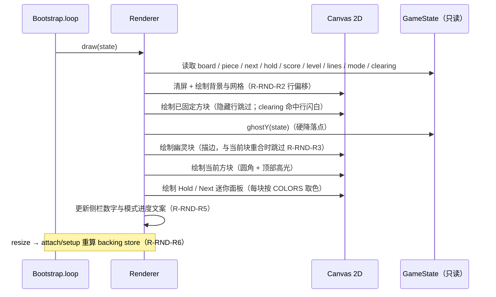

**业务规则：**

| 规则编号 | 规则描述 | 校验时机 | 不满足时的处理 |
|----------|----------|----------|----------------|
| R-RND-R8 | 覆盖层显隐与文案由 `Bootstrap.syncOverlay` 负责，`Renderer` 不做状态判断以外的界面决策 | 每帧 | — |
| R-RND-R9 | 三个画布尺寸随窗口变化重算（`resize`），重算后立即重绘，避免模糊或错位 | 每次 resize | — |
| R-RND-R10 | 中文界面：侧栏标签与覆盖层文案均为中文（`HOLD`/`NEXT` 作为游戏术语保留英文标签，其余中文） | 始终 | — |

**异常场景：**

| 异常场景 | 处理方式 |
|----------|----------|
| `getContext('2d')` 返回 `null` | `RENDER_001` 跳过绘制，逻辑与输入仍可用（无崩溃） |
| 画布被外部脚本移除/替换 | 同上，逐帧重新判空后跳过 |
| `devicePixelRatio` 变化（缩放窗口、拖到不同 DPI 屏） | `resize` 触发重算 backing store 与缩放，恢复清晰 |
| 窗口极小导致画布被压缩 | 采用固定逻辑尺寸（300×600），滚动/挤压由 CSS 处理，不改变绘制坐标系 |
| 消行动画期间 `clearing.rows` 为空数组 | 视为无闪烁行，正常绘制（防御性判空） |
| 方块位于隐藏缓冲（`y<0` 的格） | 跳过该格绘制（R-RND-R2） |

**并发控制：**
- 并发场景：无写冲突（`draw` 只读 `state`，与 `GameState` 的写发生在同一主循环的不同阶段，天然串行）。
- 控制策略：不需要锁，原因：单线程 + 只读渲染 + 每帧独立完成。

#### 5.9.5 模块自检

| 检查维度 | 结论 |
|----------|------|
| 完备性对账 | F13（幽灵块）→ R-RND-R3；F14（Next 预览）→ R-RND-R5/迷你面板绘制；F15（Hold 展示）→ 同上；F25（视觉与中文）→ R-RND-R10；F26（DPR/兼容）→ R-RND-R6；F01/F02（无外链资源）→ 全部绘制用 Canvas 生成，不引用图片/字体文件 |
| 过度设计检查 | 未实现「粒子上浮动画」「连消特效」「主题切换」「屏幕旋转适配」；未引入 WebGL/离屏画布优化（Canvas 2D 已满足帧预算），符合 YAGNI |

---

### 5.10 外壳 · `Bootstrap` 引导与主循环模块

#### 5.10.1 数据结构设计

| 字段名 | 类型 | 约束 | 默认值 | 说明 |
|--------|------|------|--------|------|
| `state` | `GameState` | 全局唯一实例 | `GameState.create()` | 会话状态 |
| `ui.modeIndex` | number | `0..Modes.list.length-1` | 0 | 面板当前选中模式下标 |
| `ui.startLevel` | number | `1..15` | `START_LEVEL_MIN` | 面板当前选中起始等级 |
| `ui.bestScore` | number | `>= 0` | 0 | **会话内**最高分（内存，不持久化） |
| `ui.lastStatus` | string | 状态枚举 | `READY` | 上一次已同步到界面的状态（用于检测状态变化） |
| `lastTs` | number | `>= 0` | 0 | 上一帧时间戳；0 表示重新起算（首帧/恢复后） |
| DOM 引用 | 元素集合 | 页面加载时一次性获取 | — | `#board/#next/#hold/#overlay/#overlay-title/#overlay-sub/#mode-list/#level-list/#score/#level/#lines/#progress-label/#progress` |
| `allCodes` | string[] | 游戏键全集（去重） | 由 `CONST.KEYS` 计算 | 统一 `preventDefault` 用 |

**索引**：本项不适用。

#### 5.10.2 枚举与常量定义

| 枚举名称 | 取值 | 含义 | 关联字段 |
|----------|------|------|----------|
| 面板文案（READY） | 标题「俄罗斯方块」/ 副标题「选择模式与起始等级，按 Enter 开始」 | 开始面板文案 | `ui.lastStatus = READY` |
| 面板文案（PAUSED） | 标题「已暂停」/ 副标题「按 P 继续」 | 暂停遮罩文案 | `PAUSED` |
| 面板文案（GAME_OVER） | 标题「本局结束 · {message}」或「目标达成」；副标题=模式结算文案 + 本会话最佳 + 重开提示 | 结算面板文案 | `GAME_OVER` |
| 面板导航 | `←/→` 切模式，`↑/↓` 切起始等级，`Enter` 开始/重开 | 键鼠双通道 | `onReadyNavigation` |

#### 5.10.3 接口详细设计

##### 引导与主循环（内部函数，非对外接口）

| 函数 | 入参 | 出参 | 描述 |
|------|------|------|------|
| `layout()` | 无 | `void` | 绑定画布并按 DPR 重算尺寸（`resize` 复用） |
| `buildChoices()` | 无 | `void` | 生成模式按钮（`Modes.list`）与起始等级按钮（1–15），绑定点击选中 |
| `syncOverlay()` | 无 | `void` | 按 `state.status` 切换覆盖层显隐、按钮高亮与文案 |
| `startGame()` | 无 | `void` | 以 `ui.modeIndex/ui.startLevel` 调用 `GameState.start` |
| `onEnter()` | 无 | `void` | `READY` 时开局；`GAME_OVER` 时回到 `READY` |
| `onReadyNavigation(code)` | `code` | `boolean` | 面板键位导航（模式/等级），未处理返回 `false` |
| `onKeyDown(e)` / `onKeyUp(e)` | 事件对象 | `void` | 统一 `preventDefault`；`Enter` 特殊处理；其余转 `Input` 并转发 intent |
| `autoPause()` | 无 | `void` | `Input.reset()` + 播放中则暂停 + `lastTs = 0` |
| `loop(ts)` | 时间戳 | `void` | 主循环：`dt` 计算 → `Input.poll` → `applyIntent` → `update` → `draw` → 状态变化同步 |
| `bootstrap()` | 无 | `void` | 自执行初始化：`buildChoices → layout → bindStats → syncOverlay → 事件绑定 → requestAnimationFrame(loop)` |

##### S25-adjacent 主循环时序（`loop`）

- **入参**：`ts`（`requestAnimationFrame` 提供的高精度时间戳）。
- **出参**：`void`（内部更新 `state` 与界面）。
- **错误码**：`STATE_001`（非法 intent 被内核幂等忽略）。
- **业务规则**：

| 规则编号 | 规则描述 | 校验时机 | 不满足时的处理 |
|----------|----------|----------|----------------|
| R-BOOT-01 | `dt` 计算：首帧或恢复后（`lastTs === 0`）取 0；否则取 `ts - lastTs`；`lastTs` 每帧更新 | 每帧 | 杜绝恢复瞬间的巨量 `dt`（与内核钳制双保险） |
| R-BOOT-02 | 每帧顺序固定：`poll` → 逐个 `applyIntent` → `update` → `draw` → 状态变化检测 | 每帧 | 顺序颠倒（如先 draw 后 update）会导致视觉滞后一帧 |
| R-BOOT-03 | 状态变化检测：`state.status !== ui.lastStatus` 时，若进入 `GAME_OVER` 且 `state.score > ui.bestScore` 则更新会话内最高分，随后 `syncOverlay()` 并更新 `ui.lastStatus` | 每次状态变化 | — |
| R-BOOT-04 | `autoPause` 绑定 `window.blur` 与 `document.visibilitychange`（`document.hidden` 为真时）；恢复后 `lastTs = 0` 重新起算 | 事件触发 | 缺失即违反 F23 验收 |
| R-BOOT-05 | 游戏键全集统一 `preventDefault()`，防止方向键/空格滚动页面 | 每次按下 | 页面滚动即为缺陷 |
| R-BOOT-06 | `Enter` 由 `Bootstrap` 直接处理（不经过 `Input` 的 intent 通道）；重复按键（`isRepeat`）忽略 | 每次按下 | 长按 `Enter` 不会连续开局 |
| R-BOOT-07 | 面板为键鼠双通道：键盘 `←/→/↑/↓` 与鼠标点击等效，选中项高亮（`active` 类） | 每次交互 | — |
| R-BOOT-08 | 页面加载后立即渲染一帧（READY 面板可见、画布空白网格已绘制），不出现「黑屏等待」 | 引导末尾 | — |
| R-BOOT-09 | 引导期自检：DOM 元素齐全 + `CONST` 合法性（R-CONST-03/04）；不通过输出 `CONST_001`/`RENDER_001` 并终止进入主循环 | 引导时 | — |

#### 5.10.4 子功能详细设计

##### 5.10.4.1 主循环与模式选择面板（F19–F23、F01）

- 处理时序图：

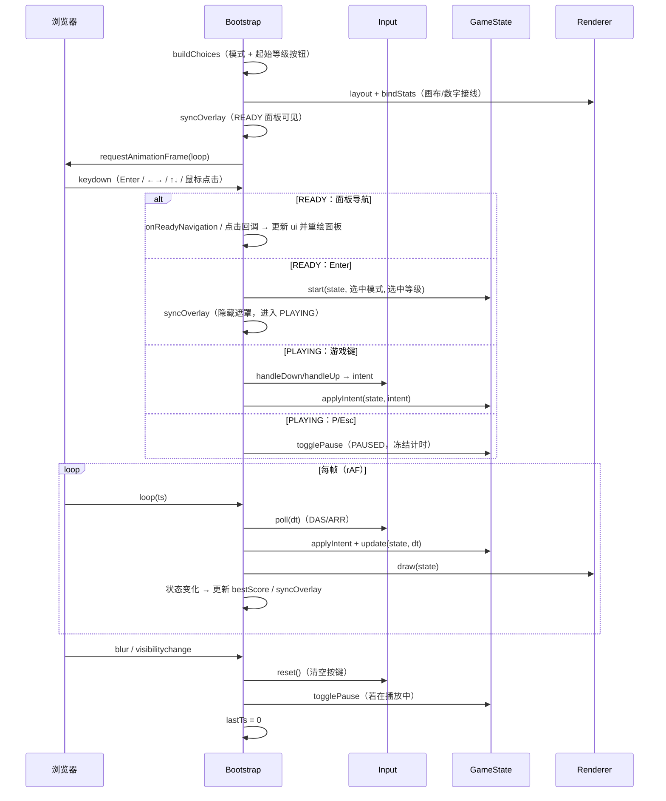

**业务规则：**

| 规则编号 | 规则描述 | 校验时机 | 不满足时的处理 |
|----------|----------|----------|----------------|
| R-BOOT-10 | 模式选择与起始等级选择必须对三种模式与 1–15 等级全部可用（按钮数量 = 3 + 15） | 引导时 | 数量不符即为缺陷 |
| R-BOOT-11 | 结算面板按 `Enter` 返回 READY，可换模式/换等级重开，且 `ui.bestScore` 保留 | 每次结算后 | — |
| R-BOOT-12 | 刷新页面回到 READY（无持久化，F24/A14），不残留上一局数据 | 每次加载 | 出现持久化痕迹即为范围违规 |
| R-BOOT-13 | 不注册任何网络请求（无 fetch/XHR、无外链资源），页面在断网下功能完整 | 始终 | 违反 F01/F02 |

**异常场景：**

| 异常场景 | 处理方式 |
|----------|----------|
| 开局瞬间用户连按 `Enter` | `isRepeat` 忽略 + `READY` 已离开 → `STATE_001` 幂等忽略（R-BOOT-06） |
| 切后台长时间后再回来 | 自动暂停（R-BOOT-04）+ `lastTs=0` + 内核 `dt` 钳制，方块不瞬间掉落 |
| 窗口 resize 至画布被挤压 | `layout()` 重算画布，保持逻辑坐标不变（R-RND-R9） |
| 用户用鼠标点击面板后立即按空格 | 按钮点击后 `blur()` 释放焦点，`Space` 映射为硬降而非「再次点击按钮」 |
| 结算后用户切后台再回来 | 状态为 `GAME_OVER`，`autoPause` 不改变状态（仅清按键），面板保持结算信息 |
| 浏览器标签页被节流（后台 rAF 停摆） | 恢复时 `lastTs=0` 重新起算，`dt` 为 0，无补偿性掉落（R-BOOT-01） |

**并发控制：**
- 并发场景：**事件回调与动画帧回调交错**（键盘/点击/失焦事件 vs rAF 帧）；以及 `resize` 与绘制交错。
- 控制策略：不需要锁，原因：单线程事件循环，所有状态写入都发生在同一线程的**串行任务**中；且写入唯一入口是 `GameState`，`Renderer.draw` 只读、`Input` 只产出 intent。为避免「事件任务中途打断帧任务」的可见性问题，`layout()`（画布重算）只在 `attach`/`resize` 时执行，不与 `draw` 并发。

#### 5.10.5 模块自检

| 检查维度 | 结论 |
|----------|------|
| 完备性对账 | F01（双击即玩/无网络）→ R-BOOT-13；F19–F21（模式选择与结算）→ R-BOOT-10/11 + §5.6；F22（起始等级选择）→ R-BOOT-10；F23（暂停/自动暂停/重开）→ R-BOOT-04/11；F24（会话内最高分）→ R-BOOT-03/12；F26（resize/DPR）→ R-RND-R9；F28（自测不阻塞交付）→ tools/ 目录与页面解耦 |
| 过度设计检查 | 未实现「路由/多页面」「配置持久化面板」「启动时长优化（懒加载）」；事件绑定为直接函数引用，未引入事件总线；符合 YAGNI |

---

### 5.11 跨模块时序图

##### 5.11.1 一局开始（READY → PLAYING）

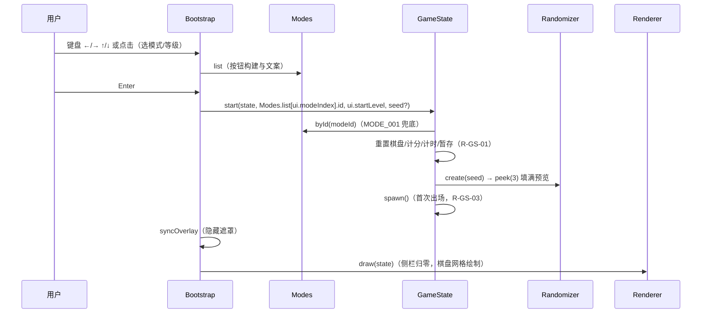

##### 5.11.2 一次操作到落地消行的完整链路

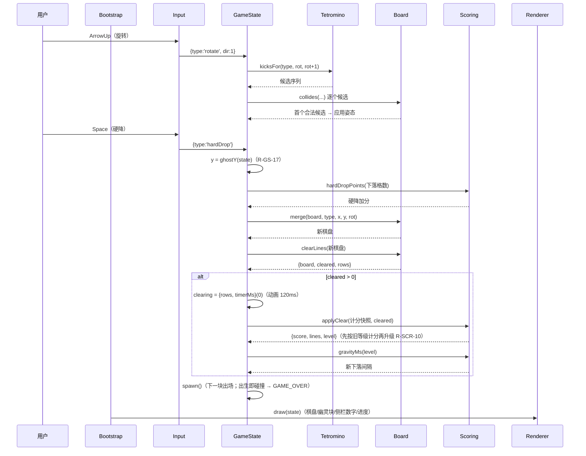

##### 5.11.3 暂停、自动暂停与结算重开

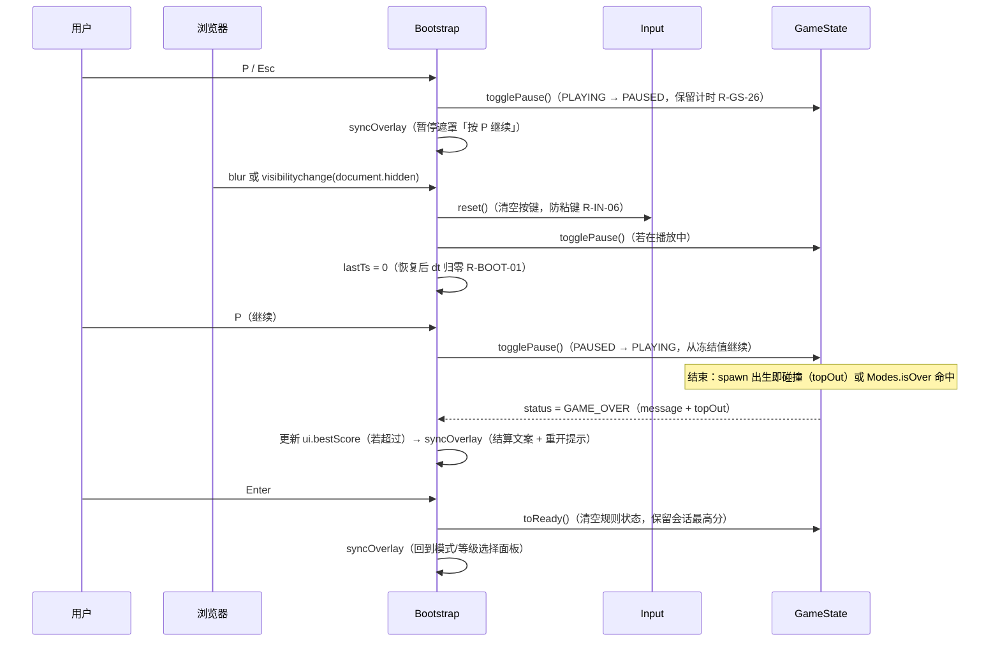

---

### 5.12 模块自检汇总

**完备性对账（功能点 → 设计落点）**

| 功能编号 | 设计落点 | 覆盖结论 |
|----------|----------|----------|
| F01 `file://` 打开即玩 | §2.4 方案 A；§5.10 R-BOOT-13；§附录 A-1 | 覆盖 |
| F02 单文件零依赖 | §2.1/§2.2；§5.9（全部图形由 Canvas 绘制，无外链资源） | 覆盖 |
| F03 独立 README | §附录 C 交付物清单；§附录 B（README 覆盖度断言） | 覆盖 |
| F04 棋盘 10×20+2 | §5.1.1；§5.4.1 | 覆盖 |
| F05 7 种方块与配色 | §5.1.2；§5.2.1/5.2.2 | 覆盖 |
| F06 移动（DAS/ARR） | §5.8 R-IN-02/03/05 | 覆盖 |
| F07 SRS 旋转 + 踢墙 | §5.2.1 踢墙表；§5.7 R-GS-32/33/34 | 覆盖 |
| F08 软降 | §5.5 S14；§5.7 R-GS-08 | 覆盖 |
| F09 硬降 | §5.5 S14；§5.7 R-GS-24 | 覆盖 |
| F10 自动下落与升级 | §5.5 S15；§5.7 R-GS-07 | 覆盖 |
| F11 碰撞与固化 | §5.4 S07/S08 | 覆盖 |
| F12 满行消除与动画 | §5.4 S09/S10；§5.7 R-GS-11 | 覆盖 |
| F13 幽灵块 | §5.7 R-GS-17；§5.9 R-RND-R3 | 覆盖 |
| F14 Next 预览 3 | §5.3 R-RND-08；§5.9 迷你面板 | 覆盖 |
| F15 Hold | §5.7 R-GS-21/22/23；§5.9 迷你面板 | 覆盖 |
| F16 锁定延迟 | §5.7 R-GS-09/10 | 覆盖 |
| F17 Guideline 计分与升级 | §5.5 S13/S16；R-SCR-09 | 覆盖 |
| F18 7-bag | §5.3 R-RND-01/02/06 | 覆盖 |
| F19 马拉松 | §5.6 R-MODE-02/10 | 覆盖 |
| F20 40 行竞速 | §5.6 R-MODE-03/10 | 覆盖 |
| F21 限时冲刺 | §5.6 R-MODE-04/10 | 覆盖 |
| F22 起始等级 1–15 | §5.1.1；§5.5 R-SCR-07；§5.10 R-BOOT-10 | 覆盖 |
| F23 暂停/自动暂停/重开 | §5.7 状态机；§5.10 R-BOOT-04/11 | 覆盖 |
| F24 会话内最高分 | §5.10 R-BOOT-03/12 | 覆盖 |
| F25 中文与视觉 | §5.9 R-RND-R10；§5.10.2 文案表 | 覆盖 |
| F26 浏览器兼容 | §1 兼容性约束；§5.9 R-RND-R6 | 覆盖 |
| F27 参数集中 | §5.1 R-CONST-01/05 | 覆盖 |
| F28 开发期自测 | §附录 B | 覆盖 |

**过度设计检查（全局）**

| 检查项 | 结论 |
|--------|------|
| 是否为范围外需求预留结构 | 否。未引入账号/排行榜/存档/皮肤/音效/触控的任何结构或开关 |
| 是否引入不需要的抽象 | 否。无事件总线、无插件体系、无依赖注入、无通用 ORM/仓储层 |
| 是否引入不需要的依赖 | 否。零第三方运行时依赖；自测脚本为开发工具且不属于交付物运行路径 |
| 是否有机可乘的「万能工具类」 | 否。模块均单一职责，无 `utils` 大杂烩 |
| 是否存在重复实现 | 否。计分仅 `Scoring`、碰撞仅 `Board`、时钟仅主循环、模式判定仅 `Modes`（R-SCR-09/R-GS-15 强约束） |
| 是否所有功能点都有落点 | 是。见上方对账表 |

---

## 6. 非功能性需求设计

### 6.1 高可用性

- **无下游依赖**：应用不调用任何外部服务（无 HTTP/RPC/第三方脚本/外部资源），因此不存在「下游异常导致本系统不可用」的场景；集成面仅浏览器宿主能力（§2.2）。
- **本地自我可用**：唯一运行前提是用户本地存在 `index.html` 与一个受支持的桌面浏览器；断网、无服务器、无构建环境均不影响完整功能。
- **容错与降级**：`Renderer` 在画布/上下文不可用时跳过绘制（`RENDER_001`），逻辑与输入仍可推进，不崩溃、不死循环；`Modes.byId` 未知 id 回退马拉松（`MODE_001`）；`Tetromino` 踢墙键缺失回退 `(0,0)`（`TETROMINO_002`）。
- **无状态可重建**：页面刷新即得到全新可用实例（无持久化、无中间状态残留），不存在「坏状态需要人工修数据」的问题。

### 6.2 可扩展性

- **水平/垂直扩缩容**：本项不适用，原因：无服务端实例，不存在扩缩容概念；如需多端分发，复制单文件即可无限分发。
- **架构可扩展性**：内核/外壳分层 + 全部规则数值集中于 `CONST` + 模式数据化配置，使以下扩展无需改动核心逻辑：新增模式（追加一条 `ModeConfig`）、调整手感与计分（改 `CONST`）、替换视觉（改 `COLORS`/样式）、未来工程化（按 §2.1 边界拆成多文件并引入打包与测试框架）。
- **兼容实现替换**：若未来需要外部存储或在线排行榜，可在 `Bootstrap` 侧新增适配层，内核与渲染不受影响（当前范围外，不做预留实现）。

### 6.3 稳定性/可靠性

- **时间健壮性**：`dt` 双保险（外壳首帧/恢复归零 + 内核 `MAX_DT_MS` 钳制），切后台或标签页节流后恢复不产生瞬时多格掉落。
- **状态健壮性**：状态机幂等（`STATE_001`），非法迁移与非法 intent 一律忽略；刷新即回到 `READY`，不存在卡死在中间态。
- **边界健壮性**：出生即碰撞 → `topOut` 正常结算（不死循环）；踢墙全失败 → 保持原姿态；面板未选择 → 默认马拉松 + 等级 1；`piece = null` 时所有查询接口返回安全值。
- **数值健壮性**：等级与分数单调不降；重力间隔有下限；时间展示不为负；计分行数越界按 0 处理。
- **纯函数保护**：`Board`/`Scoring`/`Tetromino` 为纯函数或只读数据，输入输出无共享可变引用，消除「渲染期意外改状态」类缺陷。

### 6.4 安全性设计

#### 6.4.1 账户系统方案

本项不适用，原因：无账号、无登录、无鉴权（单机本地运行，无服务端）。不接入任何统一登录/身份服务。

#### 6.4.2 授权与访问控制

##### 6.4.2.1 是否实现水平权限检查

本项不适用，原因：不存在数据库查询与多用户资源，无「同租户不同用户访问他人数据」的可能。

##### 6.4.2.2 是否实现垂直权限检查

本项不适用，原因：无角色与后台，不存在高权限操作入口。

##### 6.4.2.3 是否检查登录态

本项不适用，原因：无登录态概念；页面不发起任何带凭证的请求。

#### 6.4.3 数据防护方案

##### 6.4.3.1 是否对敏感数据加密存储

本项不适用，原因：不采集、不存储任何用户数据（无表单、无账号、无地址/身份证/银行卡等敏感字段）；无存储即无加密需求。

##### 6.4.3.2 是否对敏感数据展示进行脱敏

本项不适用，原因：界面仅展示游戏内部状态（分数、等级、消行、时间），无个人信息可展示。

#### 6.4.4 其他安全面（本设计主动约束）

| 安全面 | 设计约束 |
|--------|----------|
| 脚本注入（XSS） | 无用户输入回填（不接收文本输入），界面文案为静态中文常量；模式按钮文案来自代码内配置而非外部数据 |
| 远程资源与供应链 | 零第三方脚本/样式/字体/图片；源码不得出现 `http(s)://`、外部 `src=`/`href=`（§附录 B 静态断言） |
| 隐私与权限 | 不申请任何浏览器敏感权限（无摄像头/麦克风/定位/剪贴板/通知），无网络请求，无遥测上报 |
| 本地存储与痕迹 | 不读写 `localStorage`/`sessionStorage`/`document.cookie`，关闭页面后无残留数据 |
| Canvas 内容安全 | 不加载外部图像（无 `drawImage` 外链、无像素读取），不涉及跨域画布污染 |

### 6.5 监控/统计/日志/告警

- **远端监控/告警**：本项不适用，原因：无服务端、无网络上报通道（也符合「不发起任何网络请求」的硬约束）；不上报任何数据。
- **本地等价监控（设计保留）**：以浏览器控制台为观测面，覆盖启动自检（`CONST_001`）、渲染降级（`RENDER_001`）、非法状态迁移（`STATE_001`）、计分越界（`SCORING_001`）与未映射按键（`INPUT_001`）等关键异常码；开发期通过 `tools/selftest.mjs` 汇总断言结果（`selftest: N passed, M failed`）。
- **埋点范围**：不做业务埋点（无统计需求），不引入日志框架；异常码与断言汇总即全部可观测信号。

---

## 7. 变更三板斧

### 7.1 可监控

| 观测点 | 设计 | 判定标准 |
|--------|------|----------|
| 启动自检 | `CONST` 合法性与键位完整性校验；不通过输出 `CONST_001` 并终止引导 | 控制台无 error；READY 面板可交互 |
| 运行期异常 | 统一异常码输出（`STATE_001`/`SCORING_001`/`INPUT_001`/`RENDER_001`/`MODE_001`） | 正常游玩下无异常码输出 |
| 帧推进 | 主循环每帧完成 `update + draw`；单帧预算 < 5ms | 帧率稳定 60fps，无明显卡顿 |
| 逻辑正确性 | 开发期 `node tools/selftest.mjs` 汇总断言（内核纯逻辑全量覆盖） | `failed = 0` 方可进入下一任务 |
| 合规红线 | 静态断言：无外链、无 `type="module"`、无触控监听、无本地存储 | 断言全部通过 |

### 7.2 可灰度

**结论：本项不适用，原因**：交付物是本地打开的静态单文件，无服务端入口、无流量分配面，不存在按租户/用户尾号引流的技术前提。

**等价演进手段（方案对比 + 推荐）**：

| 方案 | 做法 | 优点 | 缺点 | 结论 |
|------|------|------|------|------|
| A. 版本化文件名并存 | 新旧版本以文件名区分（如带日期后缀）同时保留，用户自行选择打开 | 零成本、可随时回退比较 | 需用户手动选择，无自动引流 | **推荐**（唯一与「无服务端」自洽的方案） |
| B. 常量开关分档 | 在 `CONST` 内提供特性开关对象（如关闭幽灵块/消行动画/某模式）用以逐步放开 | 参数化控制、便于 A/B 手感验证 | 开关会带来分支，需守住「参数化而非分支化」边界 | 推荐为辅助手段（见 §7.3） |
| C. 引入服务端分流 | 增加后端按尾号灰度 | 具备标准灰度能力 | 直接违反「双击即玩、零依赖、无服务端」硬约束 | 否决 |

### 7.3 可应急

- **开关控制（避免回滚）**：手感与视觉相关能力以 `CONST` 常量收敛，形成「配置化开关」——如临时关闭消行动画（`CLEAR_ANIM_MS = 0` 视为不播放动画）、关闭幽灵块、缩小模式集合、放宽 `MAX_DT_MS` 等；改动一处常量即可改变运行行为，无需改逻辑代码。
- **回退兜底（最简单最快）**：单文件交付使回退成为**一次文件替换**：保留上一版本 `index.html` 副本，遇到问题直接换回即可，无需数据库回滚、无需上下游兼容性评估。
- **上下游影响评估**：本系统无上下游（无服务端、无数据写入、无接口消费者），因此回退**不存在级联依赖**，是本次设计可用的最快应急路径。
- **应急优先级**：① 常量开关调参（秒级，无需重新分发）→ ② 分发上一版本文件（分钟级）→ ③ 必要时进入修复发布（无热修通道，因无服务端）。

---

## 8. 方案检查（19 项 checklist）

| # | 检查项 | 结论 | 说明 / 修复动作 |
|---|--------|------|------------------|
| 1 | 模块划分合理性检查 | **通过** | 10 个模块各自单一职责：常量、方块、随机、棋盘、计分、模式、状态机、输入、渲染、引导；无循环依赖（内核不引用外壳）；无任何模块承担超 50% 功能点（F28 项分散落在 10 个模块，最大模块 `GameState` 承载约 24% 的功能点表述，且均为「推进/状态机」同类职责） |
| 2 | 依赖关系合理性 | **通过** | 依赖方向单向：`Bootstrap → (Input, Renderer, GameState)`、`GameState → (Board, Tetromino, Randomizer, Scoring, Modes, CONST)`、`Board → (Tetromino, CONST)`；无外部系统依赖，故不存在「下游异常导致本系统不可用」的场景；宿主能力缺失时由 `RENDER_001` 降级不崩溃 |
| 3 | 单点问题检查（部署层面） | **不适用** | 原因：无服务端、无实例、无负载均衡与数据层，不存在部署单点。唯一运行依赖为用户本地浏览器（属本地环境，不属系统部署单点）。可选静态分发路径（§2.3）并非必需入口，失效时仍可本地打开 |
| 4 | 表模型设计范式检查 | **不适用** | 原因：无关系型数据库与表结构（§3.1）。等价检查：内存态结构字段无二义性、无多值叠加、长度由常量固定（`COLS/ROWS/HIDDEN_ROWS/NEXT_COUNT`），满足「结构清晰、无冗余派生字段重复维护」的第一范式要求（派生值如 `TOTAL_ROWS`、下落间隔均由常量/公式推导，不单独存储） |
| 5 | 隐私安全检查 | **不适用** | 原因：不采集、不存储、不传输任何个人信息（§6.4.3）。界面展示仅游戏内部状态，无脱敏对象；同时明确禁止任何网络请求，从根本上不存在隐私外泄路径 |
| 6 | 兼容性检查（接口） | **不适用**（以等价检查替代） | 原因：无对外接口（oneapi/OpenAPI 均不适用）。等价检查：内部契约（§4.3 S01–S26）为同 realm 调用，无版本协商问题；实施计划与本文档的模块名/签名/常量值逐项一致，后续变更若破坏签名须同步更新自测断言（R-CONST-01 的单一来源约束降低破坏面） |
| 7 | 兼容性检查（表） | **不适用**（以等价检查替代） | 原因：无数据库表，无「新旧版本并存运行」问题。等价检查：`GameState` 字段为会话内新增/重置，刷新即重建，无历史数据兼容负担；新增字段须保持 `create()` 默认值完整（R-GS-01） |
| 8 | 数据迁移检查 | **不适用** | 原因：无表变更、无初始化数据、无可迁移历史数据（§3.1）。唯一「迁移」是刷新回 `READY`（会话状态清零）。若未来引入持久化，需重新评估迁移策略（当前范围外） |
| 9 | 一致性检查（功能点） | **通过** | §5.12 完备性对账表覆盖 F01–F28 全部功能点，每项均指向具体设计落点（小节编号 + 规则编号），无遗漏、无「仅列名无设计」项 |
| 10 | 一致性检查（表） | **通过** | §3.2 实体清单 14 个实体全部在 §5 有对应数据结构设计：`GameState`→§5.7.1、`Board`→§5.4.1、`ActivePiece`→§5.7.1（`piece`）、`TetrominoDef/RotationState/KickTable`→§5.2.1、`Bag/NextQueue`→§5.3.1 与 §5.7.1、`HoldSlot`→§5.7.1（`hold`/`canHold`）、`ModeConfig`→§5.6.1、`ScoringRule`→§5.5.1、`InputState`→§5.8.1、`SessionUI`→§5.10.1 |
| 11 | 一致性检查（接口） | **通过** | §4.3 的 S01–S26 均在 §5 有详细设计（入参/出参/错误码/业务规则）：S01→§5.1.3、S02–S05→§5.2.3、S12→§5.3.3、S06–S11→§5.4.3、S13–S16→§5.5.3、S17–S18→§5.6.3、S19–S23→§5.7.3、S24→§5.8.3、S25→§5.9.3、S25 相邻的主循环→§5.10.3、S26→§5.0.1 宿主导出约定 |
| 12 | 一致性检查（枚举） | **通过** | 枚举与结构字段一致：方块类型（§5.2.2）↔ `COLORS` 键（§5.1.2）↔ 棋盘格取值（§5.4.2）↔ `piece.type`（§5.7.1）；旋转态 `0..3`↔踢墙表键（§5.2.1）↔ `piece.rot`；状态枚举（§5.7.2）↔ `status` 字段与状态机；模式 id（§5.6.2）↔ `start` 入参 ↔ `mode.id`；intent 类型（§4.3）↔ `applyIntent` 分发（R-GS-14）与 `Input.intentFor`（§5.8） |
| 13 | 状态机完整性检查 | **通过** | §5.7.4.3 状态机含 4 个状态，每个状态均可达且可离开：`READY→PLAYING`、`PLAYING⇄PAUSED`、`PLAYING→GAME_OVER`、`GAME_OVER→READY`；无孤岛状态（`PAUSED`/`GAME_OVER` 均非终态）；无未定义迁移（非法迁移由 `STATE_001` 幂等忽略） |
| 14 | 并发风险检查 | **通过**（含方案对比与推荐） | 见下方「并发方案对比」；结论：单线程事件循环 + 单一写入者 + 只读渲染，无并发写冲突；风险点是「事件任务与帧任务交错」，已由 intent 队列集中消费（R-IN-07/R-GS-15）与 `layout` 不与 `draw` 并发（§5.10.4）消解 |
| 15 | 单点问题检查（定时任务层面） | **不适用**（含方案对比） | 原因：本设计**不使用任何定时任务**（无 `setInterval`/`setTimeout`/Worker 计时），时间推进完全由 `requestAnimationFrame` 的 `dt` 驱动，因此不存在定时任务单点与「多实例重复执行」问题。方案对比见下方「时间驱动方案对比」，推荐 `rAF + dt` |
| 16 | 非功能性设计可行性检查 | **通过** | 性能预算（单帧 < 5ms、60fps、冷启动 < 100ms）在 Canvas 2D + 单文件范围内可行（每帧仅约 220 格网格 + 数十方块绘制）；稳定性策略（dt 钳制/幂等状态机/安全默认值）均可落地；安全约束（无网络/无存储/无第三方）可由静态断言自动校验 |
| 17 | 变更三板斧设计可行性检查（可监控） | **通过** | 本地观测点均可落地：异常码统一输出、自测脚本汇总断言、合规静态断言（§7.1）；无需服务端埋点通道 |
| 18 | 变更三板斧设计可行性检查（可灰度） | **不适用**（含方案对比与推荐） | 原因：无服务端入口与流量分配面。方案对比见 §7.2，推荐「版本化文件名并存」；该结论与「双击即玩、无服务器」硬约束一致，不做服务端分流 |
| 19 | 变更三板斧设计可行性检查（可应急） | **通过** | 应急路径最简单且无级联依赖：① `CONST` 常量开关即时调参（秒级）；② 替换上一版本单文件回退（分钟级，无数据回滚、无上下游兼容评估）；③ 修复发布（无热修通道，因无服务端）。符合「越简单快速越好」原则 |

**并发方案对比（检查项 14 展开）**

| 方案 | 机制 | 优点 | 缺点 | 结论 |
|------|------|------|------|------|
| A. 单线程串行 + 单一写入者（**推荐，已采用**） | 主循环内 `poll → applyIntent → update → draw` 顺序执行；`Input` 只产出 intent，`Renderer` 只读状态，写入仅 `GameState` | 零锁、零竞态、逻辑确定（同输入同结果）、可断言 | 依赖「渲染只读」的纪律 | **采用** |
| B. 状态快照（双缓冲） | 每帧拷贝状态快照供渲染读取 | 渲染与逻辑彻底隔离 | 每帧对象拷贝带来分配与 GC 压力，违背单帧预算 | 否决（当前规模不需要；未来接 Worker 渲染时可启用） |
| C. 互斥/锁 | 对 `state` 加锁保护事件回调与帧回调 | 概念上直观 | 单线程环境下无意义，且引入死锁风险 | 否决 |

**时间驱动方案对比（检查项 15 展开）**

| 方案 | 机制 | 优点 | 缺点 | 结论 |
|------|------|------|------|------|
| A. `requestAnimationFrame` + `dt` 钳制（**推荐，已采用**） | 帧回调按时间戳差推进 | 与渲染节拍天然对齐；后台自动暂停；无定时器单点；掉帧时按 `dt` 补偿 | 需显式处理 `dt` 上限 | **采用** |
| B. `setInterval` 固定步长 | 每 N ms 推进一次 | 逻辑步长固定 | 定时任务单点；标签页节流后堆积回调导致瞬时掉落；与渲染节拍不同步 | 否决 |
| C. 固定步长累加器（fixed timestep） | 累积 `dt` 后按固定步长多次推进 | 物理确定性最好 | 本游戏无需严格物理步进；增加复杂度与状态量 | 否决（YAGNI；若未来加入严格回放可再评估） |

**Step 9 修复动作记录**：检查过程中对文档做了以下同步修复（无需询问用户，直接采用）——
1. 检查项 6/7/8（兼容性/迁移）在原设计中缺等价说明 → 已在 §3.1、§8 补齐「不适用原因 + 等价检查」。
2. 检查项 14/15 需方案对比 → 已在本节新增「并发方案对比」「时间驱动方案对比」两组对比与推荐。
3. 检查项 13 需状态机孤岛核查 → 已在 §5.7.4.3 补充孤岛检查结论与非法迁移处理。
4. 检查项 10/11/12 一致性核对发现「`ActivePiece`/`HoldSlot` 未显式出现在 §5 结构表」→ 已在 §5.7.1 以 `piece`、`hold`、`canHold` 字段明确定义，并在对账表中标注映射。

---

## 9. 附录

### 附录 A 验收标准（可观察，1–20）

**A. 交付形态**

1. `index.html` 双击可打开；全程无本地服务器、无网络请求。
2. 页面无控制台报错；零第三方依赖（无 CDN、无外部字体/图片/音频文件）。
3. `README.md` 独立存在，覆盖「如何打开 / 键位表 / 三种模式与起始等级 / 可调参数位置」；页面不引用它——删掉 README，游戏照常运行。

**B. 玩法完整度**

4. 7 种方块均能出现（7-bag：7 个一循环无重复），颜色可区分。
5. `←/→` 移动、`↑` 顺时针、`Z` 逆时针、`↓` 软降、`Space` 硬降，均有即时反馈。
6. 贴墙/堆叠状态下旋转可借踢墙生效（如 I 块贴左墙仍能立起）。
7. 幽灵块指示落点，位置与实际硬降落点一致。
8. 满行消除，多行同时消除正确处理，上方方块整体下移。
9. 计分随消行数/等级正确累加；软降、硬降有额外计分。
10. 达到等级阈值后下落速度明显加快。
11. Hold 可用；同一方块落地前不可重复 Hold。
12. `READY` 面板可选模式与起始等级；所选起始等级生效（下落速度与计分等级系数对应）。
13. 马拉松：无尽冲分；方块堆顶即结束，结算显示总分 / 等级 / 消行数。
14. 40 行竞速：实时显示用时；消满 40 行立即结算并显示用时；未消满即堆顶也结算。
15. 限时冲刺：实时显示倒计时；120 秒归零立即结算并显示得分；堆顶同样结算。
16. 任一模式结算后按 `Enter` 可换模式 / 换起始等级重开。

**C. 状态与健壮性**

17. 暂停/继续正确：暂停期间方块冻结、模式计时不累加、无时间泄漏。
18. 切后台再回来，游戏自动暂停且无瞬间掉落。
19. 无持久化：刷新页面后回到模式选择，不残留历史进度，不写 `localStorage`。
20. 全部操作（含模式选择面板）键盘可完成，方向键/空格不滚动页面；不存在 `touch*` 触控代码路径。

### 附录 B 验证方式与自测覆盖范围

| 验证层 | 方式 | 覆盖对象 | 通过标准 |
|--------|------|----------|----------|
| 逻辑断言（开发期） | `node tools/selftest.mjs`：从 `index.html` 抽取内核脚本在 Node 沙箱执行断言 | `CONST` 关键项、`Tetromino`（7 类型 × 4 旋转态 × 格数与唯一性、踢墙候选数量/首项/量级、关键姿态）、`Board`（碰撞/合入/满行/消行/多行消除）、`Randomizer`（7-bag 无重复且集合完整、`peek` 不消费且顺序一致、种子可复现）、`Scoring`（计分表 × 等级、软硬降分、等级推进、重力曲线单调不增且不低于下限）、`Modes`（三种模式目标判定与结算文案、`formatMs` 格式）、`GameState`（开局重置、ghost 与硬降落点一致、锁定延迟与重置上限、旋转失败保持姿态、暂存限一次、堆顶结算、状态机幂等） | 汇总行 `failed = 0` 且无 `FAIL` 输出 |
| 静态合规断言（同脚本内） | 对 `index.html` 文本做正则断言 | 无 `type="module"`、无 `<script src=`、无外链 `<link href=`、无 `http(s)://`、无 `touch*`/`pointer*` 监听、无 `localStorage|sessionStorage|document.cookie`、存在 `requestAnimationFrame`、存在 `preventDefault` 统一处理、存在失焦与 `visibilitychange` 自动暂停、存在 `devicePixelRatio`、页面不引用 `README.md` 与 `tools/` | 全部断言通过 |
| 文档覆盖度断言 | 同脚本内 README 断言 | README 非空、覆盖打开方式、键位表（左移/硬降/暂存/暂停/顺逆时针）、三种模式、`CONST` 参数表、明确不做持久化 | 全部断言通过 |
| 手工验收（有图形界面环境） | 双击 `index.html`，逐条操作附录 A 1–20 | 端到端可玩性、手感、计时、暂停与健壮性 | 20 条逐条通过 |
| 无 Node 环境的等价降级 | 浏览器打开页面后，在 DevTools Console 执行同一组断言（内核对象已在页面内加载，可直接引用） | 同上（除 README 断言改为人工核对） | 汇总行与 Node 下一致 |
| 截图留档 | 模式选择面板 / 游戏中（含幽灵块与侧栏）/ 暂停遮罩 / 三种模式结算遮罩 | 视觉与文案 | 四类截图各 1 张 |

### 附录 C 交付物与交付形态

| 交付物 | 类型 | 说明 |
|--------|------|------|
| `index.html` | **运行交付物** | 游戏本体；自包含、零依赖、双击即玩；内含样式、两个脚本区块（内核/外壳）与全部 DOM 结构 |
| `README.md` | 文档交付物 | 玩法 / 键位 / 模式 / 可调参数 / 范围外说明；**不被页面引用**，删除不影响运行 |
| `tools/selftest.mjs` | 开发期工具（非运行交付物） | 内核断言与合规静态断言；页面不引用，删除整个 `tools/` 不影响游戏运行 |
| `.agents/20261016-实现一个俄罗斯方块小游戏_直接在html/design.md` | 本文档 | 系分设计产物（承接同路径需求澄清版本的确认结论 Q1–Q3） |

**交付形态结论**：交付即「文件复制」；无构建产物、无安装包、无运行时依赖清单、无环境变量、无服务端部署步骤。

### 附录 D 风险与对策

| 风险 | 影响 | 对策 |
|------|------|------|
| 踢墙表抄写错误导致部分旋转失效 | 手感错误、贴墙无法旋转 | 自测逐个旋转态断言格数/唯一性并锁定候选序列（R-TET-06/07）；定向场景断言「I 贴左墙借踢墙转平」「1 格宽竖井内旋转失败且姿态不变」 |
| 手感参数（DAS/ARR/锁延/软降倍率）主观 | 玩起来「不跟手」 | 参数全部集中于 `CONST`（R-CONST-01/05），一处可调且无需改动逻辑；README 提供参数表 |
| 单文件较长（约 700–1000 行）难维护 | 后续改动成本上升 | 固定分节注释 + 内核/外壳两区块隔离（§5.0.1）；内核可被 Node 沙箱整段执行，改动可即时断言；未来可依 §2.1 边界迁移到多文件工程 |
| 外壳（DOM 相关）无法在 Node 中断言 | 关键接线缺自动保障 | 以内核全量断言 + 外壳静态接线断言（rAF/事件/DPR/自动化暂停/统一 `preventDefault`）+ 附录 A 20 条人工清单三层兜底；按设计约定不引入测试框架 |
| 模式分支散落到核心流程 | 维护时改一处漏一处 | 模式数据化配置（R-MODE-01）；核心规则（重力/消行/计分）完全共用 |
| 计时泄漏（暂停/切后台后计时跳变、方块瞬间掉落） | 破坏竞速/冲刺公平性 | `elapsedMs` 仅 `PLAYING` 累加（R-MODE-12）；暂停保留计时值不清零（R-GS-26）；`dt` 双保险钳制（R-BOOT-01/R-GS-06） |
| 目标浏览器差异（Canvas/rAF/`padStart`） | 个别浏览器视觉或运行异常 | 目标浏览器限定近两个大版本（§1）；仅使用受支持特性（`const/let`、箭头函数、模板字符串、`padStart`）；不引入实验性 API |
| 计划与实现漂移 | 交付物与设计不符 | 以「`node tools/selftest.mjs` 无 FAIL + 两段脚本语法检查通过」作为任务门槛；本设计的 §4.3 契约表与实施计划的契约表逐项一致，实现阶段不得改名改语义 |
| 用户误删 `README.md` 或 `tools/` | 误以为游戏损坏 | 设计明确 README 与 tools 不参与运行（附录 C），页面不引用二者；自测断言「页面不引用 README/tools」守住该性质 |

### 附录 E 参考来源

| 来源 | 用途 |
|------|------|
| 用户需求原文「实现一个俄罗斯方块小游戏，直接在 html 页面打开就可以玩」 | 需求源头（F01/F02） |
| `.agents/20261016-实现一个俄罗斯方块小游戏_直接在html/design.md`（需求澄清版本，git 可回溯） | 需求解读、方案对比、确认结论 Q1–Q3、验收标准 1–20 |
| `.agents/plans/tetris.md`、`docs/superpowers/plans/2026-10-16-tetris-html.md`（实施计划） | 模块/接口契约（`CONST`/`Tetromino`/`Board`/`Randomizer`/`Scoring`/`Modes`/`GameState`/`Input`/`Renderer`）、常量取值、手感参数、验收清单、验证降级路径 |
| `references/db.md`（skill 参考） | 用于判定数据库设计规范不适用并给出内存态结构的等价约束（§3.1、§5.0.5） |
| Tetris Guideline（SRS 旋转与踢墙、7-bag、计分表、锁定延迟） | 玩法规则依据（§5.2、§5.3、§5.5） |

---

> **系分设计结论**：交付形态、分层架构、内存态数据模型、模块接口契约、逐模块详细设计（含状态机、业务规则、异常场景、并发策略）、非功能性设计、变更三板斧与 19 项方案检查均已完成；19 项检查中 14 项通过、5 项不适用（均已给出原因与等价检查），无阻塞项。缺陷修复动作已同步回写 §8 与本设计正文。实施阶段可按 `.agents/plans/tetris.md` 的 Task 1 → Task 10 顺序执行，每个任务以「`node tools/selftest.mjs` 无 FAIL」为进入下一任务的门槛，最终以附录 A 的 20 条人工清单作为验收凭据。
