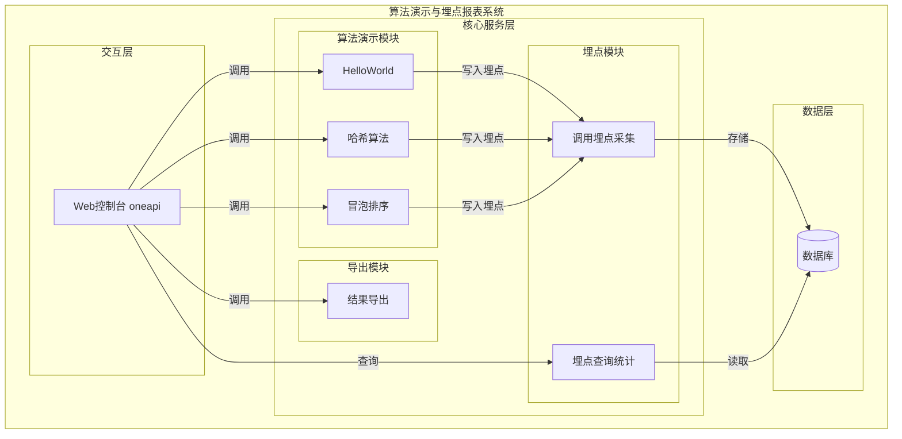
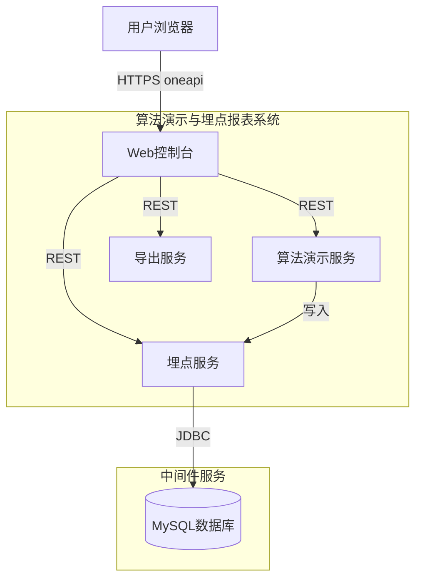
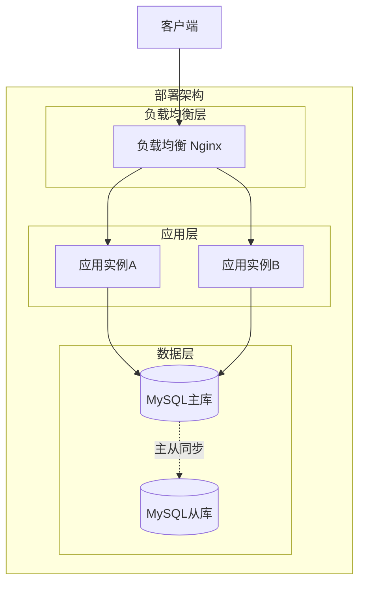
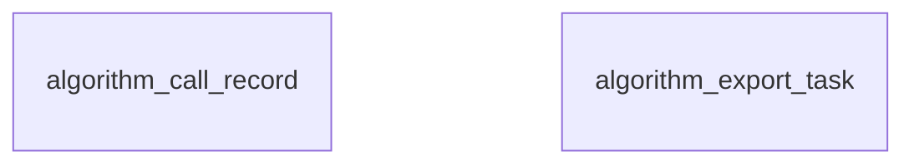
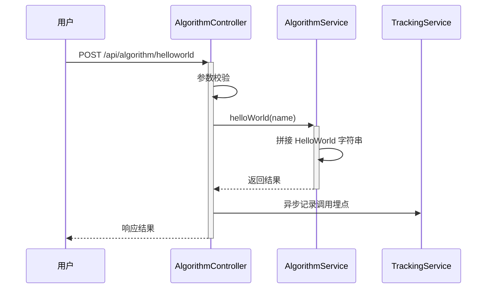
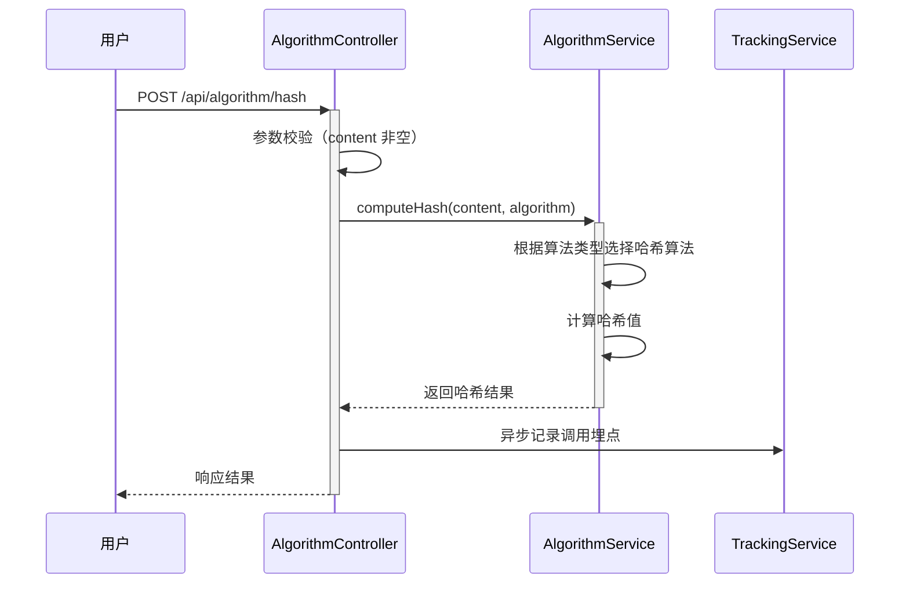
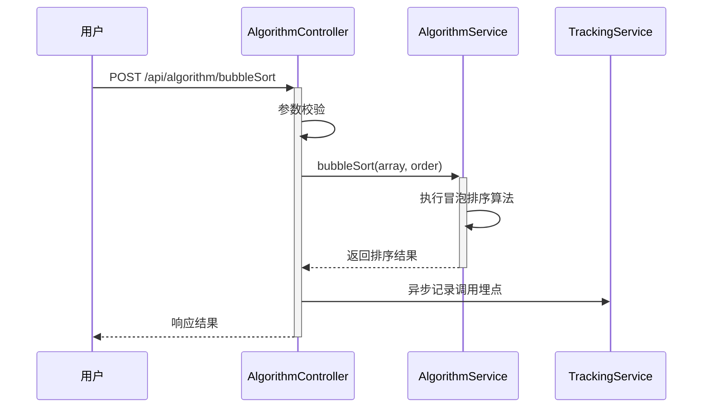
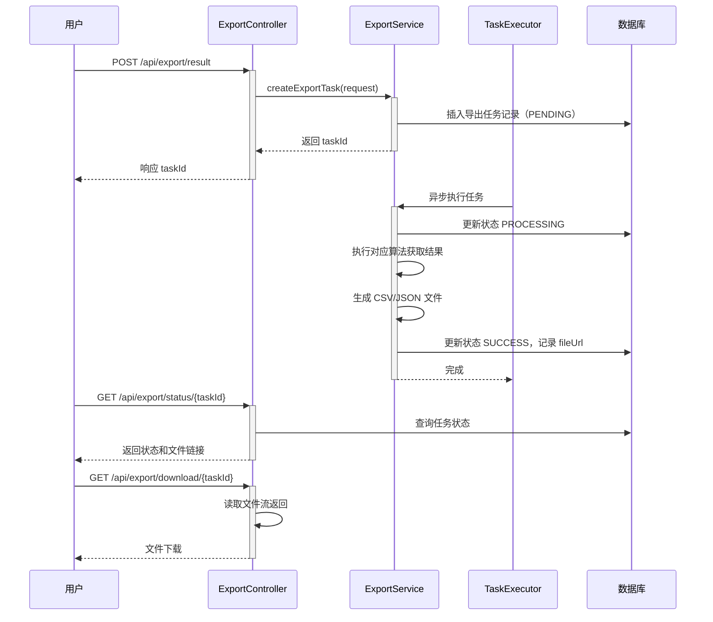
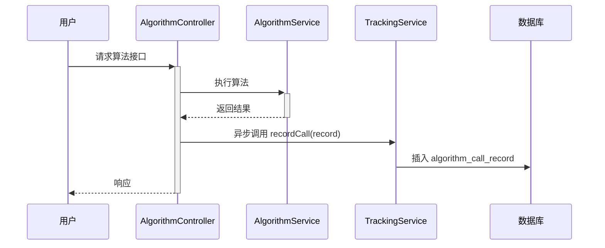
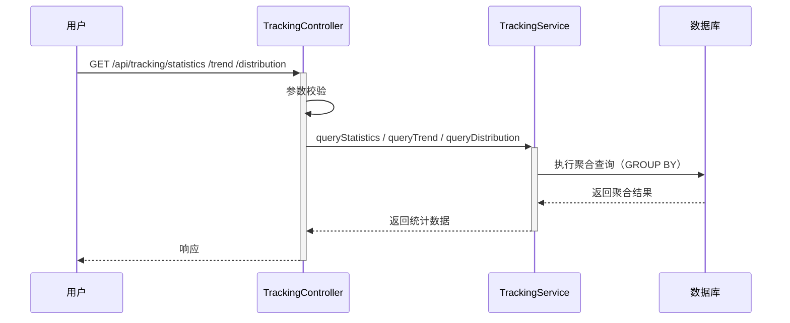

> **文档元信息**
>
> | 项目 | 内容 |
> |------|------|
> | 文档版本 | v1.0 |
> | 作者 | AiWork |
> | 创建日期 | 2026-10-29 |
> | 需求来源 | 用户原始需求 |
> | 评审状态 | 待评审 |

# 算法演示与埋点报表系统 系分设计

## 1. 需求与范围

### 1.1 背景与目标

本项目旨在构建一个算法演示与调用分析一体化系统。系统提供三个基础算法接口（HelloWorld、哈希算法、冒泡排序），并通过前端可视化页面展示执行结果；同时引入调用埋点和多维度报表能力，支持对算法调用行为进行统计分析和可视化呈现，并支持结果导出。

### 1.2 核心功能

- 后端提供三个算法执行接口：HelloWorld、哈希算法、冒泡排序。
- 前端新增一个演示页面，通过 Tab 切换展示三个算法的执行结果。
- 支持导出各 Tab 页面的展示结果。
- 后端埋点采集：调用次数、调用人身份。
- 前端报表可视化：按人员类型、人员层级、人员部门等维度统计调用情况，支持折线图、饼图、柱状图等多种展示形式。

### 1.3 约束与非功能要求

- 系统采用前后端分离架构。
- 埋点数据需支持按多维度聚合查询。
- 报表查询需保证合理响应时间（假设：简单聚合场景下 < 2s）。
- 导出功能需支持常见数据格式（假设：CSV / JSON）。

### 1.4 排除范围

- 不涉及算法本身的性能优化（仅作为演示用途）。
- 不涉及复杂的用户权限体系（仅做基础身份识别）。
- 不涉及实时流式计算（报表基于离线/准实时聚合）。

### 1.5 需求功能清单与优先级

| 编号 | 功能点 | 优先级 | PRD 原始描述/章节 | 备注 |
|------|--------|--------|-------------------|------|
| F01 | HelloWorld 接口 | P0 | 分别写三个接口 helloworld | 基础演示接口 |
| F02 | 哈希算法接口 | P0 | 分别写三个接口 哈希算法 | MD5/SHA 等哈希计算 |
| F03 | 冒泡排序接口 | P0 | 分别写三个接口 冒泡排序 | 排序算法演示 |
| F04 | 前端 Tab 页面 | P0 | 前端新增一个页面，有三个tab分别展示不同的执行结果 | 三个 Tab 对应三个接口 |
| F05 | 导出功能 | P0 | 新增导出按钮，后台提供导出接口，支持导出各个页面的展示结果 | 导出当前 Tab 结果 |
| F06 | 后端调用埋点 | P0 | 后端再做个埋点，获取调用次数和调用人 | 每次接口调用记录 |
| F07 | 报表可视化页面 | P0 | 前端在当前页面上可视化出来一个报表查看调用情况 | 折线图、饼图、柱状图 |
| F08 | 多维度统计 | P0 | 根据不同的维度：人员类型、人员层级、人员部门等 | 支持多维度下钻 |

### 1.6 假设与待确认项

| 编号 | 假设/待确认内容 | 当前假设 | 确认状态 |
|------|-----------------|----------|----------|
| A01 | 用户身份体系如何获取 | 假设通过请求头中的 userId、userType、userLevel、userDept 等字段传递 | 待确认 |
| A02 | 哈希算法具体支持哪些 | 假设支持 MD5、SHA-256 两种常见算法 | 待确认 |
| A03 | 导出文件格式 | 假设支持 CSV 和 JSON 两种格式 | 待确认 |
| A04 | 埋点数据存储时长 | 假设保留 90 天，超期数据归档或清理 | 待确认 |
| A05 | 报表时间粒度 | 假设支持按日/按周/按月聚合 | 待确认 |

---

## 2. 架构与模块

### 2.1 功能架构



**模块清单**

| 模块 | 职责 | 依赖 |
|------|------|------|
| 算法演示模块 | 提供 HelloWorld、哈希算法、冒泡排序三个接口的执行能力 | 无外部依赖 |
| 导出模块 | 支持导出各算法页面的执行结果 | 依赖算法演示模块 |
| 埋点模块 | 采集接口调用记录，提供多维度统计查询 | 依赖数据库 |

### 2.2 应用集成架构



**集成关系说明：**

| 调用方 | 被调用方 | 协议 | 接口类型 | 说明 |
|--------|----------|------|----------|------|
| 用户浏览器 | Web控制台 | HTTPS | oneapi REST | 前端页面交互 |
| Web控制台 | 算法演示服务 | HTTPS | REST | 调用算法接口 |
| Web控制台 | 导出服务 | HTTPS | REST | 导出执行结果 |
| Web控制台 | 埋点服务 | HTTPS | REST | 查询报表数据 |
| 算法演示服务 | 埋点服务 | 内部调用 | 内部接口 | 异步写入调用记录 |

### 2.3 部署架构



**部署说明：**
- **负载均衡层**：Nginx 反向代理，支持静态资源托管和 API 路由转发。
- **应用层**：前后端分离部署，前端静态文件由 Nginx 托管，后端服务多实例部署（假设 2 实例）。
- **数据层**：MySQL 主从架构，主库负责写操作，从库用于报表查询等读操作分流。

---

## 3. 数据模型与存储

### 3.1 实体清单

| 实体名称 | 实体说明 | 所属模块 | 与其他实体的关系 |
|----------|----------|----------|-----------------|
| algorithm_call_record | 算法调用记录 | 埋点模块 | 无外部关联，独立实体 |
| algorithm_export_task | 导出任务记录 | 导出模块 | 无外部关联，独立实体 |

### 3.2 实体关系图



**模型说明：**
- `algorithm_call_record`：记录每次算法接口的调用情况，包含调用人信息和调用参数。
- `algorithm_export_task`：记录导出任务的创建和执行状态（假设导出采用异步任务模式）。

---

## 4. 接口设计

### 4.1 oneapi（Web 控制台接口）

| 编号 | 接口名称 | 方法 | 路径 | 模块 |
|------|----------|------|------|------|
| W01 | HelloWorld 执行 | POST | /api/algorithm/helloworld | 算法演示模块 |
| W02 | 哈希算法执行 | POST | /api/algorithm/hash | 算法演示模块 |
| W03 | 冒泡排序执行 | POST | /api/algorithm/bubbleSort | 算法演示模块 |
| W04 | 结果导出 | POST | /api/export/result | 导出模块 |
| W05 | 获取导出任务状态 | GET | /api/export/status/{taskId} | 导出模块 |
| W06 | 下载导出文件 | GET | /api/export/download/{taskId} | 导出模块 |
| W07 | 调用统计查询 | GET | /api/tracking/statistics | 埋点模块 |
| W08 | 调用趋势查询 | GET | /api/tracking/trend | 埋点模块 |
| W09 | 调用维度分布查询 | GET | /api/tracking/distribution | 埋点模块 |

### 4.2 OpenAPI（对外接口）

本系统当前不涉及对外开放接口，故无 OpenAPI 设计。

### 4.3 内部接口（Service 层）

| 编号 | 接口名称 | 类 | 方法签名 |
|------|----------|------|----------|
| S01 | 记录调用埋点 | TrackingService | recordCall(trackingRecord) |
| S02 | 查询统计汇总 | TrackingService | queryStatistics(dimension, timeRange) |
| S03 | 异步导出结果 | ExportService | asyncExport(algorithmType, params) |

### 4.4 集成接口（Integration 层）

本系统当前不涉及外部系统集成，故无集成接口设计。

---

## 5. 功能模块设计

### 5.1 算法演示模块

#### 5.1.1 表结构设计

本模块不涉及持久化表结构设计，算法执行在内存中完成，结果直接返回。

#### 5.1.2 接口详细设计

##### W01 HelloWorld 执行

- **URI**: POST /api/algorithm/helloworld
- **描述**: 返回 HelloWorld 字符串
- **入参**:

| 参数名称 | 类型 | 是否必填 | 描述 |
|----------|------|----------|------|
| name | String | 否 | 自定义名称，不传则返回默认 HelloWorld |

- **出参**:

| 参数名称 | 类型 | 描述 |
|----------|------|------|
| result | String | 结果 code |
| msg | String | 提示信息 |
| data | Object | 业务数据 |
| data.message | String | HelloWorld 结果 |

- **错误码**:

| 错误码 | 说明 |
|--------|------|
| ALG_001 | 参数校验失败 |

- **请求示例**:
```json
{
  "name": "Manyu"
}
```

- **响应示例**:
```json
{
  "result": "OK",
  "msg": "SUCCESS",
  "data": {
    "message": "Hello, Manyu!"
  }
}
```

##### W02 哈希算法执行

- **URI**: POST /api/algorithm/hash
- **描述**: 对输入内容执行哈希计算，支持 MD5 / SHA-256
- **入参**:

| 参数名称 | 类型 | 是否必填 | 描述 |
|----------|------|----------|------|
| content | String | 是 | 待哈希的原始内容 |
| algorithm | String | 否 | 哈希算法类型，默认 SHA-256，可选 MD5 |

- **出参**:

| 参数名称 | 类型 | 描述 |
|----------|------|------|
| result | String | 结果 code |
| msg | String | 提示信息 |
| data | Object | 业务数据 |
| data.hashValue | String | 哈希结果 |
| data.algorithm | String | 实际使用的算法 |

- **错误码**:

| 错误码 | 说明 |
|--------|------|
| ALG_002 | 不支持的哈希算法 |
| ALG_003 | 内容为空 |

- **请求示例**:
```json
{
  "content": "hello world",
  "algorithm": "MD5"
}
```

- **响应示例**:
```json
{
  "result": "OK",
  "msg": "SUCCESS",
  "data": {
    "hashValue": "5d41402abc4b2a76b9719d911017c592",
    "algorithm": "MD5"
  }
}
```

##### W03 冒泡排序执行

- **URI**: POST /api/algorithm/bubbleSort
- **描述**: 对输入数组执行冒泡排序
- **入参**:

| 参数名称 | 类型 | 是否必填 | 描述 |
|----------|------|----------|------|
| array | Array<Integer> | 是 | 待排序的整数数组 |
| order | String | 否 | 排序方向，默认 ASC（升序），可选 DESC（降序） |

- **出参**:

| 参数名称 | 类型 | 描述 |
|----------|------|------|
| result | String | 结果 code |
| msg | String | 提示信息 |
| data | Object | 业务数据 |
| data.sortedArray | Array<Integer> | 排序后的数组 |
| data.order | String | 排序方向 |

- **错误码**:

| 错误码 | 说明 |
|--------|------|
| ALG_004 | 输入数组为空 |
| ALG_005 | 排序方向参数不合法 |

- **请求示例**:
```json
{
  "array": [5, 3, 8, 4, 2],
  "order": "ASC"
}
```

- **响应示例**:
```json
{
  "result": "OK",
  "msg": "SUCCESS",
  "data": {
    "sortedArray": [2, 3, 4, 5, 8],
    "order": "ASC"
  }
}
```

#### 5.1.3 子功能详细设计

##### 5.1.3.1 HelloWorld 执行（F01）

- 处理时序图


**业务规则：**
| 规则编号 | 规则描述 | 校验时机 | 不满足时的处理 |
|----------|----------|----------|--------------|
| R01 | name 字段长度不超过 100 字符 | 请求时 | 截断或返回 ALG_001 |

**异常场景：**
| 异常场景 | 处理方式 |
|----------|----------|
| 参数超长 | 返回错误码 ALG_001，提示参数不合法 |

##### 5.1.3.2 哈希算法执行（F02）

- 处理时序图


**业务规则：**
| 规则编号 | 规则描述 | 校验时机 | 不满足时的处理 |
|----------|----------|----------|--------------|
| R02 | content 不能为空 | 请求时 | 返回 ALG_003 |
| R03 | algorithm 只能是 MD5 或 SHA-256 | 请求时 | 返回 ALG_002 |

**异常场景：**
| 异常场景 | 处理方式 |
|----------|----------|
| 内容为空 | 返回 ALG_003 |
| 不支持的算法 | 返回 ALG_002 |

##### 5.1.3.3 冒泡排序执行（F03）

- 处理时序图


**业务规则：**
| 规则编号 | 规则描述 | 校验时机 | 不满足时的处理 |
|----------|----------|----------|--------------|
| R04 | array 不能为空数组 | 请求时 | 返回 ALG_004 |
| R05 | order 只能是 ASC 或 DESC | 请求时 | 返回 ALG_005 |

**异常场景：**
| 异常场景 | 处理方式 |
|----------|----------|
| 数组为空 | 返回 ALG_004 |
| 排序方向不合法 | 返回 ALG_005 |

**并发控制：**
- 并发场景：多个用户同时调用算法接口。
- 控制策略：算法执行无状态，不涉及共享数据写入，无并发风险。

---

### 5.2 导出模块

#### 5.2.1 表结构设计

##### algorithm_export_task

| 字段名 | 数据类型 | 约束 | 默认值 | 说明 |
|--------|----------|------|--------|------|
| id | bigint | PK, 自增 | - | 系统自增主键 |
| task_id | varchar(64) | NOT NULL, UK | - | 导出任务唯一标识 |
| algorithm_type | varchar(32) | NOT NULL | - | 算法类型：HELLOWORLD / HASH / BUBBLE_SORT |
| params | text | NULL | - | 导出时的请求参数（JSON 格式） |
| status | varchar(16) | NOT NULL | PENDING | 任务状态：PENDING / PROCESSING / SUCCESS / FAILED |
| file_url | varchar(512) | NULL | - | 导出文件存储路径 |
| error_msg | varchar(512) | NULL | - | 失败原因 |
| operator_id | varchar(64) | NOT NULL | - | 操作人 ID |
| gmt_create | datetime | NOT NULL | CURRENT_TIMESTAMP | 创建时间 |
| gmt_modified | datetime | NOT NULL | CURRENT_TIMESTAMP | 修改时间 |

**索引：**
- UK: `uk_export_task_id` (task_id)
- IDX: `idx_export_status` (status)
- IDX: `idx_export_operator` (operator_id)

#### 5.2.2 接口详细设计

##### W04 结果导出

- **URI**: POST /api/export/result
- **描述**: 提交导出任务，异步生成导出文件
- **入参**:

| 参数名称 | 类型 | 是否必填 | 描述 |
|----------|------|----------|------|
| algorithmType | String | 是 | 算法类型：HELLOWORLD / HASH / BUBBLE_SORT |
| params | Object | 否 | 对应算法的请求参数 |

- **出参**:

| 参数名称 | 类型 | 描述 |
|----------|------|------|
| result | String | 结果 code |
| msg | String | 提示信息 |
| data | Object | 业务数据 |
| data.taskId | String | 导出任务 ID |

- **请求示例**:
```json
{
  "algorithmType": "HASH",
  "params": {
    "content": "hello",
    "algorithm": "MD5"
  }
}
```

##### W05 获取导出任务状态

- **URI**: GET /api/export/status/{taskId}
- **描述**: 查询导出任务执行状态
- **出参**:

| 参数名称 | 类型 | 描述 |
|----------|------|------|
| result | String | 结果 code |
| msg | String | 提示信息 |
| data | Object | 业务数据 |
| data.taskId | String | 任务 ID |
| data.status | String | 任务状态 |
| data.fileUrl | String | 文件下载链接（成功时返回） |

##### W06 下载导出文件

- **URI**: GET /api/export/download/{taskId}
- **描述**: 下载已生成的导出文件
- **出参**: 文件流（Content-Disposition: attachment）

#### 5.2.3 子功能详细设计

##### 5.2.3.1 异步导出（F05）

- 处理时序图


**业务规则：**
| 规则编号 | 规则描述 | 校验时机 | 不满足时的处理 |
|----------|----------|----------|--------------|
| R06 | algorithmType 必须有效 | 请求时 | 返回 EXPORT_001 |
| R07 | 同一用户并发导出任务数不超过 5 个 | 创建时 | 返回 EXPORT_002 |

**异常场景：**
| 异常场景 | 处理方式 |
|----------|----------|
| 任务创建失败 | 返回 EXPORT_003 |
| 文件生成失败 | 任务状态更新为 FAILED，记录 errorMsg |

**并发控制：**
- 并发场景：同一用户可能同时发起多个导出任务。
- 控制策略：通过数据库唯一约束 + 状态检查限制并发导出任务数量。

---

### 5.3 埋点模块

#### 5.3.1 表结构设计

##### algorithm_call_record

| 字段名 | 数据类型 | 约束 | 默认值 | 说明 |
|--------|----------|------|--------|------|
| id | bigint | PK, 自增 | - | 系统自增主键 |
| request_id | varchar(64) | NOT NULL | - | 请求唯一标识 |
| api_path | varchar(128) | NOT NULL | - | 接口路径 |
| algorithm_type | varchar(32) | NOT NULL | - | 算法类型 |
| caller_id | varchar(64) | NOT NULL | - | 调用人 ID |
| caller_name | varchar(64) | NULL | - | 调用人姓名 |
| caller_type | varchar(32) | NULL | - | 人员类型（如：内部员工/外部合作方） |
| caller_level | varchar(32) | NULL | - | 人员层级（如：P5/P6/P7） |
| caller_dept | varchar(128) | NULL | - | 人员部门 |
| request_params | text | NULL | - | 请求参数（JSON） |
| response_result | varchar(16) | NULL | - | 响应结果：SUCCESS / FAILED |
| cost_time_ms | int | NULL | - | 接口耗时（毫秒） |
| gmt_create | datetime | NOT NULL | CURRENT_TIMESTAMP | 调用时间 |
| gmt_modified | datetime | NOT NULL | CURRENT_TIMESTAMP | 修改时间 |

**索引：**
- UK: `uk_call_request_id` (request_id)
- IDX: `idx_call_api_path` (api_path)
- IDX: `idx_call_caller_id` (caller_id)
- IDX: `idx_call_alg_type` (algorithm_type)
- IDX: `idx_call_create_time` (gmt_create)
- IDX: `idx_call_caller_type` (caller_type)
- IDX: `idx_call_caller_level` (caller_level)
- IDX: `idx_call_caller_dept` (caller_dept)

#### 5.3.2 接口详细设计

##### W07 调用统计查询

- **URI**: GET /api/tracking/statistics
- **描述**: 按维度统计调用次数
- **入参**:

| 参数名称 | 类型 | 是否必填 | 描述 |
|----------|------|----------|------|
| dimension | String | 是 | 统计维度：callerType / callerLevel / callerDept / algorithmType |
| startTime | String | 是 | 开始时间，格式 yyyy-MM-dd HH:mm:ss |
| endTime | String | 是 | 结束时间，格式 yyyy-MM-dd HH:mm:ss |

- **出参**:

| 参数名称 | 类型 | 描述 |
|----------|------|------|
| result | String | 结果 code |
| msg | String | 提示信息 |
| data | Array | 统计结果列表 |
| data[].dimensionKey | String | 维度值 |
| data[].count | Long | 调用次数 |

##### W08 调用趋势查询

- **URI**: GET /api/tracking/trend
- **描述**: 查询调用量趋势，用于折线图
- **入参**:

| 参数名称 | 类型 | 是否必填 | 描述 |
|----------|------|----------|------|
| timeGranularity | String | 是 | 时间粒度：DAY / WEEK / MONTH |
| startTime | String | 是 | 开始时间 |
| endTime | String | 是 | 结束时间 |
| algorithmType | String | 否 | 按算法类型过滤 |

- **出参**:

| 参数名称 | 类型 | 描述 |
|----------|------|------|
| result | String | 结果 code |
| msg | String | 提示信息 |
| data | Array | 趋势数据 |
| data[].timeLabel | String | 时间标签 |
| data[].count | Long | 调用次数 |

##### W09 调用维度分布查询

- **URI**: GET /api/tracking/distribution
- **描述**: 查询指定维度的分布情况，用于饼图
- **入参**:

| 参数名称 | 类型 | 是否必填 | 描述 |
|----------|------|----------|------|
| dimension | String | 是 | 维度：callerType / callerLevel / callerDept |
| startTime | String | 是 | 开始时间 |
| endTime | String | 是 | 结束时间 |

- **出参**:

| 参数名称 | 类型 | 描述 |
|----------|------|------|
| result | String | 结果 code |
| msg | String | 提示信息 |
| data | Array | 分布数据 |
| data[].dimensionKey | String | 维度值 |
| data[].count | Long | 调用次数 |
| data[].percentage | String | 占比（百分比字符串） |

#### 5.3.3 子功能详细设计

##### 5.3.3.1 调用埋点采集（F06）

- 处理时序图


**业务规则：**
| 规则编号 | 规则描述 | 校验时机 | 不满足时的处理 |
|----------|----------|----------|--------------|
| R08 | callerId 从请求头获取，不可为空 | 每次调用 | 埋点记录为 UNKNOWN |
| R09 | 埋点写入异步执行，不影响主链路 | 始终 | 埋点失败不阻断主流程 |

**异常场景：**
| 异常场景 | 处理方式 |
|----------|----------|
| 埋点写入失败 | 记录到本地日志，不阻断主流程 |

**并发控制：**
- 并发场景：高并发下大量埋点写入。
- 控制策略：异步写入 + 批量攒批（假设批量阈值 100 条或 5 秒），降低数据库压力。

##### 5.3.3.2 报表可视化查询（F07/F08）

- 处理时序图


**业务规则：**
| 规则编号 | 规则描述 | 校验时机 | 不满足时的处理 |
|----------|----------|----------|--------------|
| R10 | 查询时间范围不超过 90 天 | 请求时 | 自动截断或返回 TRACK_001 |
| R11 | 时间粒度与查询范围匹配 | 请求时 | 跨度太大时自动降级为更大粒度 |

**异常场景：**
| 异常场景 | 处理方式 |
|----------|----------|
| 查询范围过大 | 返回 TRACK_001，提示缩小查询范围 |
| 聚合数据为空 | 返回空数组，前端展示空态 |

**并发控制：**
- 并发场景：多用户同时查询报表。
- 控制策略：报表查询为纯读操作，无并发写入风险；可通过数据库从库分流读请求。

---

### 5.4 全局约定

#### 5.4.1 错误码格式

错误码格式：`{MODULE}_{SEQ}`

| 模块前缀 | 说明 |
|----------|------|
| ALG | 算法演示模块 |
| EXPORT | 导出模块 |
| TRACK | 埋点模块 |

#### 5.4.2 通用出参结构

```
{
  "result": "OK / ERROR",
  "msg": "SUCCESS / 具体错误描述",
  "data": {} // 业务数据
}
```

#### 5.4.3 模块映射表

| 功能点 | 所属模块 | 接口编号 |
|--------|----------|----------|
| HelloWorld 执行 | 算法演示模块 | W01 |
| 哈希算法执行 | 算法演示模块 | W02 |
| 冒泡排序执行 | 算法演示模块 | W03 |
| 结果导出 | 导出模块 | W04 |
| 导出状态查询 | 导出模块 | W05 |
| 导出文件下载 | 导出模块 | W06 |
| 调用统计查询 | 埋点模块 | W07 |
| 调用趋势查询 | 埋点模块 | W08 |
| 调用维度分布查询 | 埋点模块 | W09 |

---

## 6. 非功能性需求设计

### 6.1 高可用性

- 应用层采用多实例部署，通过 Nginx 负载均衡实现故障自动转移。
- 数据库采用主从架构，主库故障时可快速切换从库（需配合运维自动化）。
- 本系统不涉及外部第三方依赖，不存在第三方服务异常降级场景。

### 6.2 可扩展性

- 算法接口采用无状态设计，支持水平扩展。
- 埋点数据量增长时，可通过分表（按时间分区）或引入 OLAP 引擎（如 ClickHouse）扩展。
- 导出任务采用异步任务模式，高峰期可通过增加任务消费线程数扩展处理能力。

### 6.3 稳定性/可靠性

- 边界场景处理：
  - 输入数组过大时，冒泡排序接口增加最大长度限制（假设 10000 个元素），超限返回 ALG_006。
  - 哈希内容过大时，增加最大长度限制（假设 10MB），超限返回 ALG_007。
- 异步导出任务失败时，支持重试（最多 3 次），重试失败则标记为 FAILED。

### 6.4 安全性设计

#### 6.4.1 账户系统方案
本系统假设嵌入已有应用，用户身份由上层应用通过请求头传递，本系统不做独立的账户体系设计。

#### 6.4.2 授权&访问控制
##### 6.4.2.1 水平权限检查
- 假设：通过请求头中的 tenantId 实现租户隔离（如有租户场景）。
- 报表查询时，过滤条件默认带上 callerId 或 callerDept，确保用户只能查看自己权限范围内的数据。

##### 6.4.2.2 垂直权限检查
- 假设：通过上层应用配置角色，本系统不做独立的角色权限校验。

##### 6.4.2.3 登录态检查
- 假设：由网关层统一处理登录态校验，本系统接口默认已携带合法身份。

#### 6.4.3 数据防护方案
##### 6.4.3.1 敏感数据加密存储
- 本系统埋点数据不涉及身份证、银行卡等高敏感信息，仅需存储 callerId 等基础身份信息，无需额外加密。
- 导出文件中的敏感字段（如有）需进行脱敏处理。

##### 6.4.3.2 敏感数据展示脱敏
- 报表展示时，callerName 等字段可按照脱敏规则展示（如：张*三）。
- 日志打印 callerId 等字段时需脱敏。

### 6.5 监控/统计/日志/告警

- 监控点：
  - 算法接口 QPS、P99 响应时间。
  - 导出任务队列堆积数量。
  - 埋点数据写入延迟。
- 告警点：
  - 导出任务失败率 > 5% 时触发告警。
  - 埋点数据写入延迟 > 30s 时触发告警。

---

## 7. 变更三板斧

### 7.1 可监控

- 算法接口：通过 AOP 拦截器统一记录接口调用日志（requestId、接口路径、耗时、响应结果）。
- 导出模块：监控任务队列长度、任务执行时长、失败率。
- 埋点模块：监控异步写入延迟、批量攒批大小、数据库写入 QPS。

### 7.2 可灰度

- 灰度方案：按用户尾号灰度（如 userId 尾号 0-4 先开启新功能）。
- 特征开关：在配置中心维护 `algorithm.tracking.enabled` 开关，支持随时关闭埋点功能。
- 算法接口本身为新增接口，不影响旧逻辑，无需灰度。

### 7.3 可应急

- 埋点写入压力过大时：关闭 `algorithm.tracking.enabled` 开关，停止异步埋点写入，不影响主业务流程。
- 导出服务异常时：通过配置 `export.async.enabled=false` 切换为同步导出（小数据量场景），或暂停导出功能。
- 回滚策略：新版本发布异常时，可直接回滚到上一版本；埋点表和导出任务表为新表，旧版本无依赖，回滚安全。

---

## 8. 方案检查

| 检查项 | 检查结果 | 说明 |
|--------|----------|------|
| 模块划分合理性检查 | 通过 | 三个模块职责单一，无循环依赖 |
| 依赖关系合理性 | 通过 | 无外部依赖，内部依赖清晰 |
| 单点问题检查（部署层面） | 通过 | 多实例部署，主从数据库 |
| 表模型设计范式检查 | 通过 | 满足第三范式，无冗余字段 |
| 隐私安全检查 | 通过 | callerName 展示需脱敏 |
| 兼容性检查（接口） | 通过 | 全部为新增接口，无兼容性问题 |
| 兼容性检查（表） | 通过 | 全部为新增表，无兼容性问题 |
| 数据迁移检查 | 通过 | 新增表无需数据迁移 |
| 一致性检查（功能点） | 通过 | F01-F08 均已在模块设计中覆盖 |
| 一致性检查（表） | 通过 | Step 3 实体在 Step 5 中均有完整表结构 |
| 一致性检查（接口） | 通过 | Step 4 所有接口在 Step 5 中均有详细定义 |
| 一致性检查（枚举） | 通过 | 枚举定义与表结构字段说明一致 |
| 状态机完整性检查 | 不适用 | 无复杂状态流转场景 |
| 并发风险检查 | 通过 | 算法无状态；导出任务通过状态控制并发；埋点异步写入无并发冲突 |
| 单点问题检查（定时任务层面） | 不适用 | 不涉及定时任务 |
| 非功能性设计可行性检查 | 通过 | 高可用、安全性、性能设计可行 |
| 变更三板斧设计可行性检查（可监控） | 通过 | 监控点、告警点已明确 |
| 变更三板斧设计可行性检查（可灰度） | 通过 | 支持按用户尾号灰度和配置开关 |
| 变更三板斧设计可行性检查（可应急） | 通过 | 埋点和导出均有开关可快速关闭 |
