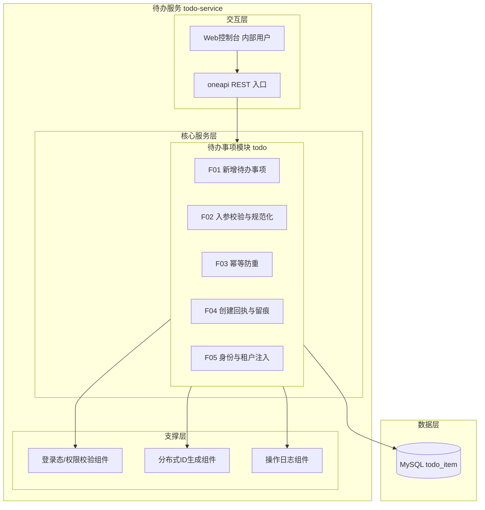
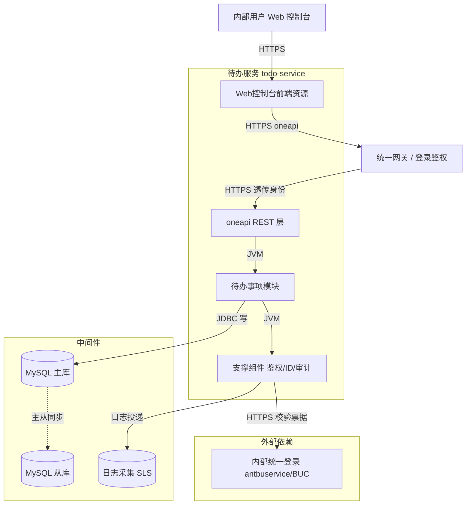
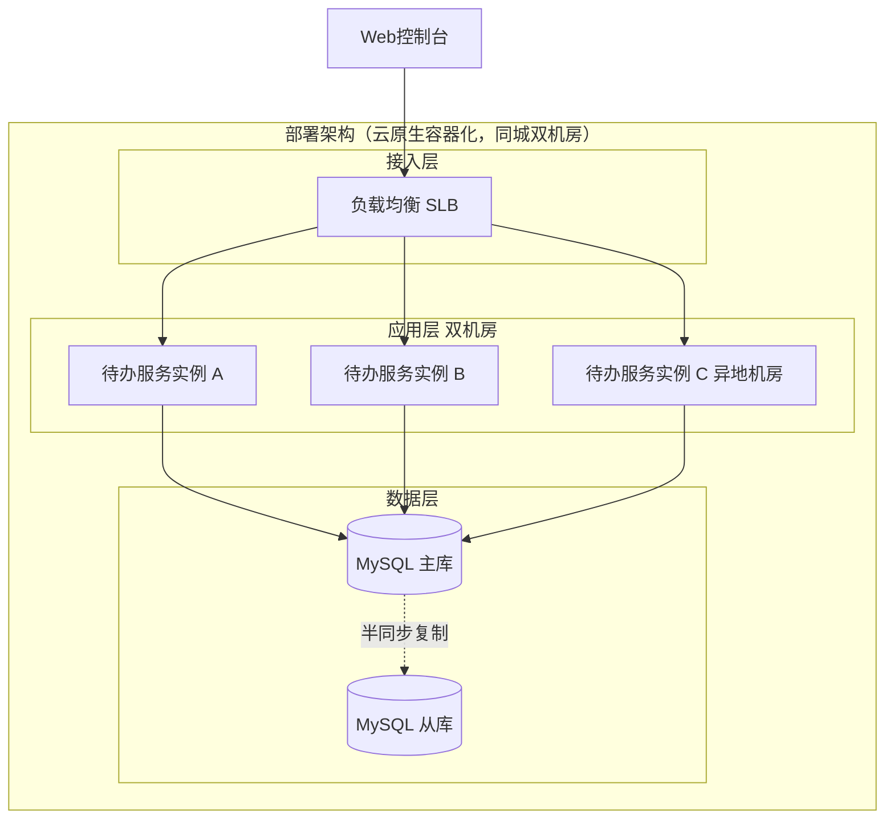
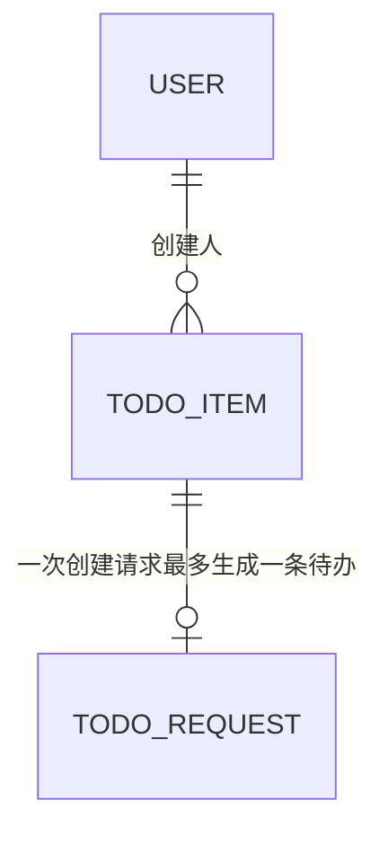
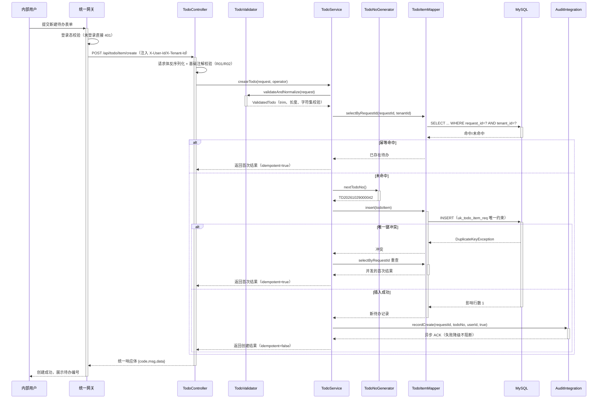
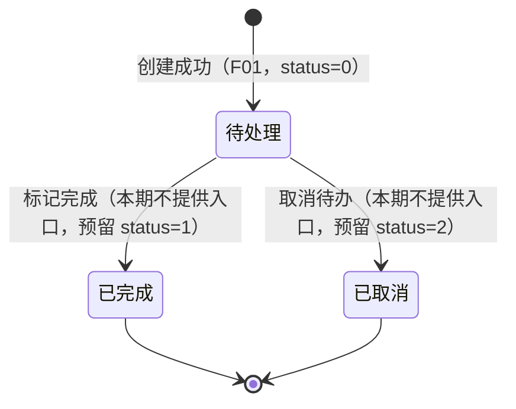

> **文档元信息**
>
> | 项目 | 内容 |
> |------|------|
> | 文档版本 | v1.0 |
> | 作者 | AiWork |
> | 创建日期 | 2026-10-29 |
> | 需求来源 | 任务需求「帮助用户记录日常待办事项（核心功能：新增待办事项；任务信息：事项名称和描述；目标用户：内部用户；最小闭环：仅创建）」 |
> | 评审状态 | 待评审 |

# 待办事项（Todo）新增功能 系分设计

## 1. 需求与范围

### 背景与目标

内部用户在日常工作中缺少一个统一、轻量的事项记录入口，导致口头/IM 中产生的待办容易遗漏。本设计交付「新增待办事项」这一最小闭环：内部用户输入事项名称与描述，系统完成校验、落库并返回待办标识，形成可被后续（列表、完成、删除等）阶段复用的数据基础。

本期只做「创建」，不做查询/流转，因此设计重点为：**入参契约、创建业务规则、数据模型可演进性、幂等与并发安全**。

### 核心功能

- 新增待办事项：录入事项名称（必填）与事项描述（选填），创建成功返回待办唯一标识。
- 创建入参校验：非空、长度、非法字符、超长截断等边界统一在服务端收口。
- 创建幂等：同一次提交（同一请求标识）重复提交不产生重复待办。
- 创建结果回执：返回待办 ID、待办编号、名称、状态与创建时间，供前端即时展示。

### 约束与非功能要求

- 技术栈：Java 8 + Maven；当前仓库 `sort-core` 为纯 Java 库（仅测试依赖），待办模块以新增包 `com.antdigital.todo` 独立引入，不改动既有排序模块行为。
- 性能：单次创建接口 P99 ≤ 200ms（不含网络），单实例 ≥ 200 TPS。
- 可用性：应用多副本部署，无状态；数据库主从，创建走主库。
- 数据一致性：单表写入，事务内完成；关键字段非空且有默认值。
- 安全：登录态统一校验；创建人身份取自登录上下文，禁止前端传入；租户隔离字段全链路透传。
- 容量：按内部用户 1 万人、人均每日 5 条估算，年增量约 1800 万条；单表 1~2 年内达到分表阈值，本期通过索引与归档策略预留。
- 可观测：创建成功率、耗时、失败错误码分布可监控。

### 排除范围

- 待办列表/详情查询、编辑、标记完成、取消、删除、批量导入导出。
- 待办提醒、到期通知、日历视图、标签/分类、优先级排序、子任务与附件。
- 多人协作、指派他人、共享待办、评论。
- 移动端/独立前端页面实现（本期仅约定服务端接口契约）。
- 组织架构与角色权限体系的建设（仅复用既有登录态与角色校验能力）。
- 历史数据迁移（本期为全新表，不涉及存量迁移）。

### 需求功能清单与优先级

| 编号 | 功能点 | 优先级 | PRD 原始描述/章节 | 备注 |
|------|--------|--------|-------------------|------|
| F01 | 新增待办事项（名称 + 描述落库） | P0 | 「核心功能：新增待办事项」「任务信息：事项名称和描述」 | 最小闭环主链路 |
| F02 | 创建入参校验与规范化 | P0 | 「任务信息：事项名称和描述」 | 名称必填、长度与字符集约束 |
| F03 | 创建幂等防重（同一请求只创建一次） | P1 | 「最小闭环：仅创建」引申 | 防止用户重复点击/网络重试产生脏数据 |
| F04 | 创建结果回执与操作留痕 | P1 | 「目标用户：内部用户」 | 返回待办标识 + 创建审计日志 |
| F05 | 创建人身份与租户隔离注入 | P0 | 「目标用户：内部用户」 | 由登录态注入，前端不可伪造 |

### 假设与待确认项

| 编号 | 假设/待确认内容 | 当前假设 | 确认状态 |
|------|-----------------|----------|----------|
| A01 | 交付形态 | 新增独立 Web 服务模块（Spring Boot 2.7.x，兼容 Java 8），与既有 `sort-core` 同仓库共存、互不依赖 | 待确认 |
| A02 | 存储选型 | MySQL 8.0 + MyBatis，单表 `todo_item`，本期不分库分表 | 待确认 |
| A03 | 交互协议 | 内部用户经 Web 控制台调用 oneapi REST 接口；本期不开放 OpenAPI | 待确认 |
| A04 | 登录态来源 | 复用公司内部统一登录（antbuservice/BUC）在网关层透传的用户身份，本服务只做校验与解析 | 待确认 |
| A05 | 描述长度上限 | 事项名称 ≤128 字符，事项描述 ≤512 字符（按字符计，非字节） | 待确认 |
| A06 | 名称唯一性 | 不做全局唯一约束（待办名称天然可重复），同名仅在前端提示，后端不拦截 | 待确认 |
| A07 | 状态初值 | 创建后状态固定为「待处理」，本期不提供状态流转入口 | 待确认 |
| A08 | 幂等键来源 | 由前端生成 `requestId`（UUID）并随请求提交，服务端以其维度幂等 | 待确认 |
| A09 | 待办编号格式 | `TD` + `yyyyMMdd` + 6 位当日序号，长度 16，业务展示用；主键仍用自增 bigint | 待确认 |
| A10 | 敏感内容策略 | 事项描述可能包含手机号/身份证等敏感信息，本期仅做日志脱敏与展示脱敏建议，不做字段级加密 | 待确认 |
| A11 | 删除语义 | 表保留 `is_deleted` 逻辑删除位，本期不提供删除接口，默认 0 | 待确认 |
| A12 | 附件/富文本 | 描述为纯文本，不支持 HTML 与附件 | 待确认 |

## 2. 架构与模块

### 功能架构



- **交互层**：Web 控制台（内部用户）通过 oneapi REST 接口提交新建待办请求；本期无 OpenAPI 对外入口。
- **核心服务层**：仅一个「待办事项模块」，本期只承载创建链路，功能点 F01~F05 均收敛在该模块内，避免为单一功能过度拆分。
- **支撑层**：登录态解析与垂直权限校验、分布式 ID 生成、创建操作审计日志，均为无业务语义的通用能力，后续模块可复用。

**模块清单**

| 模块 | 职责 | 依赖 |
|------|------|------|
| 待办事项模块（todo） | 待办创建的全部业务逻辑：参数校验、幂等判定、编号生成、落库、回执组装、审计留痕 | 支撑层（登录态、ID 生成、审计日志）、MySQL |
| 支撑层-登录态与权限 | 解析并校验调用者身份与角色，向业务层提供可信的 userId/tenantId | 统一登录服务 |
| 支撑层-ID 生成 | 生成待办编号当日序号与幂等辅助标识，保证多实例下不重复 | 无（本地号段/雪花） |
| 支撑层-审计日志 | 记录创建动作的操作人、时间、结果 | 日志采集 |

> 依赖方向为单向：交互层 → 待办模块 → 支撑层 → 存储，不存在反向依赖与循环依赖。

### 应用集成架构



**集成关系说明：**

| 调用方 | 被调用方 | 协议 | 接口类型 | 说明 |
|--------|----------|------|----------|------|
| 内部用户浏览器 | 待办服务 Web 控制台 | HTTPS | oneapi REST | 新建待办表单提交 |
| 统一网关 | 待办服务 oneapi 层 | HTTPS | oneapi REST | 透传已认证身份与租户信息 |
| 待办模块 | MySQL 主库 | JDBC | SQL | 写入 `todo_item`，事务内单表写入 |
| 待办模块 | 支撑组件-鉴权 | JVM | 内部接口 | 获取可信 userId / tenantId / 角色 |
| 支撑组件-鉴权 | 内部统一登录服务 | HTTPS | 集成接口 | 票据校验（网关已校验时可省略，见 6.4.2.3） |
| 支撑组件-审计 | 日志采集服务 | 日志投递 | 集成接口 | 创建动作埋点与留痕，异步不阻塞主链路 |

> 下游（统一登录、日志采集）异常时的可用性策略见 6.1：登录校验不可降级（安全优先，直接失败），审计日志可降级（本地落盘/异步补偿，不影响创建结果）。

### 部署架构



**部署说明：**
- **接入层**：SLB/Nginx 承担 HTTPS 终止与健康检查，跨机房双活引流，单机房故障时自动切流。
- **应用层**：无状态多副本（≥2 实例/机房），容器化部署，滚动发布（先起新副本再摘旧副本），无本地状态依赖。
- **数据层**：MySQL 主从（1 主 2 从，半同步），创建写主库，从库用于后续查询与备份；单点为主库，依赖云 RDS 高可用版自动主备切换（切换窗口 ≤30s，期间创建请求快速失败并提示重试）。
- **无单点说明**：接入层、应用层均多副本；数据层单写节点由云数据库高可用能力兜底，属已知受控单点。

## 3. 数据模型与存储

### 实体清单

| 实体名称 | 实体说明 | 所属模块 | 与其他实体的关系 |
|----------|----------|----------|-----------------|
| 待办事项（todo_item） | 一条用户记录的事项，包含名称、描述、状态与创建人信息 | 待办事项模块 | 本期独立实体，无关联实体；创建人指向外部用户体系（逻辑外键，不建物理外键） |
| 创建幂等记录（todo_request） | 一次创建请求的幂等占位记录（可由 `todo_item.request_id` 唯一索引承担，不单独建表，见 5.1.1.1 说明） | 待办事项模块 | 与待办事项一对一（同一 request_id 最多一条待办） |

### 实体关系图



**模型说明：**
- 待办与创建人（外部用户体系）为「一对多」，通过 `creator_id` 逻辑关联，禁止物理外键（符合 db.md 强制项）。
- 幂等维度本期不单独建表：`todo_item.request_id` 上的唯一索引同时承担幂等键职责，减少一次表设计与一次写放大；若后续出现大量失败重试的空占位需求，再演进为 `todo_request` 表。
- 缓存：本期不引入缓存。原因：创建为纯写路径，无热点读；后续列表查询阶段再评估 Redis 缓存与击穿防护。
- 消息队列：本期不引入。原因：创建链路无异步派生动作（提醒/通知均在排除范围）。
- 租户隔离：`todo_item.tenant_id` 全链路透传，默认 `0`（内部单租户场景），为后续多租户预留。

## 4. 接口设计

### 4.1 oneapi（Web 控制台接口）

| 编号 | 接口名称 | 方法 | 路径 | 模块 |
|------|----------|------|------|------|
| W01 | 新增待办事项 | POST | /api/todo/item/create | 待办事项模块 |

### 4.2 OpenAPI（对外接口）

本项不适用，原因：本期目标用户为内部用户，仅通过 oneapi 入口使用；对外 OpenAPI 会引入额外的鉴权、限流与版本兼容成本，且无外部调用方需求。如后续需要开放，可在 W01 基础上以 `/openapi/todo/item/create` 复用同一 Service。

### 4.3 内部接口（Service 层）

| 编号 | 接口名称 | 类 | 方法签名 |
|------|----------|------|----------|
| S01 | 创建待办 | TodoService | `TodoCreateResult createTodo(TodoCreateRequest request, OperatorContext operator)` |
| S02 | 幂等命中查询 | TodoService | `TodoCreateResult queryByRequestId(String requestId, OperatorContext operator)` |
| S03 | 入参校验与规范化 | TodoValidator | `ValidatedTodo validateAndNormalize(TodoCreateRequest request)` |
| S04 | 待办编号生成 | TodoNoGenerator | `String nextTodoNo()` |

### 4.4 集成接口（Integration 层）

| 编号 | 接口名称 | 类 | 方法签名 | 说明 |
|------|----------|------|----------|------|
| I01 | 登录票据校验 | AuthIntegration | `OperatorContext verifyTicket(String ticket)` | 网关已完成校验时可配置为直接透传模式（开关 `auth.verify.enabled`） |
| I02 | 创建审计日志投递 | AuditIntegration | `void recordCreate(String requestId, String todoNo, String operatorId, boolean success)` | 异步投递，失败降级为本地日志 |

## 5. 功能模块设计

### 5.1 待办事项模块（todo）

**模块职责**：承载待办的创建能力，对上层暴露 `TodoService`，对内完成入参校验、幂等判定、编号生成、落库与回执组装。

**技术选型方案对比（服务形态与存储）**

| 方案 | 描述 | 优点 | 缺点 |
|------|------|------|------|
| 方案一（推荐） | 新增 Spring Boot 2.7.x 服务模块，MyBatis + MySQL 持久化，REST 入口 | 契合内部用户 HTTP 使用形态；持久化可靠；与公司内部登录、审计、监控体系天然对接；符合数科标准分层 | 需为当前纯库仓库引入 Web 与数据访问依赖，构建产物形态变化 |
| 方案二 | 保持纯 Java 库，`TodoService` + `ConcurrentHashMap` 内存存储，由调用方嵌入 | 零外部依赖、改动最小、启动最快 | 进程重启数据丢失、多实例不共享、无法满足「记录日常待办」的持久化预期 |
| 方案三 | 纯 Java 库 + 本地文件（JSON/CSV）追加写 | 无数据库依赖、数据可留存 | 并发写需自行加锁、查询能力弱、无法多实例部署、后续演进成本高 |

**推荐方案：方案一**。理由：需求目标用户为内部用户，本质是需要一个可访问、可持久、可监控的服务；方案二/三无法满足数据可靠性与多副本部署，后续列表/完成等演进会推倒重来。

**技术选型方案对比（待办编号生成）**

| 方案 | 描述 | 优点 | 缺点 |
|------|------|------|------|
| 方案一（推荐） | 数据库自增主键 + 编号由「TD + yyyyMMdd + 6 位当日序号」组成，当日序号基于 Redis INCR（key 按天过期） | 编号可读、可按天排序、无全局锁 | 依赖 Redis；Redis 不可用时需降级 |
| 方案二 | 雪花算法生成长整型 ID，展示编号直接截取 | 无中心依赖、性能高 | 编号不可读、不可按天理解 |
| 方案三 | 数据库序列表 `SELECT ... FOR UPDATE` 取号 | 无额外中间件 | 行锁热点，TPS 受限，DB 故障即不可创建 |

**推荐方案：方案一**，降级策略：Redis 不可用时退化为「TD + yyyyMMdd + 雪花后 6 位」，保证创建不被阻断（编号唯一性由 `uk_todo_item_no` 唯一索引最终兜底）。

#### 5.1.1 表结构设计

##### 5.1.1.1 todo_item（待办事项表）

| 字段名 | 数据类型 | 约束 | 默认值 | 说明 |
|--------|----------|------|--------|------|
| id | bigint unsigned | PK, AUTO_INCREMENT | - | 系统自增主键（pk_todo_item） |
| todo_no | varchar(32) | NOT NULL | '' | 待办展示编号，TD+日期+6位序号，全局唯一 |
| request_id | varchar(64) | NOT NULL | '' | 创建请求幂等键，前端 UUID，全局唯一 |
| tenant_id | varchar(32) | NOT NULL | '0' | 租户标识，本期固定 0 |
| item_name | varchar(128) | NOT NULL | '' | 事项名称，必填 |
| item_desc | varchar(512) | NOT NULL | '' | 事项描述，选填，纯文本 |
| status | tinyint | NOT NULL | 0 | 待办状态，见 5.1.1.2，0=待处理 |
| creator_id | varchar(64) | NOT NULL | '' | 创建人用户 ID，取自登录态 |
| creator_name | varchar(64) | NOT NULL | '' | 创建人展示名，取自登录态（冗余，便于后续列表展示） |
| source | varchar(16) | NOT NULL | 'web' | 创建来源：web/app/api |
| is_deleted | tinyint | NOT NULL | 0 | 逻辑删除标记，0=未删除，1=已删除 |
| gmt_create | datetime | NOT NULL | CURRENT_TIMESTAMP | 创建时间，代码与库双维护 |
| gmt_modified | datetime | NOT NULL | CURRENT_TIMESTAMP | 修改时间，代码与库双维护 |

**索引：**
- PK: `pk_todo_item` (`id`)
- UK: `uk_todo_item_no` (`todo_no`) —— 编号唯一，兜底 Redis 降级场景
- UK: `uk_todo_item_req` (`request_id`) —— 幂等键唯一，兜底并发重复提交
- IDX: `idx_todo_item_creator` (`tenant_id`, `creator_id`, `gmt_create`) —— 为后续「我的待办列表」按创建人倒序查询预留
- IDX: `idx_todo_item_status` (`tenant_id`, `status`, `gmt_create`) —— 为后续按状态筛选预留

**设计说明：**
- 遵循 db.md：整型单列自增主键、无外键、无 enum/timestamp/float、索引列均 NOT NULL 且有默认值、时间字段统一 datetime、表名字段名小写加下划线且总长 <26。
- 满足第三范式：`creator_name` 为展示冗余（非频繁变更、非唯一索引列），符合 db.md 冗余字段建议；其余字段无传递依赖。
- 幂等不单独建表：`request_id` 唯一索引即幂等记录，失败请求不会留下占位（失败回滚），无脏占位问题。
- 容量与分表：单表预估年增 1800 万行接近阈值，本期先建表并保留 `tenant_id` 前缀索引；后续按 `creator_id` 哈希或按月分表，字段顺序与类型保持一致。

**数据初始化与迁移：**
- 本期为**全新增表**，不涉及存量表结构变更，`is_deleted`/`status`/`source` 均有默认值，无需历史数据刷数。
- 初始化数据：本表无字典/配置类初始数据；仅需在权限平台初始化「待办-创建」权限点（1 条），随发布脚本由运维执行。
- 灰度为新增接口，新旧版本可并行运行：旧版本不含 `todo_item` 的读写逻辑，回滚时新表保留、数据不丢。
- 若后续由其他系统迁入待办数据，迁入规则：`todo_no` 重新生成、`request_id` 以迁入批次号填充保证唯一、`gmt_create` 保留原始创建时间、`source` 置 `api`。

##### 5.1.1.2 枚举与常量定义

| 枚举名称 | 取值 | 含义 | 关联字段 |
|----------|------|------|----------|
| TodoStatus | 0 | 待处理（创建后默认） | todo_item.status |
| TodoStatus | 1 | 已完成（本期不提供流转入口，预留） | todo_item.status |
| TodoStatus | 2 | 已取消（本期不提供流转入口，预留） | todo_item.status |
| TodoSource | web | Web 控制台创建（默认） | todo_item.source |
| TodoSource | app | 移动端创建（预留） | todo_item.source |
| TodoSource | api | 接口调用创建（预留） | todo_item.source |
| DeleteFlag | 0 / 1 | 未删除 / 已删除 | todo_item.is_deleted |
| 错误码段 | TODO_0001 ~ TODO_0099 | 待办模块错误码区间 | 响应体 code |

#### 5.1.2 接口详细设计

##### W01 新增待办事项

- **URI**: POST /api/todo/item/create
- **描述**: 内部用户创建一条待办事项，返回待办标识与初始状态；同一 `requestId` 重复提交返回首次创建结果（幂等）。
- **入参**（请求头 `X-User-Id`、`X-Tenant-Id` 由网关注入，业务层不信任 Body 中的身份字段）:

| 参数名称 | 类型 | 是否必填 | 描述 |
|----------|------|----------|------|
| requestId | String(64) | 是 | 幂等键，UUID，前端每次表单提交生成一次；重试沿用同一值 |
| itemName | String(128) | 是 | 事项名称，去首尾空白后长度 1~128 字符 |
| itemDesc | String(512) | 否 | 事项描述，纯文本，长度 0~512 字符，缺省为空串 |
| source | String(16) | 否 | 创建来源，默认 `web`，取值 web/app/api |

- **出参**:

| 参数名称 | 类型 | 描述 |
|--------|------|------|
| code | String | 结果码，`OK` 表示成功 |
| msg | String | 提示信息，成功为 `SUCCESS` |
| data | Object | 业务数据 |
| data.id | String | 待办主键 ID（以 String 返回，规避前端 Number 精度丢失；与实现一致） |
| data.todoNo | String | 待办展示编号，如 TD20261029000001 |
| data.itemName | String | 事项名称（服务端规范化后的值） |
| data.itemDesc | String | 事项描述（服务端规范化后的值） |
| data.status | Integer | 待办状态，创建后固定 0 |
| data.creatorId | String | 创建人用户 ID |
| data.gmtCreate | String | 创建时间，格式 yyyy-MM-dd HH:mm:ss |
| data.idempotent | Boolean | 是否为幂等命中（true 表示本次为重复提交，返回首次结果） |

- **错误码**:

| 错误码 | 说明 |
|--------|------|
| TODO_0001 | 请求参数缺失或格式非法（requestId/itemName 缺失、source 非法） |
| TODO_0002 | 事项名称去空白后为空 |
| TODO_0003 | 事项名称超长（>128 字符） |
| TODO_0004 | 事项描述超长（>512 字符） |
| TODO_0005 | 未登录或登录态失效 |
| TODO_0006 | 无创建待办权限 |
| TODO_0007 | 待办编号生成冲突（重试一次仍冲突） |
| TODO_0008 | 存储异常，创建失败，请重试 |
| TODO_0009 | 请求过于频繁（限流） |
| TODO_0010 | 功能未开放（`todo.create.enabled` 关闭或租户未命中灰度） |
| TODO_0011 | 未预期异常（与 TODO_0008 存储异常区分，便于排障） |

- **业务规则**: 名称必填且规范化后非空；身份字段只信任网关注入；创建后状态固定 0；同 `requestId` 幂等返回；描述不做 HTML 转义存储（纯文本，展示端负责转义）。
- **请求示例**:
```json
{
  "requestId": "8f2b1c34-5d6e-4a7b-9c8d-0e1f2a3b4c5d",
  "itemName": "整理季度经营分析材料",
  "itemDesc": "汇总 Q3 数据，输出初稿并在周五前评审",
  "source": "web"
}
```
- **响应示例**:
```json
{
  "code": "OK",
  "msg": "SUCCESS",
  "data": {
    "id": 100231,
    "todoNo": "TD20261029000042",
    "itemName": "整理季度经营分析材料",
    "itemDesc": "汇总 Q3 数据，输出初稿并在周五前评审",
    "status": 0,
    "creatorId": "U10086",
    "gmtCreate": "2026-10-29 10:12:33",
    "idempotent": false
  }
}
```

##### S01 创建待办（内部接口）

- **URI**: 不适用（JVM 内部方法调用）
- **描述**: `TodoService#createTodo(TodoCreateRequest, OperatorContext)`，W01 的唯一业务实现入口，供后续内部批量/导入场景复用。
- **入参**:

| 参数名称 | 类型 | 是否必填 | 描述 |
|----------|------|----------|------|
| request.requestId | String | 是 | 幂等键 |
| request.itemName | String | 是 | 事项名称原始值 |
| request.itemDesc | String | 否 | 事项描述原始值 |
| request.source | String | 否 | 创建来源 |
| operator.userId | String | 是 | 可信用户 ID，来自登录上下文 |
| operator.userName | String | 是 | 可信用户展示名 |
| operator.tenantId | String | 是 | 租户标识，默认 '0' |
| operator.roles | List\<String\> | 否 | 角色列表，用于垂直权限判定 |

- **出参**:

| 参数名称 | 类型 | 描述 |
|--------|------|------|
| result.id | Long | 待办主键 |
| result.todoNo | String | 待办编号 |
| result.status | Integer | 待办状态 |
| result.idempotent | Boolean | 是否幂等命中 |

- **错误码**: 同 W01 的 TODO_0001~TODO_0008（异常以 `TodoBizException(code, msg)` 抛出，由统一异常处理器转换为响应体）。
- **业务规则**: 见 5.1.3.1 R01~R11。
- **请求示例**: 不适用（内部方法调用，无序列化契约）。
- **响应示例**: 不适用。

##### S02 / S03 / S04 内部接口补充定义

| 编号 | 方法签名 | 入参 | 出参 | 错误码 | 业务规则 |
|------|----------|------|------|--------|----------|
| S02 | `TodoCreateResult queryByRequestId(String requestId, OperatorContext operator)` | requestId（必填，格式见 R01）、operator（可信上下文） | TodoCreateResult（命中返回待办快照并置 `idempotent=true`；未命中返回 null） | TODO_0001、TODO_0005 | 查询条件必须带 `tenant_id`，禁止跨租户查询；仅返回未逻辑删除记录 |
| S03 | `ValidatedTodo validateAndNormalize(TodoCreateRequest request)` | request（原始入参） | ValidatedTodo（规范化后的 name/desc/requestId/source） | TODO_0001~TODO_0004 | 执行 R01~R04：trim、NFC 规范化、控制字符剔除、长度校验；不做静默截断 |
| S04 | `String nextTodoNo()` | 无 | 待办编号字符串（TD + yyyyMMdd + 6 位序号） | 内部降级不抛业务异常，冲突由调用方重试 | 依赖 Redis INCR（key 按天过期），不可用时降级为雪花后缀；不保证唯一，唯一性由 `uk_todo_item_no` 兜底 |

#### 5.1.3 子功能详细设计

##### 5.1.3.1 新增待办事项（F01/F02/F03/F04/F05）

- 处理时序图



**业务规则：**

| 规则编号 | 规则描述 | 校验时机 | 不满足时的处理 |
|----------|----------|----------|--------------|
| R01 | `requestId` 必填，长度 1~64，仅允许字母、数字、`-`、`_` | 创建时 | 返回 TODO_0001 |
| R02 | `itemName` 必填，去首尾空白（含全角空格）后长度 1~128 字符 | 创建时 | 空 → TODO_0002；超长 → TODO_0003 |
| R03 | `itemDesc` 选填，长度 0~512 字符，超长不截断直接报错（避免静默丢数据） | 创建时 | 返回 TODO_0004 |
| R04 | 名称与描述统一做 Unicode 规范化（NFC）与控制字符剔除（保留换行、制表符） | 创建时 | 剔除后按 R02/R03 校验 |
| R05 | `creatorId`/`creatorName`/`tenantId` 只取网关注入的登录上下文，忽略 Body 中的同名字段 | 创建时 | 若上下文缺失 → TODO_0005 |
| R06 | 垂直权限：调用者须具备「待办-创建」权限点，无权限拒绝 | 创建时 | 返回 TODO_0006 |
| R07 | 同一 `tenantId + requestId` 只允许创建一条待办，重复请求返回首次结果且 `idempotent=true` | 创建时 | 直接返回已存在记录，不报错 |
| R08 | `status` 强制为 0（待处理）、`is_deleted` 强制为 0、`source` 缺省 `web`，均不接受前端指定 | 创建时 | 服务端覆盖为固定值 |
| R09 | `todo_no` 由生成器生成，冲突时重试 1 次，仍冲突返回 TODO_0007 | 落库前 | 返回 TODO_0007，引导用户重试 |
| R10 | 创建成功必须写审计日志（操作人、待办编号、结果、耗时）；审计失败不阻断创建 | 落库后 | 降级为 ERROR 级本地日志 + 监控告警 |
| R11 | 单用户创建频率限制：默认 30 次/分钟（可配置），超出限流 | 进入业务前 | 返回 TODO_0009 |

**异常场景：**

| 异常场景 | 处理方式 |
|----------|----------|
| 请求体为空或 JSON 解析失败 | 统一异常处理器捕获，返回 TODO_0001，不进入业务层 |
| 名称/描述超长 | 校验层直接拒绝（TODO_0003/TODO_0004），不做隐式截断 |
| 描述包含 HTML 标签/脚本 | 原样存储（纯文本语义），响应不转义，由前端渲染层统一转义；记录一条 WARN 审计 |
| 网关未注入用户身份（内部调用漏配） | 返回 TODO_0005，同时打 ERROR 日志并告警，防止匿名写入 |
| 唯一键冲突（并发重复提交） | 捕获后按 `request_id` 重查并返回首次结果，`idempotent=true`，不向用户报错 |
| 编号冲突（Redis 重置/时钟回拨） | 重试 1 次取新号；仍冲突返回 TODO_0007 |
| 数据库连接池耗尽/超时 | 事务回滚，返回 TODO_0008，前端提示重试（重试沿用同一 requestId，天然幂等安全） |
| Redis（编号取号）不可用 | 降级为雪花后缀编号，创建不阻断；记录降级监控事件 |
| 审计日志服务不可用 | 异步队列满/投递失败时丢弃并本地 ERROR 日志，不影响创建结果 |
| 主库切换（高可用切换窗口） | 短暂写失败返回 TODO_0008，前端指数退避重试 |

> **事务与回滚策略**：创建为单表单条 INSERT，使用本地事务（`@Transactional`，`rollbackFor = Exception.class`）。审计与限流均在事务外/异步执行，避免长事务；编号生成不占用事务资源。

**并发控制（如涉及数据写入）：**
- 并发场景一：用户双击/网络重试导致同一表单重复提交；多实例同一时刻处理同一 `requestId`。
- 并发场景二：多实例同时取号，可能产生相同 `todo_no`。
- 控制策略：
  - 重复提交采用**幂等键 + 唯一索引**方案（推荐）：`uk_todo_item_req(tenant_id, request_id)` 数据库唯一约束为最终防线，冲突后重查返回首次结果；相比「分布式锁」实现简单、无锁超时风险、跨实例天然一致。
  - 编号唯一采用**唯一索引兜底 + 重试**：Redis INCR 保证常规不冲突，`uk_todo_item_no` 保证绝对不重复。
  - 说明：不同 `requestId` 的创建请求之间无共享资源竞争，不需要额外加锁（无并发写同一行场景，故不使用乐观锁/悲观锁）。

**幂等方案对比：**

| 方案 | 描述 | 优点 | 缺点 |
|------|------|------|------|
| 方案一（推荐） | 前端 `requestId` + 表唯一索引 + 冲突重查 | 无额外中间件依赖；跨实例强一致；重试安全 | 需前端配合生成并复用 requestId |
| 方案二 | Redis SETNX 幂等键（TTL 24h） | 拦截更早、DB 压力小 | Redis 不可用即失效或误拦；需处理占位与回滚一致性 |
| 方案三 | 名称 + 创建人 + 时间窗去重（业务判重） | 无需前端改造 | 误杀正常重复待办（名称天然可重复），语义不可靠 |

**推荐方案：方案一**，Redis 仅作为可选前置加速（若接入，命中即返回，未命中仍以 DB 唯一索引为准）。

**状态机设计（如实体存在状态字段）：**



**状态流转规则：**

| 当前状态 | 目标状态 | 流转条件 | 前置校验 | 触发动作 |
|----------|----------|----------|----------|----------|
| （无） | 待处理 | 创建成功 | R01~R09 全部通过 | 落库 + 审计日志 |
| 待处理 | 已完成 | 本期不提供操作入口，字段与枚举已预留 | 创建人本人或授权管理员 | 后续阶段实现：更新状态、记录完成时间 |
| 待处理 | 已取消 | 本期不提供操作入口，字段与枚举已预留 | 创建人本人或授权管理员 | 后续阶段实现：置 `is_deleted`/状态 2 |
| 已完成 / 已取消 | （终态） | 不可回退（如需重开由后续阶段单独评估） | - | - |

> 状态机完整性说明：本期仅实现「创建 → 待处理」一条流转，`已完成`/`已取消` 为预留终态且均有明确入口规划，不存在无法到达的孤岛状态；创建后 `status` 恒为 0，不会被其他流程隐式修改。

**模块自检（完备性对账）**

| 功能点 | 设计落点 | 结论 |
|--------|----------|------|
| F01 新增待办事项 | 5.1.2 W01 / S01、5.1.3.1 时序图与 R01~R11 | 已覆盖 |
| F02 入参校验与规范化 | 5.1.3.1 R01~R04、异常场景表 | 已覆盖 |
| F03 幂等防重 | R07、唯一索引 `uk_todo_item_req`、幂等方案对比 | 已覆盖 |
| F04 创建回执与留痕 | W01 出参表、R10、I02 审计接口 | 已覆盖 |
| F05 身份与租户注入 | R05/R06、I01 登录票据校验、6.4.2 | 已覆盖 |

**过度设计检查**：未引入 MQ、缓存、分库分表、工作流引擎；未为单功能创建多余模块；状态枚举仅保留必要取值。唯一「超前」设计为列表查询所用索引与状态预留，成本极低（建表时顺带创建），予以保留。

## 6. 非功能性需求设计

### 6.1 高可用性

- 应用层多副本（每机房 ≥2），SLB 健康检查摘除异常实例，单实例故障不影响创建能力。
- 登录校验（I01）为强依赖：鉴权服务不可用时创建接口快速失败（TODO_0005），**不做降级放行**，安全优先；网关已校验模式下可关闭二次校验（开关 `auth.verify.enabled=false`），降低一次外部依赖。
- 审计日志（I02）为弱依赖：异步投递 + 有界队列，队列满或下游异常时降级为本地 ERROR 日志并告警，不阻断创建。
- 编号生成 Redis 为弱依赖：不可用时降级为雪花后缀方案，创建链路不中断。
- 数据库主库切换期间（≤30s）创建请求快速失败并提示重试，重试因幂等键而安全；从库不参与写，避免脏读。
- 自动化降级：Redis 连续失败 5 次触发熔断 30s，期间直接走降级编号；数据库错误率超阈值触发限流保护（见 6.3）。

### 6.2 可扩展性

- 水平扩展：服务完全无状态，会话与身份由网关透传，可线性扩容。
- 垂直扩展：单实例 JVM 参数与连接池大小按 TPS 线性调整（连接池 ≤ 单库最大连接数的 1/N）。
- 架构可扩展：待办模块通过 `TodoService` 对外提供能力，后续「列表/完成/删除」在同模块新增接口即可，不影响创建契约；`source` 字段预留 app/api 入口。
- 存储可扩展：`tenant_id` 前缀索引与一致的字段顺序已为后续分库分表预留；若切换存储（如 OceanBase），仅替换 Mapper 层。
- 外部依赖可替换：审计、鉴权、编号生成均以接口（`AuthIntegration`/`AuditIntegration`/`TodoNoGenerator`）抽象，支持 OSS ↔ MinIO 式替换思路，环境差异通过配置注入。

### 6.3 稳定性/可靠性

- 边界场景：名称仅空白字符、全角空格、emoji（按字符计长）、512 字符满长描述、并发 200 请求同一 `requestId`，均需覆盖并稳定返回（详见测试要点，设计侧要求校验语义与幂等语义稳定）。
- 限流：单用户 30 次/分钟（令牌桶，本地 + 网关双层），单接口集群 QPS 上限可配置（默认 500），超限返回 TODO_0009。
- 超时控制：DB 查询/写入超时 1s，鉴权调用 500ms，超时即失败并回滚，避免线程堆积。
- 隔离：创建接口独立线程池/信号量（默认 50 并发），防止慢 SQL 拖垮整个应用。
- 幂等重试安全：所有失败均返回可重试错误码，前端重试沿用同一 `requestId`，不会产生重复数据。

### 6.4 安全性设计

#### 6.4.1 账户系统方案

复用公司内部统一登录（办公网 antbuservice/BUC），不在本服务自实现登录、注册、找密。本服务不持有密码等凭证。

#### 6.4.2 授权&访问控制

##### 6.4.2.1 是否实现水平权限检查

实现。创建场景下资源尚不存在，水平权限体现为：写入记录的 `creator_id`/`tenant_id` 必须来自登录上下文（R05），禁止由请求体指定；`tenant_id` 由网关签名透传，业务层不得跨租户写入。后续查询/更新场景将按 `tenant_id + creator_id` 做资源级校验（`@LevelAuthorizationAccess` 思路）。

##### 6.4.2.2 是否实现垂直权限检查

实现。通过统一权限平台配置「待办-创建」权限点，服务端以注解 + 权限点方式校验（R06），无权限返回 TODO_0006。内部运营角色可额外具备「待办-管理」权限（后续阶段使用）。

##### 6.4.2.3 是否检查登录态

检查。默认全链路统一拦截器校验登录态，`/api/todo/**` 全部在保护范围内，无白名单接口；仅健康检查 `/api/health` 放开。

#### 6.4.3 数据防护方案

##### 6.4.3.1 是否对敏感数据加密存储

本期待办名称/描述为用户自由文本，统一按「可能含敏感信息」处理：不采集身份证、银行卡等结构化敏感字段，故不做字段级加密；数据库层面依赖云 RDS 存储加密（TDE）与访问白名单。若后续引入附件、结构化敏感字段，需按安全规范加密存储并走安全评审。

##### 6.4.3.2 是否对敏感数据展示进行脱敏

- 展示端：列表/详情页面若描述命中手机号、身份证、邮箱等正则，前端展示时脱敏（如 138****8000）。
- 日志端：创建成功日志仅打印 `todoNo`、`creator_id`、耗时，**不打印 `itemName`/`itemDesc` 原文**；异常日志中如需打印入参，先做正则脱敏与长度截断（≤100 字符）。
- 传输：全链路 HTTPS；接口入参过滤控制字符，防止日志注入与 CSV 注入。

### 6.5 监控/统计/日志/告警

- 埋点指标：`todo_create_total`（按 code 维度）、`todo_create_cost_ms`（P50/P99）、`todo_create_idempotent_hit_total`、`todo_create_rate_limited_total`、`todo_no_degrade_total`（编号降级次数）。
- 日志：创建成功 INFO（含 requestId/todoNo/creatorId/耗时）；校验失败 WARN（含规则编号）；系统异常 ERROR（含堆栈，入参脱敏）。
- 告警：
  - 创建成功率 < 99% 持续 5 分钟 → P2 告警；
  - P99 耗时 > 500ms 持续 5 分钟 → P2；
  - TODO_0008（存储异常）1 分钟内 > 20 次 → P1；
  - 编号降级事件 > 10 次/分钟 → P2（提示 Redis 异常）；
  - 审计投递失败 > 50 次/分钟 → P3。
- 统计：按天统计创建量、活跃创建人数、幂等命中率，用于容量评估与后续分表决策。

## 7. 变更三板斧

### 7.1 可监控

- 服务埋点：创建接口的调用量、成功率、耗时、错误码分布（上文指标）。
- 依赖埋点：鉴权调用成功率/耗时、DB 写入耗时、Redis 取号耗时与降级次数、审计投递成功率。
- 业务埋点：幂等命中率（识别前端重复提交问题）、单用户创建量 Top N（识别异常刷单）。
- 发布期观测：新版本发布后对比错误码分布与 P99 耗时，异常即回滚。

### 7.2 可灰度

- 本期为新增接口，无存量流量切换风险，灰度策略为：
  - **推荐方案**：按租户尾号灰度（`tenant_id` 末位取模），先放量 10% → 50% → 100%，每阶段观察 30 分钟错误率与耗时。
  - 备选方案一：按用户白名单灰度（内部试点小组），控制最精细但覆盖慢。
  - 备选方案二：按网关流量比例灰度（5%/50%/100%），实现最简单但无法排除特定租户。
- 灰度开关：配置中心 `todo.create.gray.tenants`（租户尾号列表）+ `todo.create.enabled`（总开关）。未命中灰度的租户返回 TODO_0009 语义的「功能未开放」提示（复用限流错误码文案区分）。
- 数据库变更为「新增表」，无存量表结构变更，新旧版本可同时运行（旧版本不感知新表），灰度期无兼容问题。

### 7.3 可应急

- **一级应急（优先，无需回滚）**：配置中心关闭 `todo.create.enabled` 总开关，创建入口立即降级为「功能维护中」，数据库与已创建数据不受影响；或调低限流阈值快速止血。
- **二级应急**：若为编号生成/审计等弱依赖问题，仅关闭对应子能力（`todo.no.redis.enabled=false`），创建仍可用。
- **三级应急（兜底）**：回滚发布包至上一版本。回滚依赖检查：本期仅新增表与新增接口，旧版本不读写 `todo_item`，回滚后已创建数据仍保留且不影响其他模块；无数据格式双向依赖，无上下游强耦合，回滚安全。
- 应急演练：发布前在预发环境验证开关生效时延（配置推送 ≤ 10s）与回滚后服务可用性。

## 附录 A：方案检查清单（Step 9）

| 检查项 | 结论 | 说明 |
|------|------|------|
| 模块划分合理性检查 | 通过 | 单模块承载 F01~F05，功能点无单点超 50% 集中；依赖单向（交互层 → 待办模块 → 支撑层 → 存储），无循环依赖 |
| 依赖关系合理性 | 通过 | 强依赖仅数据库与登录态，登录校验不可用即快速失败；审计/编号 Redis 为弱依赖并有降级路径 |
| 单点问题检查（部署层面） | 通过（受控） | 应用层多副本、接入层 SLB 双机房；数据库单写节点由云 RDS 自动主备切换兜底，切换期请求快速失败并依赖幂等重试 |
| 表模型设计范式检查 | 通过 | 满足 1NF/2NF/3NF；`creator_name` 为展示型低频变更冗余，符合 db.md 冗余建议，不引入唯一索引，故不提范式 |
| 隐私安全检查 | 通过 | 描述按可能含敏感信息处理：日志不打印原文、展示端正则脱敏、传输 HTTPS、入参过滤控制字符；结构化敏感字段本期不采集 |
| 兼容性检查（接口） | 通过 | 全新接口，无存量调用方；入参采用可选字段 + 默认值，后续新增字段可向后兼容 |
| 兼容性检查（表） | 通过 | 全新表，无存量结构变更；新增字段均带默认值或允许为空，新旧版本可并行 |
| 数据迁移检查 | 通过 | 全新增表，无历史刷数；仅需初始化「待办-创建」权限点 1 条；迁入规则已在 5.1.1.1 说明 |
| 一致性检查（功能点） | 通过 | F01~F05 在 5.1.3.1 时序图、R01~R11 规则表、模块自检对账表均有落点 |
| 一致性检查（表） | 通过 | 实体 `todo_item` 在 5.1.1.1 有完整字段与索引；`todo_request` 说明为不单独建表，由 `uk_todo_item_req` 承担 |
| 一致性检查（接口） | 通过 | W01、S01~S04、I01~I02 在 5.1.2 均有入参/出参/错误码定义 |
| 一致性检查（枚举） | 通过 | TodoStatus 0/1/2 与 `status` 字段默认值、状态机、状态流转表一致；TodoSource 与 `source` 默认值一致 |
| 状态机完整性检查 | 通过 | 唯一实体状态字段有 stateDiagram；创建后固定 0，1/2 为预留终态且入口已规划，无孤岛状态 |
| 并发风险检查 | 通过 | 重复提交采用「幂等键 + 唯一索引 + 冲突重查」；编号采用「Redis INCR + 唯一索引兜底 + 重试」；不同 requestId 间无共享写竞争，无需锁 |
| 单点问题检查（定时任务层面） | 不适用 | 本期无定时任务；后续归档若引入，采用分布式调度（单实例抢占 + 幂等执行）保证不重复 |
| 非功能性设计可行性检查 | 通过 | 限流、超时、线程池隔离、熔断降级均为成熟组件能力，无自研风险；性能指标与单表写入量匹配 |
| 变更三板斧-可监控 | 通过 | 接口成功率/耗时/错误码分布 + 依赖埋点 + 业务埋点（幂等命中率）+ 5 条告警规则 |
| 变更三板斧-可灰度 | 通过 | 推荐租户尾号灰度（10%→50%→100%），备选白名单与流量比例方案；由配置中心开关控制 |
| 变更三板斧-可应急 | 通过 | 一级关总开关（无需回滚）→ 二级关弱依赖子能力 → 三级回滚发布包；回滚无数据格式双向依赖，已创建数据保留 |

**结论：19 项检查中 18 项通过、1 项不适用，无待修复项。**
