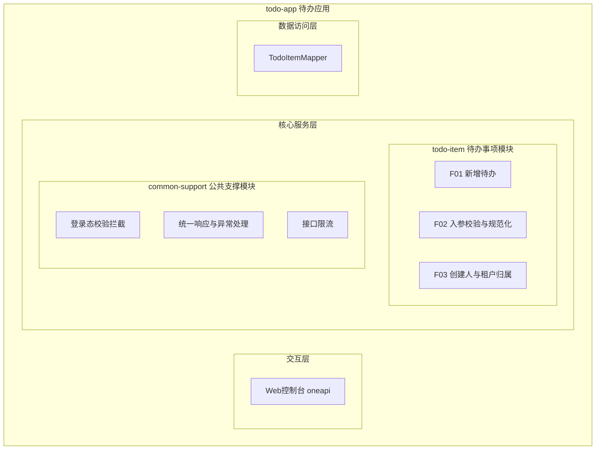
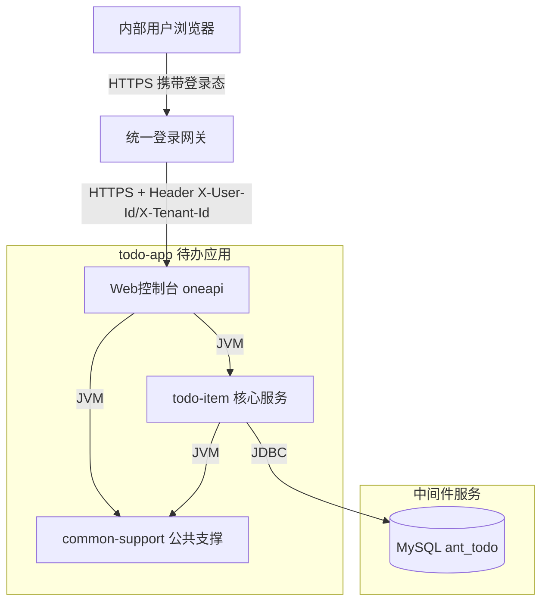
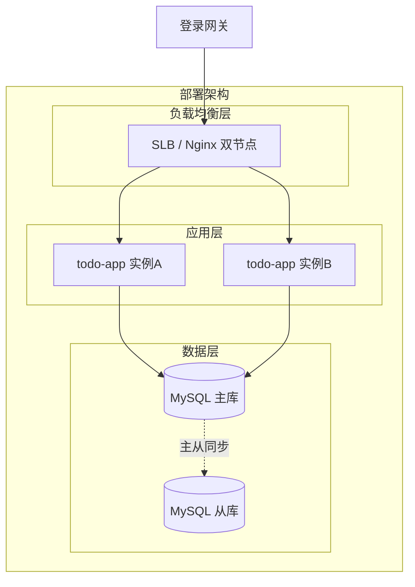
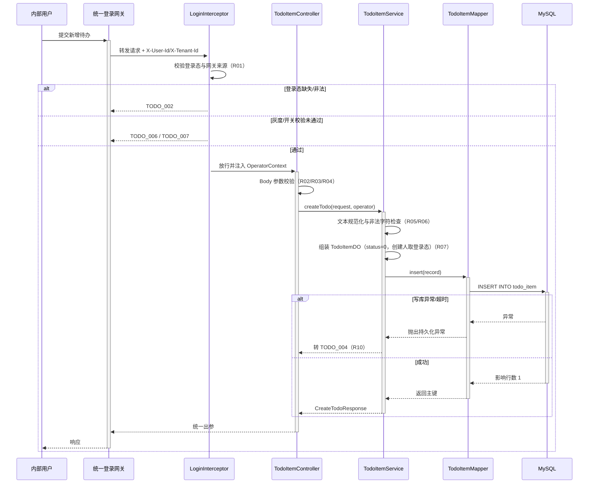
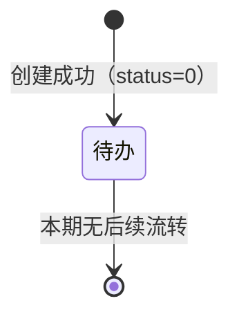
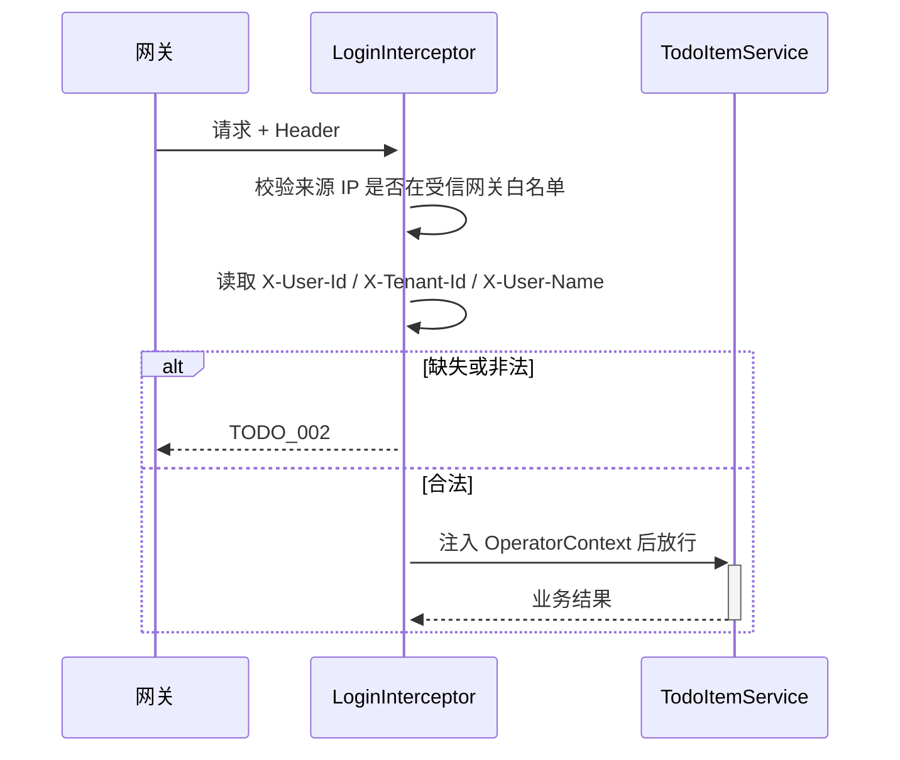

> **文档元信息**
>
> | 项目 | 内容 |
> |------|------|
> | 文档版本 | v1.0 |
> | 作者 | AiWork |
> | 创建日期 | 2026-10-29 |
> | 需求来源 | 任务需求「帮助用户记录日常待办事项 — 新增待办事项」 |
> | 评审状态 | 待评审 |

# 待办事项（新增待办）系分设计

## 1. 需求与范围

### 1.1 背景与目标

内部用户在日常工作中需要记录零散的待办事项，目前缺少统一的记录入口。本期提供「新增待办事项」能力：用户输入事项名称与描述，提交后持久化保存，作为后续列表、提醒、看板等能力的数据基础。

目标是交付一个最小可用闭环（仅创建）：调用方一次请求即可把一条待办落库，并在响应中返回新建记录的唯一标识与创建时间。

### 1.2 核心功能

- 新增待办事项：填写事项名称与事项描述，提交后生成一条待办记录。
- 归属识别：记录创建人与所属租户，取值为网关透传的登录态信息，不由前端传入。
- 入参校验与规范化：名称必填、长度受限；描述选填、长度受限；前后空白裁剪。

### 1.3 约束与非功能要求

| 类别 | 要求 |
|------|------|
| 技术栈 | Java 8 + Spring Boot 2.7 + MyBatis-Plus + MySQL；同仓新增 `com.antdigital.todo` 包，不修改既有 `com.antdigital.sort` 包 |
| 性能 | 单条创建 P99 < 200ms（应用侧，不含网络）；支撑单实例 50 QPS |
| 可用性 | 服务可用性 99.9%；应用多副本无状态部署，无单点 |
| 数据 | 记录永久保留（本期不做清理）；新增表遵循库表规范（InnoDB、utf8mb4、整型自增主键、无外键） |
| 安全 | 必须登录后调用；不得越权代表他人创建（创建人只能取自登录态） |
| 一致性 | 创建成功 = 记录已落库；不做服务端幂等，重复提交产生多条记录为可接受结果 |

### 1.4 排除范围

- 待办列表查询、详情查询、编辑、删除、标记完成、状态流转。
- 提醒/通知（站内信、邮件、IM 推送）、到期时间、优先级、标签、附件、子任务、共享协作。
- 对外 OpenAPI 开放、批量导入、数据回收站与恢复。
- 服务端幂等键、防重令牌、分布式锁。

### 1.5 需求功能清单与优先级

| 编号 | 功能点 | 优先级 | 原始描述/章节 | 备注 |
|------|--------|--------|---------------|------|
| F01 | 新增待办事项（名称+描述提交并落库） | P0 | 「核心功能：新增待办事项」「最小闭环：仅创建」 | 主流程 |
| F02 | 入参校验与文本规范化 | P0 | 「任务信息：事项名称和描述」 | 名称必填，描述选填 |
| F03 | 创建人与租户归属识别 | P1 | 「目标用户：内部用户」 | 登录态透传，服务端强制 |

### 1.6 假设与待确认项

| 编号 | 假设/待确认内容 | 当前假设 | 确认状态 |
|------|-----------------|----------|----------|
| A01 | 运行形态 | 在 `sort-core` 仓库内新增 Spring Boot Web 应用能力（新增依赖与启动类），既有排序模块保持不变 | 待确认 |
| A02 | 数据存储 | 使用 MySQL 新增库 `ant_todo`、表 `todo_item` | 待确认 |
| A03 | 字段约束 | 名称必填 1~100 字符；描述选填 ≤500 字符；均按字符计（非字节） | 待确认 |
| A04 | 身份来源 | 内部统一登录网关已就绪，通过 Header `X-User-Id`、`X-User-Name`、`X-Tenant-Id` 透传；不在本系统自建登录 | 待确认 |
| A05 | 成功后跳转 | 前端在 `result=OK` 后跳转/刷新列表页，本期列表页由别的需求提供 | 待确认 |
| A06 | 重复提交 | 不做服务端幂等，前端按钮置灰防重；重复记录可接受 | 待确认 |
| A07 | 富文本 | 描述为纯文本，若前端编辑器输出 HTML 则服务端按纯文本转义存储 | 待确认 |
| A08 | 租户维度 | 每个用户属于唯一租户，`tenant_id` 由网关给出，非空 | 待确认 |

## 2. 架构与模块

### 2.1 功能架构



- **交互层**：仅一个 oneapi 写接口 `POST /api/todo/item/create`，供内部 Web 控制台调用；本期不开放 OpenAPI。
- **核心服务层**：`todo-item` 承载待办创建全部业务规则；`common-support` 提供跨模块横切能力，不承载业务语义。
- **数据访问层**：`TodoItemMapper` 单表写入，无跨表事务。

**模块清单**

| 模块 | 职责 | 依赖 |
|------|------|------|
| todo-item | 待办事项创建：参数校验、业务规则校验、实体组装、落库、结果返回 | common-support、MySQL |
| common-support | 登录态拦截、统一响应封装、全局异常处理、限流、埋点 | 无业务模块依赖 |

依赖方向单向：`todo-item → common-support`，无循环依赖。

### 2.2 应用集成架构



**集成关系说明**

| 调用方 | 被调用方 | 协议 | 接口类型 | 说明 |
|--------|----------|------|----------|------|
| 内部用户浏览器 | 统一登录网关 | HTTPS | - | 已完成登录并持有会话 |
| 统一登录网关 | 应用 Web控制台 | HTTPS | oneapi REST | 透传登录态 Header，应用只信任网关来源 |
| 应用 todo-item | MySQL | JDBC | SQL | 单表 insert，无跨库调用 |

外部依赖仅登录网关与 MySQL，两者异常时本系统直接快速失败并返回明确错误码，不做旁路兜底（创建动作无降级语义）。

### 2.3 部署架构



**部署说明**

- **负载均衡层**：SLB/Nginx 双节点（或云厂商托管 SLB），无单点。
- **应用层**：≥2 副本，无状态，滚动发布；健康检查 `/api/actuator/health`（仅内网）。
- **数据层**：MySQL 主从，本期仅用主库写入；从库供后续列表查询；不做跨机房双写（本期数据量小，同可用区主从即可，跨机房能力下期随列表查询一并建设）。
- **私有化场景**：容器化部署，镜像 + ConfigMap 注入数据库与开关配置。

## 3. 数据模型与存储

### 3.1 实体清单

| 实体名称 | 实体说明 | 所属模块 | 与其他实体的关系 |
|----------|----------|----------|-----------------|
| TodoItem | 一条待办事项，包含名称、描述、状态、创建人归属 | todo-item | 无（本期单实体，无关联实体） |

### 3.2 实体关系图


**模型说明**

- 本期只引入 `TodoItem` 一个实体，不存在实体间关系，因此无外键、无关联表、无级联规则。
- 逻辑归属关系（用户、租户）通过 `tenant_id`、`creator_id` 冗余字段表达，不与用户中心建库级外键，避免跨库强耦合。
- 无缓存、无消息队列：创建为单次写库动作，不引入中间态数据。

## 4. 接口设计

### 4.1 oneapi（Web 控制台接口）

| 编号 | 接口名称 | 方法 | 路径 | 模块 |
|------|----------|------|------|------|
| W01 | 新增待办事项 | POST | /api/todo/item/create | todo-item |

### 4.2 OpenAPI（对外接口）

本项不适用，原因：需求面向内部用户、仅 Web 控制台使用，不对外开放。

### 4.3 内部接口（Service 层）

| 编号 | 接口名称 | 类 | 方法签名 |
|------|----------|------|----------|
| S01 | 创建待办 | TodoItemService | CreateTodoResponse createTodo(CreateTodoRequest request, OperatorContext operator) |
| S02 | 写入待办记录 | TodoItemMapper | int insert(TodoItemDO record) |

### 4.4 集成接口（Integration 层）

本项不适用，原因：本期无第三方系统调用；登录态由网关 Header 透传，无需应用主动调用外部接口。

## 5. 功能模块设计

**全局约定**

| 约定项 | 内容 |
|--------|------|
| 通用出参结构 | `{result, msg, data}`；成功 `result=OK`、`msg=SUCCESS`；失败 `result=<错误码>`、`msg=<提示文案>`、`data=null` |
| 错误码格式 | `{MODULE}_{SEQ}`，本模块前缀 `TODO` |
| 异常处理 | 全局异常处理器统一捕获校验异常、业务异常、未知异常，统一转出参结构 |
| 时间格式 | `yyyy-MM-dd HH:mm:ss`，时区 UTC+8 展示、库内 `datetime` |

### 5.1 待办事项模块（todo-item）

#### 5.1.1 表结构设计

##### 5.1.1.1 todo_item（待办事项表）

| 字段名 | 数据类型 | 约束 | 默认值 | 说明 |
|--------|----------|------|--------|------|
| id | bigint | PK, 自增 | - | 记录主键，全局唯一 |
| tenant_id | varchar(64) | NOT NULL | '' | 租户标识，取自登录态，索引列禁止 NULL |
| title | varchar(200) | NOT NULL | '' | 事项名称，业务限制 1~100 字符；列宽留 2 倍余量以兼容 emoji/多字节 |
| description | varchar(1000) | NOT NULL | '' | 事项描述，业务限制 ≤500 字符；空描述存空串，不存 NULL |
| status | tinyint | NOT NULL | 0 | 待办状态：0=待办（本期仅此取值） |
| creator_id | varchar(64) | NOT NULL | '' | 创建人 ID，取自登录态 |
| creator_name | varchar(128) | NOT NULL | '' | 创建人展示名（冗余，便于后续列表免关联查询） |
| gmt_create | datetime | NOT NULL | CURRENT_TIMESTAMP | 创建时间 |
| gmt_modified | datetime | NOT NULL | CURRENT_TIMESTAMP | 最后修改时间，由代码逻辑维护 |

**索引：**

| 索引名 | 类型 | 字段 | 说明 |
|--------|------|------|------|
| PRIMARY | 主键 | id | 自增主键，满足整型单列主键规范 |
| idx_todo_item_tenant_creator | 普通索引 | (tenant_id, creator_id, gmt_create) | 供后续「我的待办」列表按租户+创建人倒序分页；区分度高的列在前 |

**表设计说明**

- 满足第一范式（字段原子、无二义）与第二/第三范式（主键 `id` 单列，非主属性完全依赖主键；`creator_name` 为有意冗余以换取列表查询免联表，属可控反范式，冗余值在创建时一次写入且不可变）。
- 无外键、无触发器、无视图、无存储过程；引擎 InnoDB 由库级默认决定，不在建表语句指定。
- 本期为新增表，不涉及已上线表变更与字段迁移；初始化数据无（状态值由代码常量维护）。

##### 5.1.1.2 枚举与常量定义

| 枚举名称 | 取值 | 含义 | 关联字段 |
|----------|------|------|----------|
| TodoStatus | 0 | 待办（未完成） | todo_item.status |
| ResultCode | OK | 成功 | 响应 result |
| ResultCode | TODO_001 | 参数校验失败 | 响应 result |
| ResultCode | TODO_002 | 未登录或登录态失效 | 响应 result |
| ResultCode | TODO_003 | 无权代表该用户/租户创建 | 响应 result |
| ResultCode | TODO_004 | 系统繁忙，请稍后重试 | 响应 result |
| ResultCode | TODO_005 | 内容包含非法字符 | 响应 result |
| ResultCode | TODO_006 | 功能未开放（灰度未命中） | 响应 result |
| ResultCode | TODO_007 | 功能已临时关闭 | 响应 result |

**常量：** `TITLE_MAX_LEN=100`、`DESC_MAX_LEN=500`、`DEFAULT_STATUS=0`、`INSERT_TIMEOUT_MS=3000`。

#### 5.1.2 接口详细设计

##### W01 新增待办事项

- **URI**: `POST /api/todo/item/create`
- **描述**: 创建一条待办事项记录。创建人与租户取自登录态，前端不可指定。
- **入参（Body，application/json）**:

| 参数名称 | 类型 | 是否必填 | 描述 |
|----------|------|----------|------|
| title | String | 是 | 事项名称；去首尾空白后长度 1~100 字符；不可全为空白 |
| description | String | 否 | 事项描述；≤500 字符；不传或空白按空串存储 |

- **入参（Header，由网关注入）**:

| 参数名称 | 类型 | 是否必填 | 描述 |
|----------|------|----------|------|
| X-User-Id | String | 是 | 登录用户 ID；应用不信任客户端直传，仅信任网关来源 |
| X-User-Name | String | 否 | 登录用户展示名；缺失时以 X-User-Id 兜底 |
| X-Tenant-Id | String | 是 | 租户 ID |
| X-Trace-Id | String | 否 | 链路追踪 ID，缺失时应用生成 |

- **出参（data 对象）**:

| 参数名称 | 类型 | 描述 |
|----------|------|------|
| result | String | 结果码，成功为 OK |
| msg | String | 提示信息，成功为 SUCCESS |
| data.id | Long | 新建记录主键 |
| data.title | String | 规范化后的事项名称（去空白后） |
| data.status | Integer | 记录状态，固定 0 |
| data.gmtCreate | String | 创建时间 yyyy-MM-dd HH:mm:ss |

- **错误码**:

| 错误码 | 说明 |
|--------|------|
| TODO_001 | 参数校验失败（名称为空/超长、描述超长） |
| TODO_002 | 未登录或登录态失效 |
| TODO_003 | 登录态与请求归属不一致（如租户 Header 与登录态不符） |
| TODO_004 | 系统繁忙（DB 异常/超时/未知异常） |
| TODO_005 | 内容包含非法字符（控制字符、非法编码） |
| TODO_006 | 功能未开放（灰度未命中当前租户） |
| TODO_007 | 功能已临时关闭（总开关关闭） |

- **业务规则**: 见 5.1.3.1 规则表 R01~R10；单条创建一次 insert，无事务嵌套。
- **幂等性**: 不做服务端幂等，重复调用生成多条记录；前端按钮置灰防抖。

- **请求示例**:
```json
{
  "title": "整理季度汇报材料",
  "description": "汇总三条业务线数据，周三前发评审"
}
```

- **响应示例**:
```json
{
  "result": "OK",
  "msg": "SUCCESS",
  "data": {
    "id": 102401,
    "title": "整理季度汇报材料",
    "status": 0,
    "gmtCreate": "2026-10-29 09:35:12"
  }
}
```

- **失败响应示例**:
```json
{
  "result": "TODO_001",
  "msg": "事项名称不能为空",
  "data": null
}
```

#### 5.1.3 子功能详细设计

##### 5.1.3.1 新增待办事项（F01 / F02 / F03）

- **处理时序**



- **业务规则**

| 规则编号 | 规则描述 | 校验时机 | 不满足时的处理 |
|----------|----------|----------|--------------|
| R01 | 必须存在有效登录态，且请求来源为受信网关；`X-User-Id`、`X-Tenant-Id` 非空 | 请求进入时 | 返回 TODO_002，不进入业务层 |
| R02 | `title` 必填，去首尾空白后长度 1~100 字符 | Controller 参数校验 | 返回 TODO_001，msg=「事项名称不能为空」或「事项名称不能超过100个字符」 |
| R03 | `description` 选填，去首尾空白后长度 ≤500 字符 | Controller 参数校验 | 返回 TODO_001，msg=「事项描述不能超过500个字符」 |
| R04 | `description` 缺省或全空白时按空串处理，不落 NULL | Service 组装前 | 正常通过，存空串 |
| R05 | 文本规范化：去除首尾空白、全角空格归一为半角、连续空白折叠为单个空格；名称与描述均适用 | Service 组装前 | - |
| R06 | 文本包含控制字符（除 \n、\t）或非法 UTF-8 编码时拒绝 | Service 组装前 | 返回 TODO_005 |
| R07 | 创建人/租户只能取自 `OperatorContext`，忽略 Body 中任何同名参数；`creator_name` 缺失时以 `creator_id` 兜底 | Service 组装时 | 强制覆盖，不报错 |
| R08 | 新建记录 `status` 固定为 0（待办），不接受前端指定 | Service 组装时 | 强制覆盖 |
| R09 | 总开关关闭时直接拒绝；灰度开关开启但当前租户尾号未命中时拒绝 | 进入业务逻辑前 | 返回 TODO_007 / TODO_006 |
| R10 | 落库必须成功（影响行数=1）才返回 OK；任何持久化异常统一转 TODO_004，不暴露 SQL 细节 | 写库返回后 | 返回 TODO_004 |

- **异常场景**

| 异常场景 | 处理方式 |
|----------|----------|
| 请求 Body 非 JSON / 字段类型不符 | 全局异常处理器捕获反序列化异常 → TODO_001 |
| 登录态过期、Header 缺失 | 拦截器直接拒绝 → TODO_002 |
| 网关来源非法（非内网来源 IP） | 拦截器拒绝 → TODO_002，记录安全日志 |
| 名称仅由空白字符组成 | R02 判定为空 → TODO_001 |
| 描述超长（>500 字符） | R03 → TODO_001，提示具体字段 |
| 文本含控制字符 | R06 → TODO_005 |
| DB 连接超时 / 死锁 / 主库不可用 | 3s 超时快速失败 → TODO_004，日志记录 SQL 异常摘要与 traceId |
| DB 主键冲突（极端情况） | 视为系统异常 → TODO_004，由前端提示重试 |
| 同一用户 1 秒内连续提交（前端防重失效） | 允许创建多条，不拦截（见 A06） |

- **事务与回滚**：单表单条 insert，无跨表写，使用单条语句自动提交；不引入显式事务，异常时该条记录不会产生，无需回滚策略。

- **并发控制**
  - 并发场景：同一用户多标签页/重复点击并发提交；不同用户并发创建互不影响。
  - 控制策略：无并发冲突（insert 只新增、不更新共享数据），采用数据库自增主键保证唯一性；不引入乐观锁/分布式锁。限流用于保护整体容量（见 6.3），不属于并发正确性问题。

- **状态机设计**



- **状态流转规则**

| 当前状态 | 目标状态 | 流转条件 | 前置校验 | 触发动作 |
|----------|----------|----------|----------|----------|
| （初始） | 待办(0) | 创建接口调用成功 | R01~R10 全部通过 | 写入 todo_item，返回 id |
| 待办(0) | — | 本期无流转（完成/取消由后续需求设计） | - | - |

说明：本期仅创建，状态机只有初始入边，无孤岛状态；`status` 为后续扩展预留。

- **技术选型：持久层**

| 维度 | 方案A MyBatis-Plus | 方案B Spring Data JPA | 方案C JdbcTemplate |
|------|--------------------|----------------------|---------------------|
| 单表写入代码量 | 低（BaseMapper 直接 insert） | 低 | 中（手写 SQL 参数绑定） |
| SQL 可控性/索引可解释性 | 高 | 中（生成 SQL 需观察） | 高 |
| 团队熟悉度 | 高 | 中 | 高 |
| 后续列表分页支持 | 内置分页插件 | 内置 | 需手写 |
| 引入成本 | 一个 starter | 一个 starter + 实体注解 | 已在 web starter 内 |

**推荐并采用：方案A MyBatis-Plus**。理由：与团队主流选型一致，单表 CRUD 与后续分页扩展成本最低，SQL 可审计；JPA 的自动 DDL/懒加载在规范库表场景下收益为负，JdbcTemplate 在后续列表需求下重复代码偏多。

- **技术选型：入口校验位置**

| 维度 | 方案A Bean Validation（注解式） | 方案B Service 内手工校验 |
|------|-------------------------------|--------------------------|
| 一致性 | 高，校验声明式集中 | 低，易漏 |
| 与统一异常处理配合 | 好（MethodArgumentNotValidException 统一捕获） | 需自定义异常 |
| 可测性 | 好 | 好 |

**推荐并采用：方案A**，长度与必填用注解声明，跨字段与规范化逻辑（R05/R06）仍放在 Service，避免注解承载业务语义。

- **模块自检**

| 检查项 | 结论 |
|--------|------|
| F01/F02/F03 是否都有对应设计 | 通过（F01 主流程、F02 R02~R06、F03 R01/R07） |
| 表结构是否覆盖全部业务字段 | 通过（名称、描述、状态、创建人、租户、时间） |
| 接口是否覆盖需求全部操作 | 通过（仅创建，符合最小闭环） |
| 枚举与字段取值是否一致 | 通过（TodoStatus 0 与 status 默认 0 一致） |
| 过度设计检查 | 通过：未引入幂等表、分布式锁、MQ、缓存、审批流 |

### 5.2 公共支撑模块（common-support）

#### 5.2.1 表结构设计

本模块无表结构，原因：仅提供横切能力（拦截、封装、限流），不持久化业务数据。

#### 5.2.2 内部接口

| 编号 | 名称 | 类 | 方法签名 | 说明 |
|------|------|------|----------|------|
| S03 | 登录态解析 | LoginInterceptor | boolean preHandle(HttpServletRequest, HttpServletResponse, Object) | 校验网关来源与登录 Header，写入 OperatorContext |
| S04 | 统一响应封装 | ApiResponse | static <T> ApiResponse<T> ok(T data) / fail(String code, String msg) | 统一出参结构 |
| S05 | 全局异常处理 | GlobalExceptionHandler | handle(Exception) → ApiResponse | 校验异常/业务异常/未知异常映射错误码 |
| S06 | 限流 | RateLimitInterceptor | boolean preHandle(...) | 按 userId 维度令牌桶限流 |

#### 5.2.3 子功能设计

**登录态拦截（C01）**



| 规则编号 | 规则描述 | 校验时机 | 不满足时的处理 |
|----------|----------|----------|--------------|
| R11 | 来源 IP 必须在受信网关白名单内，否则视为未授权访问 | 请求进入 | TODO_002，记安全日志 |
| R12 | `X-User-Id`、`X-Tenant-Id` 去空白后非空且长度 ≤64 | 请求进入 | TODO_002 |
| R13 | 若请求携带 `tenantId` 查询参数且与登录态不一致 | 请求进入 | TODO_003 |

**统一异常与响应（C02）**

| 异常类型 | 映射错误码 | 说明 |
|----------|-----------|------|
| MethodArgumentNotValidException / 反序列化异常 | TODO_001 | 取首个字段错误提示返回 |
| BizException | 自带错误码 | 业务规则显式抛出 |
| PersistenceException / TimeoutException | TODO_004 | 仅记录内部日志，对外统一文案 |
| 其他 Exception | TODO_004 | 兜底，含 traceId 供排障 |

**限流（C03）**

- 粒度：userId 维度，默认 10 QPS/用户，实例级令牌桶；超限返回 TODO_004 并提示稍后重试。
- 无缓存依赖：使用进程内令牌桶，多副本下为近似限流（可接受，用户级限流精度要求低）。

**技术选型：校验与限流**

| 维度 | 方案A 进程内令牌桶（Guava RateLimiter） | 方案B Redis + Lua 集中限流 |
|------|-----------------------------------------|----------------------------|
| 精度 | 实例级，多副本近似 | 全局精确 |
| 引入依赖 | 无新增中间件 | 需 Redis |
| 故障影响 | 无外部依赖 | Redis 故障需降级 |

**推荐并采用：方案A**。理由：本需求流量规模小（50 QPS/实例），引入 Redis 仅为本功能不经济；限流目的为保护自身容量而非计费，近似限流足够。

## 6. 非功能性需求设计

### 6.1 高可用性

- 应用 ≥2 副本无状态部署，单实例故障由 LB 摘除，用户重试即可成功（创建动作无副作用，重试安全）。
- MySQL 主库异常：接口 3s 超时快速失败，返回 TODO_004，不阻塞线程池；连接池设置最大等待时间，避免请求堆积拖垮应用。
- 登录网关异常：请求无法到达应用，属于上游不可用，本系统无需额外兜底；不缓存登录态以避免越权风险。
- 无 MQ、无缓存，因此无消息堆积与缓存击穿类风险。

### 6.2 可扩展性

- 水平扩容：应用无状态，直接加副本；接口层无限流单点。
- 数据层扩展：`tenant_id` 已作为索引首列，后续可按租户分库分表；主键为自增 bigint，满足全局唯一要求。
- 功能扩展：`status` 字段与 `idx_todo_item_tenant_creator` 索引已为列表/完成态能力预留；新增列表接口不需改表。
- 依赖可替换：持久层通过 Mapper 隔离，后续切换存储只需改数据访问层实现。

### 6.3 稳定性/可靠性

- 边界输入：空名称、纯空白、超长、含控制字符、超长描述、缺字段均有明确错误码，不抛 500 原始堆栈。
- 容量保护：用户级 10 QPS 限流 + 连接池上限（最大 20，等待 1s），防止突发流量打满 DB。
- 超时：HTTP 接口 5s、DB 语句 3s，均为有限等待，无死等。
- 数据可靠性：单条 insert 自动提交，成功即持久化；主从异步复制存在秒级延迟，本期不使用从库读，无读到旧数据风险。

### 6.4 安全性设计

#### 6.4.1 账户系统方案

使用内部统一登录网关（办公网 buc / IAM 体系既有能力），本系统不自建注册、登录、找密。应用只消费网关透传的登录态 Header，不实现密码逻辑，不存储任何凭证。

#### 6.4.2 授权与访问控制

##### 6.4.2.1 水平权限检查

涉及。创建人归属由服务端强制注入（R07）：`tenant_id`、`creator_id` 全部取自登录态，Body 中同名参数被忽略，因此用户无法以他人身份创建记录。查询类接口本期不涉及，后续列表接口需按 `tenant_id + creator_id` 过滤。

##### 6.4.2.2 垂直权限检查

本项不适用，原因：新增待办为所有内部用户均具备的基础能力，无角色差异；后续若引入管理员代建能力，再按 IAM 角色配置。

##### 6.4.2.3 登录态检查

全局 `LoginInterceptor` 统一拦截 `/api/**`，仅健康检查与内部监控端点白名单放行；不依赖单接口自行判断。

#### 6.4.3 数据防护方案

##### 6.4.3.1 敏感数据加密存储

本项不适用，原因：待办名称与描述为一般业务文本，不含身份证、银行卡、生物特征等敏感个人信息；若后续支持附件或敏感字段，另行评估加密方案。

##### 6.4.3.2 敏感数据展示脱敏

- 描述与名称按纯文本存储，页面渲染时统一 HTML 转义，防止 XSS（R06 已过滤控制字符）。
- 日志打印不输出 `description` 全文，仅打印长度与 traceId；`creator_id` 在日志中保留（内部 ID，非手机号/证件）。
- 接口响应仅返回本人创建的记录字段，不含其他用户信息。

### 6.5 监控/统计/日志/告警

| 类型 | 内容 |
|------|------|
| 指标 | 接口 QPS、P99 RT、错误码分布（TODO_001~TODO_007 分桶）、DB insert 耗时、连接池活跃数 |
| 日志 | 访问日志（traceId、userId、tenantId、耗时、结果码）；异常日志（异常摘要 + traceId）；不打印描述全文 |
| 告警 | 错误率 >1%（5 分钟窗口）；P99 >500ms 持续 5 分钟；TODO_004 连续 10 次；DB insert 失败率 >5% |
| 统计 | 每日新增待办条数（按租户聚合），供运营观察使用 |

## 7. 变更三板斧

### 7.1 可监控

- 服务埋点：Controller 入口与 Service 出口埋点（调用方、处理结果、耗时、traceId），覆盖成功/失败分支。
- 数据埋点：insert 影响行数与耗时上报；异常按错误码打点，便于区分「用户输入问题（TODO_001/005）」与「系统问题（TODO_004）」。
- 三方埋点：本项不适用，原因：无第三方服务调用；登录网关由网关侧统一监控。

### 7.2 可灰度

- 方案对比：
  - 方案A 按租户尾号灰度（配置 `todo.create.gray-tenant-suffix=0,1,2`，未命中返回 TODO_006）：实现简单、可精确放量、无额外依赖。
  - 方案B 按用户白名单灰度（配置 userId 列表）：适合小范围内测，但名单维护成本高。
  - 方案C 网关注入流量比例：需网关侧改造，超出本期范围。
- **推荐并采用：方案A**（可叠加 B 作为内测阶段手段）。默认灰度关闭（`gray-enabled=false`）即全量，上线初期置为 `0,1,2` 观察后逐步放开。

### 7.3 可应急

- 主开关 `todo.create.enabled`（配置中心动态生效）：关闭后接口直接返回 TODO_007，不写库、不影响既有其他能力。
- 优先使用开关而非回滚：本次为新增能力，无旧逻辑需切回，关闭开关即可止血。
- 回滚兼容性：新增库表独立，回滚代码后遗留的 `todo_item` 表与数据不影响旧版本运行（旧版本不读取该表），因此回滚时保留表、不执行 DROP，避免数据丢失。
- 配置项（库连接、灰度尾号、开关、限流阈值）均支持热更新，应急时无需发版。
