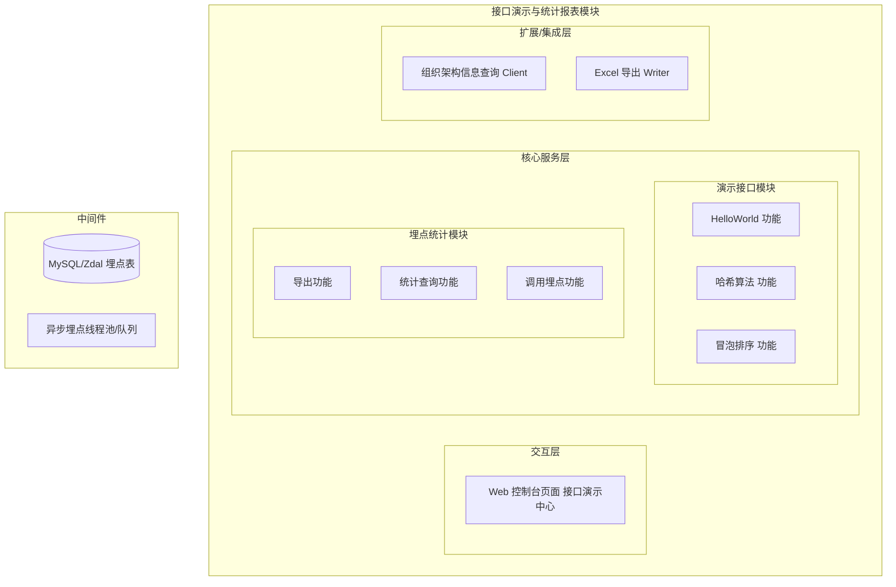
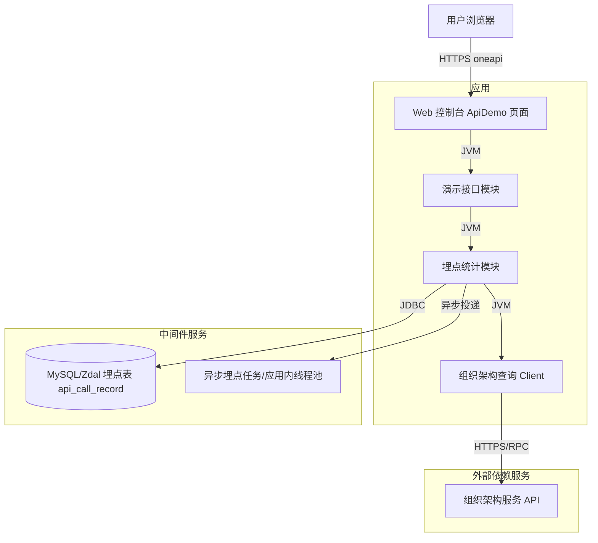
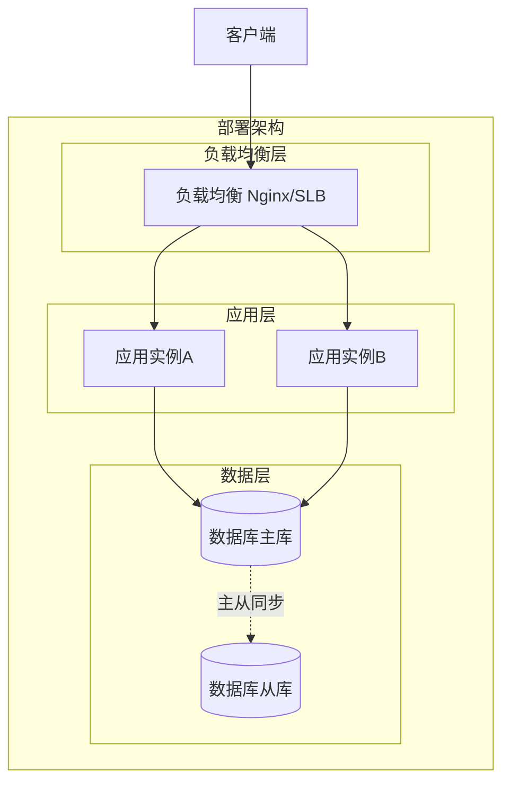
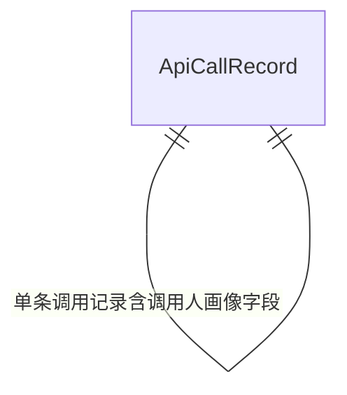
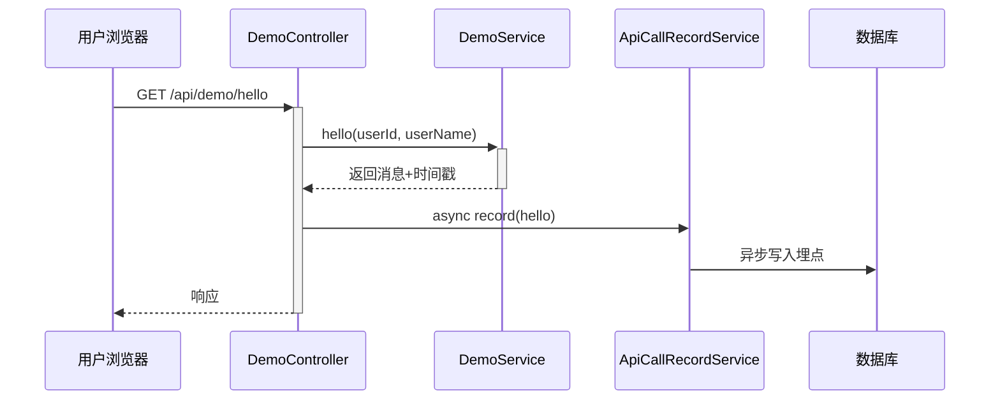
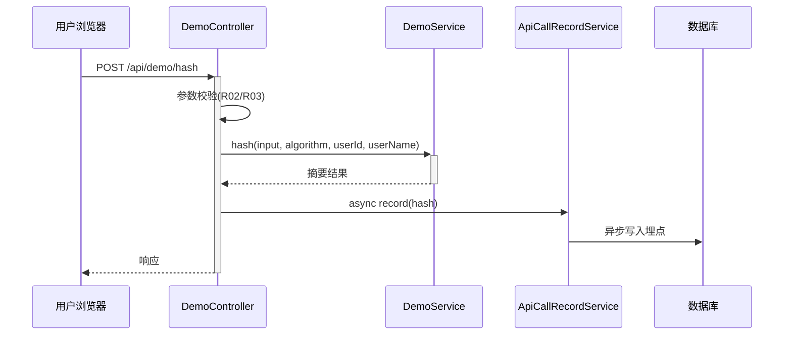
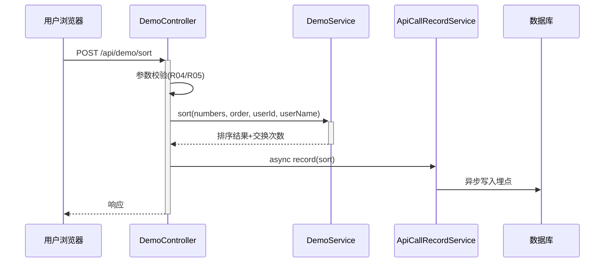
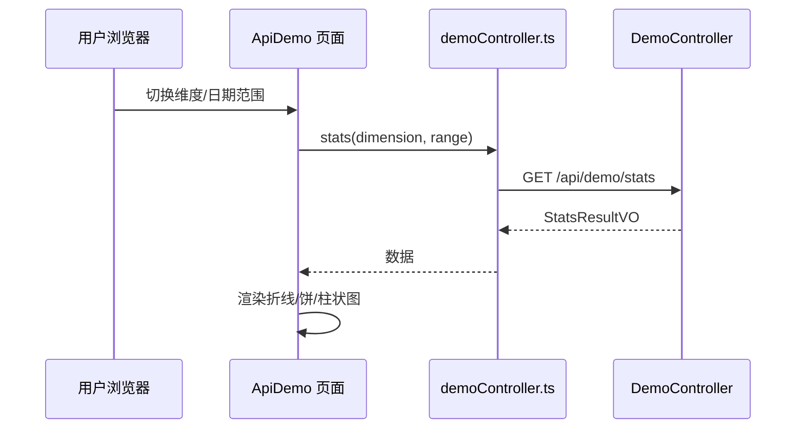

> **文档元信息**
>
> | 项目 | 内容 |
> |------|------|
> | 文档版本 | v1.0 |
> | 作者 | AiWork |
> | 创建日期 | 2026-10-30 |
> | 需求来源 | 任务需求描述；附件 `20260831-接口统计报表5.md`（接口演示与统计报表 — 设计规格，草案，2026-08-31） |
> | 评审状态 | 待评审 |

# 接口演示与统计报表 系分设计

## 1. 需求与范围

### 1.1 背景与目标

在现有平台内新增「接口演示与统计报表」功能模块：提供三个经典示例/算法接口（HelloWorld、哈希算法、冒泡排序）的前端可视化执行与结果展示；对每次接口调用进行调用埋点（记录调用人、调用次数及调用人的人员类型/层级/部门），并配套数据导出与多维度可视化统计报表。

目标：

- 后端提供 3 个可执行示例接口 + 统一导出接口 + 埋点统计查询接口。
- 前端新增一个页面，用 3 个 Tab 分别展示三类接口的执行结果。
- 页面提供导出按钮，导出对应 Tab 的展示结果。
- 页面内嵌调用统计报表，支持按人员类型 / 人员层级 / 人员部门三维度查看，并以折线图、饼图、柱状图三种形式呈现。

### 1.2 核心功能

| 功能域 | 能力 |
|--------|------|
| 接口演示 | HelloWorld、哈希算法（SHA-256，可选 MD5/SHA-1）、冒泡排序（升/降序） |
| 调用埋点 | 每次接口调用异步记录调用人、调用次数、调用结果与调用人画像（类型/层级/部门） |
| 数据导出 | 按 Tab（hello/hash/sort）导出执行结果为 Excel（xlsx） |
| 统计查询 | 按人员类型 / 人员层级 / 人员部门维度聚合调用次数，支持日期范围 |
| 报表可视化 | 折线图（每日趋势）、饼图（占比）、柱状图（对比） |

### 1.3 约束与非功能要求

- 后端沿用现有 SOFABoot 技术栈；前端沿用现有 Bigfish 框架与 `@ant-design/charts` 图表库。
- 导出使用 Apache POI（版本按现有 pom 声明，附件为 5.2.3）。
- 埋点写入不得阻塞接口主流程（异步化 + 失败降级）。
- 数据库沿用现有 MySQL/Zdal 数据源，遵循《数据库设计规范》（references/db.md）。
- 实现范围不含权限控制、国际化、性能专项优化、埋点数据定期清理（见第 9/10 章假设与实施边界）。

### 1.4 排除范围

| 排除项 | 说明 |
|--------|------|
| 权限控制 | 所有登录用户可访问，本设计不引入角色/资源鉴权扩展 |
| 国际化 | 仅中文 |
| 性能专项优化 | 演示接口，数据量极小，不引入额外性能优化 |
| 埋点数据清理策略 | 本期不做定期清理（数据量可控） |

### 1.5 需求功能清单与优先级

| 编号 | 功能点 | 优先级 | PRD 原始描述/章节 | 备注 |
|------|--------|--------|-------------------|------|
| F01 | HelloWorld 示例接口 | P0 | 「写接口 helloworld」 | GET，自动返回消息+时间戳 |
| F02 | 哈希算法接口 | P0 | 「写接口 哈希算法」 | POST，支持 MD5/SHA-1/SHA-256 |
| F03 | 冒泡排序接口 | P0 | 「写接口 冒泡排序」 | POST，支持 asc/desc，返回交换次数 |
| F04 | 前端 Tab 页面 | P0 | 「前端新增一个页面，有三个 tab 分别展示不同的执行结果」 | 3 个 Tab |
| F05 | 导出按钮 + 后台导出接口 | P0 | 「新增导出按钮，后台提供导出接口，支持导出各个页面的展示结果」 | 按 Tab 导出 xlsx |
| F06 | 调用埋点 | P0 | 「后端再做个埋点，获取调用次数和调用人」 | 异步写入埋点表 |
| F07 | 调用统计查询接口 | P0 | 「获取调用次数和调用人」+ 可视化 | 按维度聚合 |
| F08 | 前端报表可视化 | P0 | 「前端在当前页面上可视化出来一个报表查看调用情况（人员类型/层级/部门），折线图以及饼图和柱状图」 | 三图三类 |

### 1.6 假设与待确认项

| 编号 | 假设/待确认内容 | 当前假设 | 确认状态 |
|------|-----------------|----------|----------|
| A01 | 后端/前端代码落位仓库 | 任务提供 `manyu_test`（后端，已有 `bubble_sort.py`）与 `manyu_test1`（前端，仅 README）；附件所述 SOFABoot/Bigfish 真实工程与当前最小测试仓结构不一致 | 待确认 |
| A02 | 调用人画像来源 | 从登录会话上下文获取工号/姓名，人员类型/层级/部门通过组织架构接口查询并冗余到埋点表 | 待确认 |
| A03 | 默认统计时间窗 | 未指定日期时默认近 7 天 | 待确认 |
| A04 | 埋点存储清洗 | 埋点表冗余调用人画像字段，采用异步写入，写入失败降级为日志 | 待确认 |
| A05 | 表格引擎/建表方式 | 表结构随设计文档交付，建表由实施阶段通过 MyBatis/脚本完成 | 待确认 |

---

## 2. 架构与模块

### 2.1 功能架构



- 交互层说明：前端单页 `ApiDemo` 提供 Tab 演示、导出按钮与报表可视化。
- 核心服务层说明：演示接口模块提供三类算法/示例接口执行；埋点统计模块提供埋点、导出、统计查询能力。
- 扩展/集成层说明：调用人画像（人员类型/层级/部门）依赖组织架构查询 Client；导出依赖 Excel 写入 Writer（Apache POI）。

**模块清单**

| 模块 | 职责 | 依赖 |
|------|------|------|
| 演示接口模块 | HelloWorld/哈希/冒泡排序三个接口的执行与结果返回 | 埋点统计模块（触发调用记录） |
| 埋点统计模块 | 调用埋点写入、按维度聚合统计、按 Tab 导出 | 演示接口模块、组织架构查询 Client、Excel Writer、MySQL |
| 组织架构信息查询 | 提供人员类型/层级/部门画像 | 外部组织架构系统 |
| Excel 导出 | 生成 xlsx 文件流 | Apache POI |

### 2.2 应用集成架构



**集成关系说明：**

| 调用方 | 被调用方 | 协议 | 接口类型 | 说明 |
|--------|----------|------|----------|------|
| 用户浏览器 | 应用 Web 控制台 | HTTPS | oneapi REST | 页面交互与报表展示 |
| 演示接口模块 | 埋点统计模块 | JVM | 内部 Service | 接口调用后触发埋点 |
| 埋点统计模块 | 数据库 | JDBC | SQL | 埋点写入/聚合查询 |
| 埋点统计模块 | 组织架构服务 | HTTPS/RPC | 集成接口 | 获取人员类型/层级/部门 |
| 埋点统计模块 | 异步队列/线程池 | JVM | 内部 | 埋点异步落地，不阻塞主流程 |

### 2.3 部署架构



**部署说明：**

- 负载均衡层：SLB/Nginx 分流。
- 应用层：无状态多副本部署（≥2 副本），避免单点；埋点异步队列为应用内线程池（无跨实例状态）。
- 数据层：主从架构，统计查询可读从库以降低主库压力（读从库在本期为可选优化项，假设见 A02/A05）。

---

## 3. 数据模型与存储

### 3.1 实体清单

| 实体名称 | 实体说明 | 所属模块 | 与其他实体的关系 |
|----------|----------|----------|-----------------|
| ApiCallRecord | 接口调用埋点记录（一次调用一条） | 埋点统计模块 | 与「调用人」冗余画像字段构成 1:1 属性归属关系 |

> 说明：本功能仅新增一个核心实体；调用人画像（类型/层级/部门）作为该实体的冗余字段存储，不单独建立人员实体表，以降低跨系统依赖（依据 db.md 冗余字段原则：非频繁修改、非超长文本字段）。

### 3.2 实体关系图



**模型说明：**

- 单实体模型，无跨实体关联；`api_call_record` 直连组织架构服务冗余人员画像字段即可满足三维度聚合需求。

### 3.3 缓存/MQ 说明

- 缓存：统计查询涉及聚合，本期数据量小不引入缓存；如未来报表查询频繁，可对「当日维度聚合结果」用本地缓存/Redis 并设置击穿/雪崩防护（见第 6 章）。
- MQ/队列：埋点采用应用内异步线程池 + 有界队列落地，避免引入消息中间件；写入失败二次降级仅记日志。

---

## 4. 接口设计

### 4.1 oneapi（Web 控制台接口）

| 编号 | 接口名称 | 方法 | 路径 | 模块 |
|------|----------|------|------|------|
| W01 | HelloWorld 接口 | GET | /api/demo/hello | 演示接口模块 |
| W02 | 哈希算法接口 | POST | /api/demo/hash | 演示接口模块 |
| W03 | 冒泡排序接口 | POST | /api/demo/sort | 演示接口模块 |
| W04 | 结果导出接口 | GET | /api/demo/export | 埋点统计模块 |
| W05 | 调用统计查询接口 | GET | /api/demo/stats | 埋点统计模块 |

### 4.2 OpenAPI（对外接口）

本项不适用，原因：本功能为内部 Web 控制台功能，无需对外开放 OpenAPI。

### 4.3 内部接口（Service 层）

| 编号 | 接口名称 | 类 | 方法签名 |
|------|----------|------|----------|
| S01 | HelloWorld 执行 | DemoService | DemoResultVO hello(String userId, String userName) |
| S02 | 哈希计算 | DemoService | DemoResultVO hash(String input, String algorithm, String userId, String userName) |
| S03 | 冒泡排序 | DemoService | DemoResultVO sort(List(Integer) numbers, String order, String userId, String userName) |
| S04 | 埋点记录写入 | ApiCallRecordService | void record(ApiCallRecord record) |
| S05 | 按维度聚合统计 | ApiCallRecordService | StatsResultVO stats(String dimension, Date start, Date end) |
| S06 | 导出执行结果 | ApiCallRecordService | byte[] export(String type, String format) |

### 4.4 集成接口（Integration 层）

| 编号 | 接口名称 | 类 | 方法签名 | 说明 |
|------|----------|------|----------|------|
| I01 | 查询人员画像 | OrganizationClient | String[] getProfile(String userId) | 返回人员类型/层级/部门 |

---

## 5. 功能模块设计

> 全局约定（Step 5 前置确认，不询问用户）：
> - 错误码格式：`DEMO_{SEQ}`。
> - 通用出参结构：`{code, msg, data}`（附件草案使用 `success/data`，本设计统一为模板通用结构 `code/msg/data`，见下表与响应示例）。
> - 模块→接口映射：演示接口模块→W01/W02/W03；埋点统计模块→W04/W05。

### 5.1 演示接口模块

#### 5.1.1 表结构设计

本模块不直接落表（演示结果实时计算，不持久化）；运行结果依赖埋点模块 `api_call_record` 记录。故：本项不适用，原因：演示接口无自有持久化实体。

#### 5.1.2 接口详细设计

##### W01 HelloWorld 接口

- **URI**: GET /api/demo/hello
- **描述**: 返回欢迎消息与时间戳，前端 Tab 一自动调用展示。
- **入参**: 无业务入参。

| 参数名称 | 类型 | 是否必填 | 描述 |
|----------|------|----------|------|
| （无） | - | - | 无入参 |

- **出参**:

| 参数名称 | 类型 | 描述 |
|----------|------|------|
| code | String | 结果码，成功 `OK` |
| msg | String | 提示信息 |
| data.type | String | 固定 `hello` |
| data.message | String | 欢迎消息 |
| data.timestamp | String | 服务端生成时间（ISO8601） |

- **错误码**:

| 错误码 | 说明 |
|--------|------|
| DEMO_001 | 系统内部错误 |

- **业务规则**: 每次调用均触发一次埋点（记录 hello）。

- **响应示例**:
```json
{
  "code": "OK",
  "msg": "SUCCESS",
  "data": {
    "type": "hello",
    "message": "Hello World! 接口演示中心 v1.0",
    "timestamp": "2026-10-30T10:00:00+08:00"
  }
}
```

##### W02 哈希算法接口

- **URI**: POST /api/demo/hash
- **描述**: 对输入字符串计算哈希摘要，可选算法 MD5 / SHA-1 / SHA-256。
- **入参**:

| 参数名称 | 类型 | 是否必填 | 描述 |
|----------|------|----------|------|
| input | String | 是 | 待计算哈希的原文 |
| algorithm | String | 否 | 算法，默认 SHA-256，可选 MD5/SHA-1/SHA-256 |

- **出参**:

| 参数名称 | 类型 | 描述 |
|----------|------|------|
| code | String | 结果码 |
| msg | String | 提示信息 |
| data.type | String | 固定 `hash` |
| data.algorithm | String | 实际使用的算法 |
| data.input | String | 原文回显 |
| data.output | String | 哈希摘要（十六进制字符串） |
| data.timestamp | String | 生成时间 |

- **错误码**:

| 错误码 | 说明 |
|--------|------|
| DEMO_010 | 算法不支持 |
| DEMO_011 | 输入参数为空 |

- **业务规则**: 不支持的算法返回 `DEMO_010`；输入为空返回 `DEMO_011`。

- **响应示例**:
```json
{
  "code": "OK",
  "msg": "SUCCESS",
  "data": {
    "type": "hash",
    "algorithm": "SHA-256",
    "input": "hello",
    "output": "2cf24dba5fb0a30e26e83b2ac5b9e29e1b161e5c1fa7425e73043362938b9824",
    "timestamp": "2026-10-30T10:00:00+08:00"
  }
}
```

##### W03 冒泡排序接口

- **URI**: POST /api/demo/sort
- **描述**: 对数字数组执行冒泡排序，返回排序结果与交换次数。
- **入参**:

| 参数名称 | 类型 | 是否必填 | 描述 |
|----------|------|----------|------|
| numbers | List&lt;Integer&gt; | 是 | 待排序数字数组 |
| order | String | 否 | 排序方向，默认 asc，可选 asc/desc |

- **出参**:

| 参数名称 | 类型 | 描述 |
|----------|------|------|
| code | String | 结果码 |
| msg | String | 提示信息 |
| data.type | String | 固定 `sort` |
| data.original | List&lt;Integer&gt; | 原始数组 |
| data.sorted | List&lt;Integer&gt; | 排序后数组 |
| data.order | String | 排序方向 |
| data.swapCount | Integer | 交换次数 |
| data.timestamp | String | 生成时间 |

- **错误码**:

| 错误码 | 说明 |
|--------|------|
| DEMO_020 | 排序输入非法（非数字/空） |
| DEMO_021 | 排序方向非法（非 asc/desc） |

- **业务规则**: 非法输入返回 `DEMO_020`；非法方向返回 `DEMO_021`。

- **响应示例**:
```json
{
  "code": "OK",
  "msg": "SUCCESS",
  "data": {
    "type": "sort",
    "original": [5, 3, 8, 1, 9, 2],
    "sorted": [1, 2, 3, 5, 8, 9],
    "order": "asc",
    "swapCount": 7,
    "timestamp": "2026-10-30T10:00:00+08:00"
  }
}
```

#### 5.1.3 子功能详细设计

##### 5.1.3.1 HelloWorld 功能（F01）

- 处理时序图


**业务规则：**

| 规则编号 | 规则描述 | 校验时机 | 不满足时的处理 |
|----------|----------|----------|--------------|
| R01 | 调用即埋点 | 始终 | 异步投递，失败降级记日志 |

**异常场景：**

| 异常场景 | 处理方式 |
|----------|----------|
| 埋点队列满/写入失败 | 降级为日志记录，不影响响应 |

**并发控制：** 无并发写入风险，原因：HelloWorld 无状态、无共享可变数据。

**状态机设计：** 本功能无状态字段。

##### 5.1.3.2 哈希算法功能（F02）

- 处理时序图


**业务规则：**

| 规则编号 | 规则描述 | 校验时机 | 不满足时的处理 |
|----------|----------|----------|--------------|
| R02 | input 非空 | 调用时 | 返回 DEMO_011 |
| R03 | algorithm ∈ {MD5,SHA-1,SHA-256} | 调用时 | 返回 DEMO_010 |

**异常场景：**

| 异常场景 | 处理方式 |
|----------|----------|
| 算法不支持 | 返回 DEMO_010，前端展示错误提示 |
| 埋点写入失败 | 降级记日志 |

**并发控制：** 无并发风险，原因：纯计算无共享写。

**状态机设计：** 本功能无状态字段。

##### 5.1.3.3 冒泡排序功能（F03）

- 处理时序图


**业务规则：**

| 规则编号 | 规则描述 | 校验时机 | 不满足时的处理 |
|----------|----------|----------|--------------|
| R04 | numbers 非空且全为数字 | 调用时 | 返回 DEMO_020 |
| R05 | order ∈ {asc,desc} | 调用时 | 返回 DEMO_021 |

**异常场景：**

| 异常场景 | 处理方式 |
|----------|----------|
| 输入非数字 | 前端校验 + 后端二次校验，返回 DEMO_020 |
| 方向非法 | 返回 DEMO_021 |

**并发控制：** 无并发风险，原因：对入参副本排序，不共享可变状态（后端应对入参数组做拷贝后再排序，避免影响调用方引用）。

**状态机设计：** 本功能无状态字段。

---

### 5.2 埋点统计模块

#### 5.2.1 表结构设计

##### 5.2.1.1 api_call_record（接口调用埋点记录表）

| 字段名 | 数据类型 | 约束 | 默认值 | 说明 |
|--------|----------|------|--------|------|
| id | bigint | PK, 自增 | - | 系统自增主键 |
| api_name | varchar(64) | NOT NULL | - | 接口名（hello/hash/sort） |
| caller_id | varchar(64) | NOT NULL | - | 调用人工号 |
| caller_name | varchar(128) | NOT NULL | - | 调用人姓名（脱敏展示见第 6 章） |
| person_type | varchar(64) | NOT NULL | '' | 人员类型 |
| person_level | varchar(64) | NOT NULL | '' | 人员层级 |
| person_dept | varchar(256) | NOT NULL | '' | 人员部门 |
| call_time | datetime | NOT NULL | CURRENT_TIMESTAMP | 调用时间 |
| result_status | varchar(16) | NOT NULL | 'success' | 调用结果（success/failure） |
| gmt_create | datetime | NOT NULL | CURRENT_TIMESTAMP | 记录创建时间 |
| gmt_modified | datetime | NOT NULL | CURRENT_TIMESTAMP | 记录修改时间 |

**索引：**
- PK: `pk_id`（主键）
- IDX: `idx_api_call_record_api_time`（api_name, call_time）
- IDX: `idx_api_call_record_person_type`（person_type, call_time）
- IDX: `idx_api_call_record_person_dept`（person_dept, call_time）
- 说明：统计按「维度 + 时间范围」聚合，联合索引遵循左前缀原则，将 dim 字段置前、call_time 置后。

**枚举与常量定义：**

| 枚举名称 | 取值 | 含义 | 关联字段 |
|----------|------|------|----------|
| api_name | hello / hash / sort | 接口标识 | api_call_record.api_name |
| result_status | success / failure | 调用结果 | api_call_record.result_status |
| stats_dimension | personType / personLevel / personDept | 统计维度 | 统计查询接口入参 dimension |
| export_type | hello / hash / sort | 导出 Tab | 导出接口入参 type |
| sort_order | asc / desc | 排序方向 | 排序接口入参 order |
| hash_algorithm | MD5 / SHA-1 / SHA-256 | 哈希算法 | 哈希接口入参 algorithm |

#### 5.2.2 接口详细设计

##### W04 结果导出接口

- **URI**: GET /api/demo/export?type=hello&format=xlsx
- **描述**: 按 Tab 导出对应执行结果为 Excel 文件流。
- **入参**:

| 参数名称 | 类型 | 是否必填 | 描述 |
|----------|------|----------|------|
| type | String | 是 | 导出 Tab：hello/hash/sort |
| format | String | 否 | 默认 xlsx |

- **出参**: 文件流（`application/vnd.openxmlformats-officedocument.spreadsheetml.sheet`），前端以 Blob 下载。

- **错误码**:

| 错误码 | 说明 |
|--------|------|
| DEMO_030 | 导出类型非法 |
| DEMO_031 | 导出数据为空（生成空表并提示） |

- **业务规则**: type 非法返回 `DEMO_030`；数据为空生成仅含表头的空 Excel，前端提示「暂无数据」。

- **响应示例**（文件流截图略）：下载文件 `api_demo_{type}_{yyyyMMddHHmmss}.xlsx`。

##### W05 调用统计查询接口

- **URI**: GET /api/demo/stats?dimension=personType&startDate=2026-10-24&endDate=2026-10-30
- **描述**: 按维度聚合调用次数，返回报表明细与分桶数据。
- **入参**:

| 参数名称 | 类型 | 是否必填 | 描述 |
|----------|------|----------|------|
| dimension | String | 是 | personType/personLevel/personDept |
| startDate | String | 否 | 开始日期，默认近 7 天 |
| endDate | String | 否 | 结束日期，默认今日 |

- **出参**:

| 参数名称 | 类型 | 描述 |
|----------|------|------|
| code | String | 结果码 |
| msg | String | 提示信息 |
| data.dimension | String | 统计维度 |
| data.items[].name | String | 维度分桶名（如「研发工程师」） |
| data.items[].callCount | Integer | 该分桶调用次数 |
| data.trend[].date | String | 日期 |
| data.trend[].callCount | Integer | 当日总调用次数 |

- **错误码**:

| 错误码 | 说明 |
|--------|------|
| DEMO_040 | 统计维度非法 |

- **业务规则**: dimension 非法返回 `DEMO_040`；无数据返回空 items、空 trend，前端展示空状态。

- **响应示例**:
```json
{
  "code": "OK",
  "msg": "SUCCESS",
  "data": {
    "dimension": "personType",
    "items": [
      { "name": "研发工程师", "callCount": 120 },
      { "name": "测试工程师", "callCount": 45 }
    ],
    "trend": [
      { "date": "2026-10-24", "callCount": 20 },
      { "date": "2026-10-25", "callCount": 31 }
    ]
  }
}
```

#### 5.2.3 子功能详细设计

##### 5.2.3.1 调用埋点功能（F06）

- 处理时序图
```mermaid
sequenceDiagram
    participant Demo as 演示接口模块
    participant Track as ApiCallRecordService
    participant Org as OrganizationClient
    participant Q as 异步线程池
    participant DB as 数据库

    Demo->>+Track: record(userId, apiName, resultStatus)
    Track->>|异步投递| Q
    Q->>+Org: getProfile(userId)
    Org-->>-Q: [type, level, dept]
    Q->>DB: insert api_call_record
    Note over Q,DB: 失败降级记日志，不阻塞主流程
```

**业务规则：**

| 规则编号 | 规则描述 | 校验时机 | 不满足时的处理 |
|----------|----------|----------|--------------|
| R10 | 每次接口调用记录一条埋点 | 调用后 | 异步落库 |
| R11 | 从登录会话获取调用人 | 埋点时 | 取不到则 caller_id 记 `anonymous` |

**异常场景：**

| 异常场景 | 处理方式 |
|----------|----------|
| 埋点插入失败 | 降级记日志，不影响主流程 |
| 组织架构查询失败 | 画像字段置空字符串，异步重试一次 |

**并发控制：** 无并发写冲突风险，原因：埋点为纯追加（append-only）写入，无更新竞争。

**状态机设计：** `result_status` 为结果标记（success/failure），非流程状态，无需状态机。

##### 5.2.3.2 统计查询功能（F07）

- 处理时序图
```mermaid
sequenceDiagram
    participant C as 用户浏览器
    participant Ctrl as DemoController
    participant Svc as ApiCallRecordService
    participant DB as 数据库

    C->>+Ctrl: GET /api/demo/stats
    Ctrl->>Ctrl: 参数校验(维度)
    Ctrl->>+Svc: stats(dimension, start, end)
    Svc->>DB: 按维度聚合查询
    DB-->>-Svc: 分桶计数 + 日趋势
    Svc-->>-Ctrl: StatsResultVO
    Ctrl-->>-C: 响应
```

**业务规则：**

| 规则编号 | 规则描述 | 校验时机 | 不满足时的处理 |
|----------|----------|----------|--------------|
| R12 | dimension ∈ 三维度 | 调用时 | 返回 DEMO_040 |
| R13 | 时间窗默认近 7 天 | 未传日期时 | 服务端补默认值 |

**异常场景：**

| 异常场景 | 处理方式 |
|----------|----------|
| 统计无数据 | 返回空结构，前端空状态 |
| 日期区间非法（start>end） | 返回参数错误提示 |

**并发控制：** 无并发风险，原因：只读聚合查询。

##### 5.2.3.3 导出功能（F05）

- 处理时序图
```mermaid
sequenceDiagram
    participant C as 用户浏览器
    participant Ctrl as DemoController
    participant Svc as ApiCallRecordService
    participant DB as 数据库

    C->>+Ctrl: GET /api/demo/export
    Ctrl->>Ctrl: 参数校验(type/format)
    Ctrl->>+Svc: export(type, format)
    Svc->>DB: 查询该 tab 数据
    DB-->>-Svc: 结果集
    Svc-->>-Ctrl: 生成 xlsx 字节流
    Ctrl-->>-C: 文件流下载
```

**业务规则：**

| 规则编号 | 规则描述 | 校验时机 | 不满足时的处理 |
|----------|----------|----------|--------------|
| R14 | type ∈ {hello,hash,sort} | 调用时 | 返回 DEMO_030 |
| R15 | 导出数据为空 | 生成时 | 生成空表头文件，前端提示 |

**异常场景：**

| 异常场景 | 处理方式 |
|----------|----------|
| 导出数据为空 | 返回空 Excel，提示「暂无数据」 |
| 导出类型非法 | 返回 DEMO_030 |

**并发控制：** 无并发风险，原因：只读查询 + 内存生成文件流。

##### 5.2.3.4 前端报表可视化（F08）

- 处理时序图


**业务规则：**

| 规则编号 | 规则描述 | 校验时机 | 不满足时的处理 |
|----------|----------|----------|--------------|
| R16 | 折线图=趋势、饼图=占比、柱状图=对比 | 渲染时 | 数据为空展示空状态 |
| R17 | 前端埋点零代码 | 交互时 | 后端调用即埋点 |

**异常场景：**

| 异常场景 | 处理方式 |
|----------|----------|
| 报表接口失败 | 图表区显示错误提示 |
| 无调用数据 | 三图均展示「暂无调用数据」空状态 |

**并发控制：** 前端无并发写风险。

**状态机设计：** 不涉及。

---

## 6. 非功能性需求设计

### 6.1 高可用性

- 服务多副本部署，单实例故障由负载均衡摘除。
- 埋点为 append-only 异步写入，队列满或 DB 短暂不可用时降级为日志，不影响主接口可用性。
- 组织架构服务不可用时，画像字段置空并异步补取，报表仍可基于已冗余字段统计；未补取数据按「未知」分组。

### 6.2 可扩展性

- 统计维度通过「维度标识 → 字段」映射实现，新增维度只需扩展映射与建后续索引，不改造查询主流程。
- 图表库封装统一数据适配层，切换图表类型不侵入业务代码。
- 导出格式通过 format 参数扩展，未来可加 csv 等。

### 6.3 稳定性/可靠性

- 边界场景：空输入、非数字、超大数组（排序限制长度阈值）均有校验与错误码。
- 埋点时序用系统时间，跨实例一致。

### 6.4 安全性设计

#### 6.4.1 账户系统方案
沿用现有登录体系（Bigfish 前端 + 后端会话上下文）获取当前用户，本功能不自建登录。

#### 6.4.2 授权&访问控制
- 水平权限：不涉及跨租户数据查询，报表为全量公共统计；如存在多租户，需按 tenant 隔离（假设 A02 待确认）。
- 垂直权限：本功能所有登录用户可访问，不新增角色鉴权。
- 登录态检查：通过全局统一登录拦截器校验。

#### 6.4.3 数据防护方案
- 敏感数据：仅 `caller_name`（姓名）属轻度敏感，展示与导出时做脱敏（姓 + `*`），日志打印同脱敏。
- 不涉及身份证/银行卡等强敏感数据，无需加密存储。

### 6.5 监控/统计/日志/告警

- 埋点本身即监控数据；对埋点落库成功率、异步队列积压、统计查询耗时设置监控点。
- 告警点：埋点队列积压超阈值、统计接口 P99 超阈值。

---

## 7. 变更三板斧

### 7.1 可监控

- 服务埋点：对 hello/hash/sort 三个接口记录调用人、调用结果、耗时；对 stats/export 记录维度、结果状态、耗时。
- 业务指标：调用次数（分接口）、维度分桶计数（类型/层级/部门）。
- 技术指标：埋点写入成功率、异步队列积压数。

### 7.2 可灰度

- 灰度方案对比：

| 方案 | 优点 | 缺点 | 推荐 |
|------|------|------|------|
| 全量发布 | 实现简单 | 无保护，风险高 | 否 |
| 按登录用户尾号灰度 | 影响面可控，回滚快速 | 需灰度枚举 | 是（推荐） |

- 推荐：按登录用户尾号灰度放量（如 5%→20%→100%），通过前端路由灰度或后端开关控制；仅影响「埋点是否生效」，未命中灰度的用户埋点记空/不记录，保证新老逻辑随时可切。

### 7.3 可应急

- 开关降级：提供「埋点开关」，紧急时可关闭埋点（不记表，仅日志）以止血。
- 导出/报表应急：报表查询异常时前端降级为隐藏图表区不影响主功能；导出失败前端提示重试。
- 回滚：本模块为新增，与旧逻辑解耦，支持单独回滚发布包；无上下游破坏性变更。

---

## 附：仓间对齐点

| 对齐点 | [manyu_test] 后端 | [manyu_test1] 前端 | 说明 |
|--------|------|------|------|
| 接口路径 | `/api/demo/*`（hello/hash/sort/export/stats） | service 层新增调用方法 | 前后端路径契约对齐 |
| 响应格式 | `{code,msg,data}` CommonResponse | 按 CommonResponse 泛型解析 | 统一响应体 |
| 统计维度枚举 | personType/personLevel/personDept | 下拉选项同枚举 | 前后端枚举对齐 |
| 导出 | 文件流（xlsx） | Blob 下载处理 | 前端处理二进制流 |
| 埋点 | 后端自动记录 | 前端零埋点代码 | 调用即埋点 |

---

## 附：实施方案待确认项（供评审，不阻塞设计）

1. 后端真实工程落位：当前 [manyu_test] 仓库仅含 `bubble_sort.py`，与附件描述的 SOFABoot/Bigfish 工程不一致；实施阶段需确认后端 Java 工程路径与前端 Bigfish 工程路径（假设 A01）。
2. 调用人画像字段来源接口（组织架构服务）实际客户端类名与返回结构（假设 A02）。
3. 多租户隔离是否启用 `tenant_id`（假设 A02，默认单租户/公共统计）。